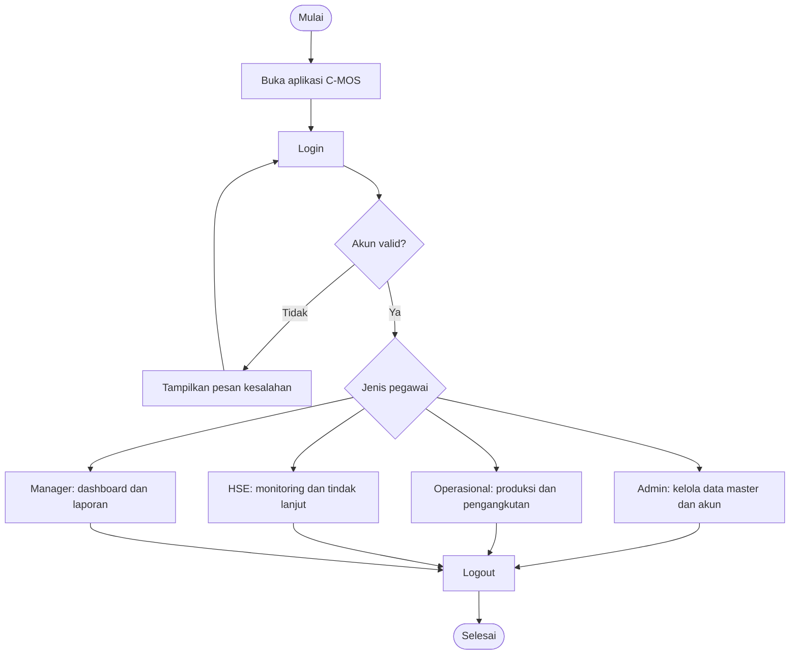
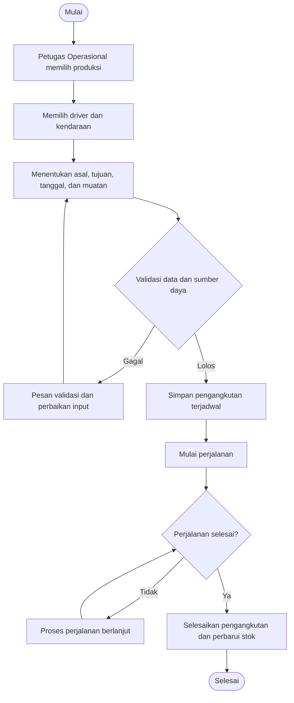
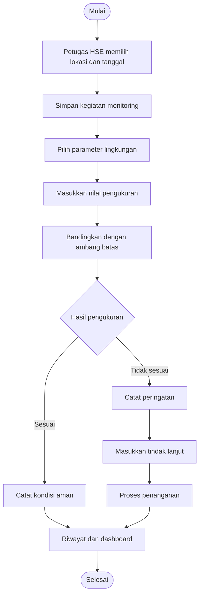
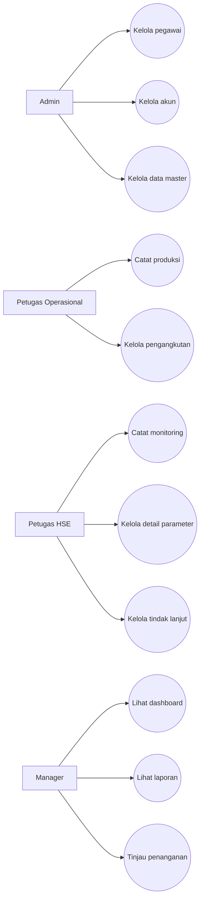

# C-MOS: Cobalt Mining Operation System

> Aplikasi desktop pengelolaan operasional pertambangan PT Cobalt.
>
> Proyek akademik Pemrograman Berorientasi Objek (PBO) dan Sistem Basis Data (SBD).

## Daftar Isi

1. [Nama Program](#1-nama-program)
2. [Deskripsi Singkat](#2-deskripsi-singkat)
3. [Fitur Utama Program](#3-fitur-utama-program)
4. [Tech Stack](#4-tech-stack)
5. [Perancangan Sistem](#5-perancangan-sistem)
6. [Struktur Folder dan Package](#6-struktur-folder-dan-package)
7. [Penerapan Empat Pilar OOP](#7-penerapan-empat-pilar-oop)
8. [Panduan Penggunaan dan Alur Hasil Program](#8-panduan-penggunaan-dan-alur-hasil-program)
9. [Kontributor](#9-kontributor)

---

## 1. Nama Program

**C-MOS (Cobalt Mining Operation System)** adalah aplikasi desktop berbasis Java untuk mengelola kegiatan operasional PT Cobalt. C-MOS menghubungkan data pegawai, akun, lokasi, material, kendaraan, produksi, pengangkutan, pemantauan lingkungan, dan laporan manajemen.

- **Nama aplikasi:** Cobalt Mining Operation System (C-MOS)
- **Studi kasus:** PT Cobalt, perusahaan pertambangan fiktif untuk keperluan akademik.
- **Jenis aplikasi:** Desktop, multi-pengguna berdasarkan jabatan.
- **Proyek NetBeans/Maven:** `CobaltMiningOperationSystem`
- **Entry point:** `app.Main`
- **Fokus:** Produksi tambang, pengangkutan material, pemantauan lingkungan, dan dukungan keputusan manajer.

> **Gambar 1. Identitas dan tampilan awal aplikasi C-MOS**


**Arahan screenshot:** Jalankan aplikasi, ambil tampilan awal atau login yang menampilkan identitas C-MOS. Jangan memakai gambar desain contoh sebagai pengganti hasil program.

## 2. Deskripsi Singkat

PT Cobalt menjalankan aktivitas penambangan, pengangkutan hasil tambang, pengelolaan kendaraan dan driver, serta pemantauan lingkungan. Seluruh aktivitas tersebut menghasilkan data yang saling berhubungan. Pengelolaan terpisah menyulitkan pencarian informasi, pemeriksaan stok material, penjadwalan kendaraan, pemilihan driver, dan evaluasi kondisi lingkungan.

C-MOS dirancang untuk mengintegrasikan proses tersebut dalam satu aplikasi desktop yang terhubung ke MySQL. Petugas Operasional mencatat hasil produksi, lalu menggunakan produksi yang tersedia sebagai sumber pengangkutan. Sebelum membuat pengangkutan, sistem memeriksa kesesuaian lokasi, kapasitas kendaraan, ketersediaan driver, masa berlaku SIM, jumlah material, serta potensi benturan jadwal. Petugas HSE mencatat hasil pengukuran parameter lingkungan dan tindak lanjut. Manager memantau hasil kegiatan melalui dashboard dan laporan.

Data lingkungan menjadi informasi untuk pengambilan keputusan. Status peringatan lingkungan **tidak otomatis menghentikan pengangkutan**. Tindakan operasional tetap mengikuti kewenangan dan proses yang ditentukan perusahaan.

### 2.1 Tujuan pengembangan

1. Memusatkan pencatatan data operasional pertambangan.
2. Menghubungkan produksi dengan pengangkutan berdasarkan sumber material.
3. Mencegah penugasan driver atau kendaraan yang tidak memenuhi ketentuan operasional.
4. Mengontrol jumlah muatan terhadap kapasitas kendaraan dan stok produksi.
5. Mencatat hasil monitoring lingkungan dan tindak lanjutnya.
6. Menyediakan dashboard dan laporan untuk mendukung keputusan Manager.
7. Menerapkan konsep PBO, basis data relasional, dan antarmuka Java Swing.

### 2.2 Ruang lingkup

Sistem mengelola data pegawai, akun, lokasi, jenis material, kendaraan, parameter lingkungan, produksi tambang, pengangkutan, monitoring lingkungan, detail monitoring, dan laporan. Pemeriksaan teknis kendaraan secara terpisah tidak termasuk modul utama. Driver merupakan data pegawai yang ditugaskan dalam pengangkutan, bukan pengguna yang melakukan login.

### 2.3 Pembagian peran

| Peran | Tanggung jawab utama | Login |
| --- | --- | --- |
| Admin | Mengelola pegawai, akun, dan data master | Ya |
| Petugas Operasional | Mengelola produksi dan pengangkutan | Ya |
| Petugas HSE | Mengelola monitoring, pengukuran, dan tindak lanjut lingkungan | Ya |
| Manager | Melihat dashboard, laporan, detail operasional, dan informasi penanganan | Ya |
| Driver | Mengemudikan kendaraan pada kegiatan pengangkutan | Tidak |

**Catatan akses:** Manager tidak bertugas menambah detail pengukuran parameter. Pengisian pengukuran merupakan tanggung jawab Petugas HSE. Hak akses yang benar harus diuji pada hasil program.

## 3. Fitur Utama Program

### 3.1 Autentikasi dan pembagian akses

- Login menggunakan akun pengguna.
- Mengidentifikasi pegawai yang terhubung dengan akun.
- Mengarahkan pengguna ke halaman utama sesuai jenis pegawai.
- Menyediakan empat halaman utama: `MainFrameAdmin`, `MainFrameOperasional`, `MainFrameHSE`, dan `MainFrameManager`.
- Memisahkan data `User` dari `Pegawai`. Driver tidak memiliki akun login.

### 3.2 Pengelolaan pegawai

- Menambah, melihat, mengubah, dan menghapus data sesuai aturan sistem.
- Memilih jenis pegawai: Admin, Petugas Operasional, Petugas HSE, Manager, atau Driver.
- Menampilkan isian khusus sesuai jenis pegawai.
- Mengelola status kepegawaian.
- Menyimpan data turunan sesuai jenis pegawai pada tabel yang bersangkutan.

Contoh isian khusus: `shift_kerja` pada Petugas Operasional, `no_sim` dan `masa_berlaku_sim` pada Driver, `no_sertifikasi_HSE` pada Petugas HSE, serta `divisi_tanggung_jawab` pada Manager.

### 3.3 Pengelolaan akun pengguna

- Membuat dan mengelola akun bagi pegawai yang berhak login.
- Mengaitkan akun dengan satu pegawai.
- Memeriksa identitas saat login.
- Mengelola perubahan data akun sesuai hak akses.

### 3.4 Pengelolaan lokasi

- Menyimpan nama, jenis, status operasional, dan keterangan lokasi.
- Membedakan lokasi penambangan (`PIT`) dan lokasi penumpukan (`STOCKPILE`).
- Menyediakan pilihan lokasi pada produksi, pengangkutan, dan monitoring.

### 3.5 Pengelolaan jenis material

- Menyimpan nama material, satuan, dan deskripsi.
- Menghubungkan jenis material dengan catatan produksi.
- Menyediakan pilihan material dalam form produksi.

### 3.6 Pengelolaan kendaraan

- Menyimpan jenis kendaraan, nomor polisi, kapasitas, tahun, dan status kendaraan.
- Memeriksa ketersediaan kendaraan sebelum pengangkutan.
- Memvalidasi muatan agar tidak melampaui kapasitas.

### 3.7 Pengelolaan parameter lingkungan

- Menyimpan nama parameter, satuan, batas minimum, batas maksimum, dan keterangan.
- Menggunakan parameter sebagai acuan pemeriksaan hasil pengukuran.
- Menghubungkan parameter dengan setiap detail monitoring.

Contoh parameter yang dapat disiapkan dalam data master: pH air, TSS, PM10, kebisingan, dan kadar kobalt dalam air. Nilai batas harus mengikuti ketentuan atau data studi kasus yang digunakan, bukan angka asumsi tanpa dasar.

### 3.8 Produksi tambang

- Mencatat tanggal, lokasi, jenis material, jumlah produksi, dan petugas pencatat.
- Menghitung jumlah material yang tersedia untuk pengangkutan.
- Menyediakan daftar produksi sebagai sumber pengangkutan.
- Menampilkan status produksi dan informasi stok.

### 3.9 Pengangkutan material

- Memilih produksi sebagai sumber material.
- Memilih kendaraan dan driver yang tersedia.
- Menentukan lokasi asal dan tujuan.
- Memvalidasi muatan terhadap kapasitas kendaraan dan stok produksi.
- Memeriksa status pegawai, status driver, masa berlaku SIM, dan jadwal yang berpotensi bentrok.
- Mendukung tahapan pengangkutan: `DIJADWALKAN`, `DALAM_PERJALANAN`, `SELESAI`, dan pembatalan sesuai aturan program.
- Memperbarui stok setelah pengangkutan diselesaikan sesuai logika service.

### 3.10 Monitoring lingkungan

- Mencatat kegiatan monitoring berdasarkan lokasi dan petugas HSE.
- Memasukkan nilai hasil pengukuran untuk setiap parameter.
- Membandingkan hasil pengukuran dengan ambang batas.
- Menampilkan kondisi monitoring, tindak lanjut, dan status penanganan.
- Menyimpan riwayat monitoring serta detail pengukuran.
- Menyediakan informasi kondisi lokasi untuk Manager.

### 3.11 Dashboard dan laporan

- Dashboard khusus untuk setiap jenis pengguna.
- Ringkasan data produksi, pengangkutan, kendaraan, dan lingkungan sesuai kewenangan.
- Grafik ringkasan melalui komponen chart yang tersedia.
- Halaman laporan produksi, pengangkutan, dan monitoring.
- Penyajian data detail agar Manager dapat menilai kondisi operasional.

### 3.12 Pencarian, filter, dan validasi

Aplikasi menyediakan komponen tabel, form, dan filter pada berbagai halaman. Filter harus memuat data dari sumber yang relevan. Data internal seperti ID basis data dapat disembunyikan dari tampilan dan diganti nomor urut baris, tanpa menghilangkan ID yang dibutuhkan program untuk operasi CRUD.

## 4. Tech Stack

| Komponen | Teknologi | Penggunaan |
| --- | --- | --- |
| Bahasa | Java | Logika aplikasi, model, controller, dan antarmuka |
| GUI | Java Swing | JFrame, JPanel, JTable, JComboBox, JButton, dan komponen form |
| GUI Designer | Apache NetBeans GUI Builder | Mendesain dan memelihara antarmuka `.form` |
| Database | MySQL | Menyimpan data relasional |
| Akses database | JDBC | Koneksi dan eksekusi SQL |
| Driver database | MySQL Connector/J 8.3.0 | Penghubung JDBC ke MySQL |
| Build tool | Apache Maven | Dependensi dan build aplikasi |
| Layout | Swing Layout 1.0.3, AbsoluteLayout | Layout yang digunakan pada proyek |
| Pemilih tanggal | JCalendar 1.4 | Komponen tanggal pada form |
| Grafik | JFreeChart 1.5.4 | Grafik dashboard |
| Arsitektur | Model, View, Controller, Service, Repository, DAO | Pemisahan tanggung jawab program |

**Versi Java pada berkas yang diperiksa:** `pom.xml` berisi `<maven.compiler.release>26</maven.compiler.release>`. Oleh karena itu, README ini mengikuti konfigurasi proyek tersebut. Jika target tugas mewajibkan Java 8, konfigurasi dan kompatibilitas kode perlu disesuaikan terlebih dahulu.

**Konfigurasi database pada source:** `config.DatabaseConfig` menggunakan nilai bawaan `jdbc:mysql://localhost:3308/cmos_db`, pengguna `root`, dan kata sandi kosong jika variabel lingkungan tidak diisi. Nama database ini mengikuti source yang diperiksa, bukan asumsi dari diagram.

Variabel lingkungan yang didukung:

```text
CMOS_DB_URL
CMOS_DB_USER
CMOS_DB_PASSWORD
```

### 4.1 Cara menyiapkan proyek

1. Siapkan JDK sesuai versi `pom.xml`.
2. Instal Apache NetBeans yang mendukung proyek Maven dan versi Java tersebut.
3. Siapkan MySQL dan buat/import skema database yang sesuai dengan source proyek.
4. Pastikan alamat, port, nama database, username, dan password benar.
5. Buka folder `CobaltMiningOperationSystem` melalui NetBeans.
6. Jalankan proses pemuatan dependensi Maven.
7. Jalankan kelas utama `app.Main`.
8. Login menggunakan akun yang tersedia dalam database.

> **Gambar 2. Konfigurasi proyek Maven di NetBeans**


**Arahan screenshot:** Buka tab Projects, tampilkan nama proyek, Source Packages, Dependencies, dan file `pom.xml`.

> **Gambar 3. Koneksi database MySQL**


**Arahan screenshot:** Tampilkan daftar tabel database yang benar-benar digunakan. Jangan tampilkan kata sandi atau informasi sensitif.

## 5. Perancangan Sistem

### 5.1 Gambaran alur sistem

Alur utama aplikasi dimulai ketika pengguna membuka program dan login. Sistem memeriksa akun serta jenis pegawai. Setelah berhasil, aplikasi membuka halaman utama sesuai kewenangan pengguna. Setiap kegiatan operasional menggunakan data master yang sudah disimpan sebelumnya.



> **Gambar 4. Flowchart utama sistem C-MOS**


**Arahan gambar:** Buat flowchart final di draw.io, Lucidchart, atau aplikasi diagram lain berdasarkan alur di atas. Simpan hasil ekspor sebagai `images/04_Flowchart_Utama.png`.

### 5.2 Flowchart produksi dan pengangkutan



> **Gambar 5. Flowchart proses produksi dan pengangkutan**


**Arahan gambar:** Gambarkan validasi stok, kapasitas, driver, SIM, kendaraan, lokasi, dan jadwal. Tunjukkan pula jalur pembatalan sesuai aturan service.

### 5.3 Flowchart monitoring lingkungan



> **Gambar 6. Flowchart monitoring lingkungan**


**Arahan gambar:** Tampilkan kegiatan monitoring, pengisian detail parameter, hasil evaluasi, tindak lanjut, dan informasi kepada Manager.

### 5.4 Use case diagram



> **Gambar 7. Use case diagram C-MOS**


**Arahan gambar:** Gunakan aktor Admin, Petugas Operasional, Petugas HSE, dan Manager. Driver tidak perlu menjadi aktor login karena ia tidak mengakses aplikasi. Jika Driver digambar sebagai aktor bisnis, bedakan dari aktor pengguna sistem.

### 5.5 ERD dan struktur basis data

Perancangan basis data menggunakan `Pegawai` sebagai supertype dan lima subtype: `Admin`, `PetugasOperasional`, `PetugasHSE`, `Manager`, dan `Driver`. Tabel `User` menyimpan akun login yang terkait dengan pegawai. Produksi menjadi sumber pengangkutan. Monitoring lingkungan memiliki beberapa detail pengukuran, dan setiap detail merujuk pada satu parameter lingkungan.

> **Gambar 8. Entity Relationship Diagram C-MOS**


**Arahan gambar:** Gunakan screenshot ERD fisik dari MySQL Workbench yang memperlihatkan tabel, PK, FK, serta kardinalitas. Perbesar gambar sampai nama tabel dan atribut terbaca. Pastikan diagram sesuai database aktual yang dijalankan.

> **Gambar 9. Enhanced Entity Relationship Diagram dan subtype Pegawai**


**Arahan gambar:** Gunakan diagram konseptual yang menunjukkan pengelompokan lima subtype di dalam Pegawai, relasi dengan User, serta hubungan ke modul operasional dan monitoring.

#### 5.5.1 Kelompok entitas

| Kelompok | Entitas/tabel | Fungsi |
| --- | --- | --- |
| Kepegawaian | `pegawai` | Identitas dasar pegawai |
| Kepegawaian | `admin` | Atribut khusus Admin |
| Kepegawaian | `petugas_operasional` | Atribut khusus petugas operasional |
| Kepegawaian | `petugas_hse` | Atribut khusus HSE |
| Kepegawaian | `manager` | Atribut khusus Manager |
| Kepegawaian | `driver` | Data SIM dan ketersediaan driver |
| Akses | `user` | Kredensial akun |
| Master | `lokasi` | Lokasi tambang dan stockpile |
| Master | `jenis_material` | Klasifikasi material |
| Master | `kendaraan` | Armada pengangkutan |
| Master | `parameter_lingkungan` | Acuan pengukuran lingkungan |
| Operasional | `produksi_tambang` | Produksi dan material tersedia |
| Operasional | `pengangkutan` | Perjalanan pengangkutan |
| Lingkungan | `monitoring_lingkungan` | Kegiatan monitoring |
| Lingkungan | `detail_monitoring` | Nilai pengukuran per parameter |

#### 5.5.2 Relasi utama

1. `Pegawai` dengan `User`: satu pegawai dapat mempunyai nol atau satu akun.
2. `Pegawai` dengan subtype: setiap subtype memakai identitas pegawai sebagai dasar.
3. `PetugasOperasional` dengan `ProduksiTambang`: satu petugas dapat mencatat banyak produksi.
4. `PetugasOperasional` dengan `Pengangkutan`: satu petugas dapat mengelola banyak pengangkutan.
5. `JenisMaterial` dengan `ProduksiTambang`: satu jenis material digunakan pada banyak produksi.
6. `Lokasi` dengan `ProduksiTambang`: satu lokasi memiliki banyak catatan produksi.
7. `ProduksiTambang` dengan `Pengangkutan`: satu produksi dapat menjadi sumber banyak pengangkutan.
8. `Driver` dengan `Pengangkutan`: satu driver dapat mengemudikan banyak pengangkutan pada waktu berbeda.
9. `Kendaraan` dengan `Pengangkutan`: satu kendaraan dapat digunakan pada banyak perjalanan berbeda.
10. `Lokasi` dengan `Pengangkutan`: lokasi digunakan sebagai asal dan tujuan.
11. `PetugasHSE` dengan `MonitoringLingkungan`: satu petugas HSE dapat melakukan banyak monitoring.
12. `Lokasi` dengan `MonitoringLingkungan`: satu lokasi dapat dipantau berulang kali.
13. `MonitoringLingkungan` dengan `DetailMonitoring`: satu monitoring memiliki banyak hasil parameter.
14. `ParameterLingkungan` dengan `DetailMonitoring`: satu parameter dapat digunakan dalam banyak monitoring.

#### 5.5.3 Contoh keterkaitan data

Misalnya produksi di PIT A menghasilkan 120 ton material. Petugas membuat rencana pengangkutan sebesar 20 ton menggunakan kendaraan berkapasitas 25 ton. Sistem memeriksa bahwa produksi memiliki stok yang mencukupi, kendaraan tersedia, driver tersedia, SIM berlaku, dan lokasi tujuan sesuai. Setelah perjalanan selesai, sistem memperbarui stok produksi sesuai jumlah yang diangkut. Data ini kemudian masuk ke laporan pengangkutan dan ringkasan dashboard.

Pada waktu berbeda, HSE mengukur parameter lingkungan di PIT A. Jika salah satu nilai berada di luar ambang batas, hasil monitoring dapat menunjukkan peringatan. Manager melihat kondisi tersebut sebagai informasi untuk menentukan tindak lanjut, bukan sebagai pemblokiran otomatis oleh aplikasi.

### 5.6 Konsistensi model dengan database

Diagram yang digunakan pada README harus disamakan dengan skema MySQL yang benar-benar diimpor. Gambar konseptual dan fisik dapat memiliki perbedaan cara menampilkan subtype atau nama foreign key. Jangan mengubah penjelasan berdasarkan gambar saja tanpa memeriksa tabel database dan DAO. Pada source yang diperiksa, `jenis_kendaraan` merupakan atribut dalam `kendaraan`, bukan tabel master terpisah.

## 6. Struktur Folder dan Package

Struktur berikut mengikuti source Java pada arsip `CMOS_Revisi_Awal_GUIBuilder.zip` yang tersedia untuk pemeriksaan.

```text
CobaltMiningOperationSystem/
├── pom.xml
├── lib/
├── src/
│   └── main/
│       └── java/
│           ├── app/
│           │   └── Main.java
│           ├── config/
│           │   ├── AppConfig.java
│           │   └── DatabaseConfig.java
│           ├── controller/
│           │   ├── AuthController.java
│           │   ├── DashboardController.java
│           │   ├── LaporanController.java
│           │   ├── MasterDataController.java
│           │   ├── MonitoringController.java
│           │   ├── PengangkutanController.java
│           │   └── ProduksiController.java
│           ├── dao/
│           │   ├── JdbcSupport.java
│           │   ├── KendaraanDAO.java
│           │   ├── LokasiDAO.java
│           │   ├── MaterialDAO.java
│           │   ├── MonitoringDAO.java
│           │   ├── ParameterDAO.java
│           │   ├── PegawaiDAO.java
│           │   ├── PengangkutanDAO.java
│           │   ├── ProduksiDAO.java
│           │   └── UserDAO.java
│           ├── enums/
│           │   ├── JenisLokasi.java
│           │   ├── Periode.java
│           │   ├── ShiftKerja.java
│           │   ├── StatusDetail.java
│           │   ├── StatusDriver.java
│           │   ├── StatusKendaraan.java
│           │   ├── StatusLokasi.java
│           │   ├── StatusMonitoring.java
│           │   ├── StatusPegawai.java
│           │   ├── StatusPenanganan.java
│           │   ├── StatusPengangkutan.java
│           │   └── StatusProduksi.java
│           ├── exception/
│           │   ├── BusinessException.java
│           │   ├── DataNotFoundException.java
│           │   └── ValidationException.java
│           ├── model/
│           │   ├── Pegawai.java
│           │   ├── Admin.java
│           │   ├── PetugasOperasional.java
│           │   ├── PetugasHSE.java
│           │   ├── Manager.java
│           │   ├── Driver.java
│           │   ├── User.java
│           │   ├── Lokasi.java
│           │   ├── JenisMaterial.java
│           │   ├── Kendaraan.java
│           │   ├── ProduksiTambang.java
│           │   ├── Pengangkutan.java
│           │   ├── ParameterLingkungan.java
│           │   ├── MonitoringLingkungan.java
│           │   └── DetailMonitoring.java
│           ├── repository/
│           │   ├── CrudRepository.java
│           │   ├── PegawaiRepository.java
│           │   ├── UserRepository.java
│           │   ├── LokasiRepository.java
│           │   ├── MaterialRepository.java
│           │   ├── KendaraanRepository.java
│           │   ├── ProduksiRepository.java
│           │   ├── PengangkutanRepository.java
│           │   ├── ParameterRepository.java
│           │   └── MonitoringRepository.java
│           ├── service/
│           │   ├── AuthService.java
│           │   ├── MasterDataService.java
│           │   ├── ProduksiService.java
│           │   ├── PengangkutanService.java
│           │   ├── MonitoringService.java
│           │   ├── DashboardService.java
│           │   └── LaporanService.java
│           ├── util/
│           │   ├── BootstrapAdmin.java
│           │   └── PasswordUtil.java
│           └── view/
│               ├── LoginFrame.java
│               ├── MainFrameRouter.java
│               ├── MainFrameAdmin.java
│               ├── MainFrameOperasional.java
│               ├── MainFrameHSE.java
│               ├── MainFrameManager.java
│               ├── DashboardAdminPanel.java
│               ├── DashboardOperasionalPanel.java
│               ├── DashboardHSEPanel.java
│               ├── DashboardManagerPanel.java
│               ├── DashboardCharts.java
│               ├── PegawaiPanel.java
│               ├── PegawaiFormFrame.java
│               ├── UserPanel.java
│               ├── UserFormFrame.java
│               ├── LokasiPanel.java
│               ├── LokasiFormFrame.java
│               ├── MaterialPanel.java
│               ├── MaterialFormFrame.java
│               ├── KendaraanPanel.java
│               ├── KendaraanFormFrame.java
│               ├── ParameterPanel.java
│               ├── ParameterFormFrame.java
│               ├── ProduksiPanel.java
│               ├── ProduksiFormFrame.java
│               ├── PengangkutanPanel.java
│               ├── PengangkutanFormFrame.java
│               ├── MonitoringPanel.java
│               ├── MonitoringFormFrame.java
│               ├── DetailMonitoringFormFrame.java
│               ├── MonitoringDetailFrame.java
│               ├── KondisiLokasiPanel.java
│               ├── KartuLokasiPanel.java
│               ├── LaporanProduksiPanel.java
│               ├── LaporanPengangkutanPanel.java
│               ├── LaporanMonitoringPanel.java
│               ├── UbahAkunFrame.java
│               ├── DataScreen.java
│               ├── FormUtil.java
│               ├── PilihanData.java
│               └── ViewFactory.java
└── ...
```

> **Gambar 10. Struktur Source Packages di NetBeans**


**Arahan screenshot:** Perluas seluruh package pada panel Projects. Jika terlalu panjang, ambil beberapa screenshot dan gabungkan menjadi satu gambar yang tetap terbaca.

### 6.1 Package `app`

`Main.java` merupakan titik masuk aplikasi. Method `main()` memanggil `SwingUtilities.invokeLater()` agar antarmuka Swing dibuat pada Event Dispatch Thread. Setelah menginisialisasi konfigurasi aplikasi, program membuka `LoginFrame`.

### 6.2 Package `config`

- `AppConfig.java` menyiapkan komponen dan dependensi aplikasi.
- `DatabaseConfig.java` mengatur koneksi JDBC ke MySQL serta menyediakan pemeriksaan koneksi.

### 6.3 Package `controller`

Controller menghubungkan aksi pengguna dari tampilan dengan proses di service. `AuthController` menangani autentikasi, `MasterDataController` menangani data master, `ProduksiController` menangani produksi, `PengangkutanController` menangani pengangkutan, `MonitoringController` menangani monitoring, dan controller dashboard/laporan menyiapkan informasi untuk tampilan.

### 6.4 Package `dao`

DAO berisi implementasi akses database melalui JDBC. Setiap DAO berfokus pada kelompok data tertentu. Contohnya `ProduksiDAO` menangani penyimpanan dan pembacaan produksi, sedangkan `PengangkutanDAO` menangani data pengangkutan. `JdbcSupport` menyediakan fungsi pendukung operasi JDBC.

### 6.5 Package `enums`

Enum membatasi nilai status atau kategori ke pilihan yang telah ditentukan. Contohnya `StatusPengangkutan`, `StatusDriver`, `StatusKendaraan`, `StatusMonitoring`, dan `ShiftKerja`. Penggunaan enum mengurangi kesalahan penulisan status pada logika Java.

### 6.6 Package `exception`

- `ValidationException`: kesalahan nilai masukan.
- `DataNotFoundException`: data yang diminta tidak ditemukan.
- `BusinessException`: pelanggaran aturan proses bisnis.

### 6.7 Package `model`

Model merepresentasikan objek utama sistem. `Pegawai` merupakan superclass abstrak bagi lima jenis pegawai. Model lain merepresentasikan lokasi, material, kendaraan, produksi, pengangkutan, monitoring, parameter, dan detail monitoring.

### 6.8 Package `repository`

Repository mendefinisikan operasi data yang diperlukan oleh service. `CrudRepository` menyediakan kontrak operasi umum. Repository khusus memisahkan kebutuhan data per domain, sedangkan DAO menjalankan query JDBC yang sesuai.

### 6.9 Package `service`

Service menyimpan aturan bisnis. Contohnya `PengangkutanService` memeriksa kapasitas, ketersediaan, tanggal, SIM, stok, dan jadwal sebelum membuat pengangkutan. `MonitoringService` menangani kegiatan monitoring, detail pengukuran, dan tindak lanjut. `DashboardService` serta `LaporanService` menyajikan data ringkasan dan laporan.

### 6.10 Package `util`

`BootstrapAdmin` menyediakan proses pendukung inisialisasi admin, sedangkan `PasswordUtil` menyediakan fungsi pendukung pengelolaan kata sandi.

### 6.11 Package `view`

Package `view` menyimpan JFrame dan JPanel antarmuka. Berkas `.form` yang menyertai sejumlah kelas view merupakan metadata desain NetBeans GUI Builder. Desain komponen dan layout harus dikelola melalui tab **Design**, bukan dengan membuat panel visual baru secara manual melalui kode.

`MainFrameRouter` mengarahkan pengguna ke halaman utama berdasarkan jenis pegawai. Setiap `MainFrame...` menyediakan navigasi untuk peran terkait. `...Panel` menyajikan halaman daftar, dashboard, atau laporan. `...FormFrame` menyediakan formulir tambah dan ubah data.

> **Gambar 11. File `.java` dan `.form` pada GUI Builder**


**Arahan screenshot:** Pilih `PegawaiFormFrame` atau form lain di NetBeans. Tampilkan tab Design, Palette, Inspector, dan Properties.

## 7. Penerapan Empat Pilar OOP

### 7.1 Encapsulation

Encapsulation melindungi atribut objek dengan akses `private` dan menyediakan akses terkontrol melalui method. Contohnya pada `model.Pegawai`:

```java
private int idPegawai;
private String namaPegawai;
private String noHp;
private java.time.LocalDate tanggalMasuk;
private enums.StatusPegawai statusPegawai;

public String getNamaPegawai() {
    return namaPegawai;
}

public void setNamaPegawai(String value) {
    this.namaPegawai = value;
}
```

Atribut `namaPegawai` tidak diakses langsung oleh kelas lain. Kelas lain menggunakan getter atau setter. Dengan demikian, struktur data objek tetap terkendali. Validasi bisnis yang lebih kompleks ditempatkan pada service sebelum perubahan data disimpan.

> **Gambar 12. Bukti encapsulation pada `Pegawai.java`**


**Arahan screenshot:** Sorot deklarasi atribut `private` serta method getter dan setter dalam `model/Pegawai.java`.

### 7.2 Inheritance

Inheritance memungkinkan subclass mewarisi atribut dan method dari superclass. Dalam proyek ini, `Pegawai` merupakan superclass bagi `Admin`, `PetugasOperasional`, `PetugasHSE`, `Manager`, dan `Driver`.

```java
public abstract class Pegawai {
    // Atribut dasar pegawai dan method bersama.
}

public class Admin extends Pegawai {
    // Atribut khusus Admin.
}

public class Driver extends Pegawai {
    // Atribut khusus Driver.
}
```

Kode tersebut menunjukkan hubungan pewarisan yang terdapat pada source. Setiap subtype memiliki atribut bersama dari `Pegawai` serta atribut khusus sesuai tugasnya. Contohnya Driver mempunyai informasi SIM, sedangkan Petugas Operasional memiliki informasi shift kerja.

> **Gambar 13. Bukti inheritance pada subclass Pegawai**


**Arahan screenshot:** Buka `Pegawai.java`, `Admin.java`, dan `Driver.java`. Sorot deklarasi `extends Pegawai`. Sertakan diagram hierarki kelas jika memungkinkan.

### 7.3 Polymorphism

Polymorphism memungkinkan objek dari beberapa subclass diperlakukan sebagai tipe superclass yang sama, tetapi memberikan perilaku sesuai jenis objek. Dalam proyek, `Pegawai` mendefinisikan method abstrak `getJenisPegawai()` dan setiap subclass mengimplementasikannya.

```java
public abstract String getJenisPegawai();
```

Contoh pemakaian konsep:

```java
Pegawai pegawai = new Driver(/* parameter konstruktor sesuai model */);
String jenis = pegawai.getJenisPegawai();
```

Baris pemanggilan `getJenisPegawai()` menggunakan tipe referensi `Pegawai`, tetapi implementasi yang dijalankan berasal dari subclass objek aktual. Potongan kedua merupakan **ilustrasi konsep**, bukan salinan kode yang siap dikompilasi karena argumen konstruktor disingkat.

> **Gambar 14. Bukti polymorphism pada `getJenisPegawai()`**


**Arahan screenshot:** Tampilkan deklarasi method di `Pegawai.java` dan implementasi override pada minimal dua subclass, misalnya `Driver.java` dan `PetugasHSE.java`.

### 7.3.1 Bukti method overloading (wajib)

Selain overriding `getJenisPegawai()`, source versi ini juga menggunakan **method overloading**. Nama method sama, tetapi daftar parameter berbeda. Contoh ditemukan pada `service/ProduksiService.java` (`tambahProduksi`), `service/PengangkutanService.java` (`buatPengangkutan`), dan `service/MonitoringService.java` (`buatMonitoring`, `tambahDetail`). Overloading memudahkan pemanggilan operasi melalui variasi parameter sesuai kebutuhan. Periksa deklarasi lengkap di source untuk membandingkan signature tiap overload.

> **Gambar 16A. Bukti overloading pada Service**


**Arahan screenshot:** Buka `ProduksiService.java`, sorot dua deklarasi `tambahProduksi(...)` beserta parameter yang berbeda. Tambahkan screenshot serupa dari `MonitoringService.java` jika diperlukan.

### 7.4 Abstraction

Abstraction menyajikan kontrak penting tanpa mewajibkan pemanggil mengetahui seluruh detail implementasi. `Pegawai` ditetapkan sebagai `abstract class`, sehingga objek `Pegawai` umum tidak dapat dibuat secara langsung. Subclass harus menyediakan implementasi `getJenisPegawai()`.

```java
public abstract class Pegawai {
    public abstract String getJenisPegawai();
}
```

Selain itu, `repository.CrudRepository` dan repository khusus menggunakan interface sebagai kontrak akses data. Service dapat bekerja terhadap operasi repository tanpa perlu mengetahui setiap detail SQL di DAO.

> **Gambar 15. Bukti abstraction pada abstract class**


**Arahan screenshot:** Sorot kata `abstract` pada deklarasi `Pegawai` dan method `getJenisPegawai()`.

> **Gambar 16. Bukti abstraction pada interface repository**


**Arahan screenshot:** Buka `repository/CrudRepository.java` dan salah satu repository khusus. Tampilkan kontrak method yang tersedia.

### 7.5 Keterkaitan OOP dengan arsitektur

Penerapan empat pilar OOP tidak berdiri sendiri. Model memanfaatkan encapsulation, inheritance, polymorphism, dan abstraction. Service menggunakan objek model serta kontrak repository untuk menjalankan aturan bisnis. Controller meneruskan permintaan dari view ke service. DAO berkomunikasi dengan database melalui JDBC. Pemisahan ini memudahkan pengujian dan perubahan logika tanpa mencampurkan seluruh proses ke dalam satu JFrame.

> **Gambar 17. Diagram alur arsitektur aplikasi**


**Arahan gambar:** Buat diagram `View → Controller → Service → Repository → DAO → MySQL`, dengan `Model` sebagai objek data yang digunakan antarlapisan. Sesuaikan arah panggilan dengan implementasi aktual.


## 8. Panduan Penggunaan dan Alur Hasil Program

Bagian ini mengikuti **source proyek `CobaltMiningOperationSystem(4).zip`**, khususnya `app.Main`, seluruh `MainFrame*`, panel dan form pada package `view`, serta method pada `controller` dan `service`. Alur dibagi berdasarkan empat akun login. **Driver bukan pengguna login**. Gambar adalah slot dokumentasi yang harus diisi screenshot aplikasi nyata, bukan gambar hasil rekaan.

**Cara membaca panduan:** setiap langkah memuat tindakan pengguna, hasil yang diharapkan, lokasi class, dan arahan screenshot. Screenshot diambil sesudah tindakan berhasil, kecuali langkah yang khusus mendokumentasikan validasi. Data contoh dalam penjelasan tidak menggantikan data database Anda.

### 8.1 Persiapan dan Menjalankan Aplikasi

#### Struktur proyek di NetBeans

Buka proyek Maven melalui NetBeans. Pastikan `pom.xml` terbaca dan package `app`, `config`, `controller`, `dao`, `enums`, `exception`, `model`, `repository`, `service`, `util`, dan `view` tersedia. File `.form` pada package view harus tetap berpasangan dengan `.java` untuk pengeditan visual GUI Builder.

> **Gambar 18. Struktur proyek di NetBeans**


**Arahan screenshot:** Buka tab Projects di NetBeans, perluas Source Packages. **Yang harus terlihat:** Nama proyek dan seluruh package utama.

#### Konfigurasi database MySQL

Siapkan MySQL dan impor `DATABASE_ASLI_DBCobaltCMOS.sql` sesuai panduan proyek. Periksa `config/DatabaseConfig.java` dan `config/AppConfig.java`. File `MIGRASI_DML_TANPA_PERUBAHAN_STRUKTUR.sql` disertakan proyek sebagai skrip penyesuaian data. Gunakan hanya sesuai petunjuk migrasi dan setelah mencadangkan database.

> **Gambar 19. Konfigurasi database MySQL**


**Arahan screenshot:** Ambil screenshot daftar tabel dari aplikasi pengelola MySQL. **Yang harus terlihat:** Nama database, tabel utama, dan status koneksi tanpa memperlihatkan password.

#### Menjalankan Main Java

Jalankan entry point `app.Main`. Aplikasi melakukan inisialisasi sebelum menampilkan layar awal. Jika koneksi database gagal, aplikasi dapat menampilkan dialog kesalahan dan proses tidak dilanjutkan.

> **Gambar 20. Menjalankan Main Java**


**Arahan screenshot:** Klik Run Project atau jalankan `app.Main`. **Yang harus terlihat:** Jendela aplikasi saat pertama kali dibuka.

#### Loading aplikasi

`view.LoadingFrame` menjalankan animasi/progress serta inisialisasi database. Tunggu hingga proses selesai. Layar ini bukan halaman login dan tidak mengubah data operasional.

> **Gambar 21. Loading aplikasi**


**Arahan screenshot:** Ambil gambar ketika loading masih berjalan. **Yang harus terlihat:** Logo/animasi loading dan indikator progress.

#### Landing page C-MOS

Setelah loading berhasil, `view.LandingFrame` menampilkan pengenalan C-MOS. Halaman ini menyediakan navigasi informasi dan tombol untuk masuk ke login.

> **Gambar 22. Landing page C-MOS**


**Arahan screenshot:** Tampilkan halaman landing pada ukuran jendela normal. **Yang harus terlihat:** Identitas C-MOS, tombol login, dan konten pengenalan.

#### Navigasi landing dan tombol login

Periksa bagian Tentang, Operasi, dan Tim melalui navigasi landing jika tampil. Tekan tombol masuk pada header atau area utama. Kedua aksi mengarah ke form login.

> **Gambar 23. Navigasi landing dan tombol login**


**Arahan screenshot:** Ambil screenshot sebelum menekan login, lalu setelah form login terbuka. **Yang harus terlihat:** Tombol navigasi landing dan perpindahan ke login.

#### Form login dan validasi

`view.LoginFrame` menerima username dan password. Pengguna dapat memperlihatkan/menyembunyikan password. Sistem memvalidasi kredensial melalui `AuthController`/`AuthService`; kredensial salah tidak boleh membuka halaman utama.

> **Gambar 24. Form login dan validasi**


**Arahan screenshot:** Ambil screenshot form login tanpa menampilkan password asli. **Yang harus terlihat:** Kolom username, password, tombol masuk, dan opsi tampilkan password.

#### Percabangan hak akses setelah login

Setelah autentikasi berhasil, `view.MainFrameRouter` membuka salah satu dari `MainFrameAdmin`, `MainFrameOperasional`, `MainFrameHSE`, atau `MainFrameManager` sesuai subtype Pegawai. Driver tidak mempunyai jalur login.

> **Gambar 25. Percabangan hak akses setelah login**


**Arahan screenshot:** Buat bagan sederhana percabangan login dan empat peran, atau screenshot empat halaman utama secara terpisah. **Yang harus terlihat:** Login → pemeriksaan akun → Admin/Operasional/HSE/Manager.

**Alur ringkas:** `Main` → `LoadingFrame` → `LandingFrame` → `LoginFrame` → `AuthController` → `AuthService` → `MainFrameRouter` → halaman utama sesuai peran. Untuk setiap peran, logout mengakhiri sesi dan mengembalikan pengguna ke alur autentikasi aplikasi.

### 8.2 Alur A. Administrator

**Tujuan:** menjaga konsistensi data master dan akun. **Menu nyata pada `MainFrameAdmin`:** Dashboard, Data Pegawai, Akun Pengguna, Lokasi Tambang, Jenis Material, Kendaraan, Parameter Lingkungan, Ubah Akun, Keluar Akun. Admin tidak menjalankan produksi, perjalanan, atau pengukuran HSE.

#### Login sebagai Admin

Masuk dengan akun milik subtype Admin. Sistem membuka `view.MainFrameAdmin`. Perhatikan identitas pengguna dan menu yang berbeda dari peran lain.

> **Gambar 26. Login sebagai Admin**


**Arahan screenshot:** Login memakai akun Admin uji. **Yang harus terlihat:** Nama pengguna, peran Admin, sidebar dan judul halaman.

#### Dashboard Administrator

`DashboardAdminPanel` memuat ringkasan pegawai, akun dan perhatian administrasi serta data master. Angka diambil dari service/database. Tombol Kelola Akun atau Periksa Akun mengarahkan Admin ke pengelolaan akun.

> **Gambar 27. Dashboard Administrator**


**Arahan screenshot:** Buka Dashboard. **Yang harus terlihat:** Kartu KPI, panel perhatian, distribusi pegawai, dan ringkasan data master.

#### Daftar Data Pegawai

Buka Data Pegawai. `PegawaiPanel` menampilkan data seluruh subtype Pegawai, fitur pencarian/filter, serta aksi tambah, ubah dan hapus. Nomor urut pada tabel adalah nomor tampilan, bukan ID database.

> **Gambar 28. Daftar Data Pegawai**


**Arahan screenshot:** Buka Data Pegawai dan tampilkan beberapa baris. **Yang harus terlihat:** Judul, kolom nomor, filter, pencarian dan tombol CRUD.

#### Form tambah Pegawai dan pilihan subtype

Tekan Tambah Data. Pada `PegawaiFormFrame`, pilih jenis pegawai: Admin, Petugas Operasional, Petugas HSE, Manager, atau Driver. Pilihan ini mengatur atribut khusus. Jangan menampilkan field SIM ketika jenis pegawai belum dipilih.

> **Gambar 29. Form tambah Pegawai dan pilihan subtype**


**Arahan screenshot:** Buka form tanpa memilih subtype lalu pilih salah satu subtype. **Yang harus terlihat:** Form awal dan combo jenis pegawai.

#### Form Pegawai jenis Admin

Pilih subtype **Admin** pada combo jenis pegawai. Isian khusus kode admin dan tanggal mulai akses. Simpan hanya setelah atribut umum dan khusus valid.

> **Gambar 30. Form Pegawai jenis Admin**


**Arahan screenshot:** Pilih Admin di form Pegawai. **Yang harus terlihat:** Field khusus yang muncul sesuai subtype, tanpa field subtype lain.

#### Form Pegawai jenis Petugas Operasional

Pilih subtype **Petugas Operasional** pada combo jenis pegawai. Isian khusus shift kerja. Simpan hanya setelah atribut umum dan khusus valid.

> **Gambar 31. Form Pegawai jenis Petugas Operasional**


**Arahan screenshot:** Pilih Petugas Operasional di form Pegawai. **Yang harus terlihat:** Field khusus yang muncul sesuai subtype, tanpa field subtype lain.

#### Form Pegawai jenis Petugas HSE

Pilih subtype **Petugas HSE** pada combo jenis pegawai. Isian nomor sertifikasi dan masa berlaku sertifikasi. Simpan hanya setelah atribut umum dan khusus valid.

> **Gambar 32. Form Pegawai jenis Petugas HSE**


**Arahan screenshot:** Pilih Petugas HSE di form Pegawai. **Yang harus terlihat:** Field khusus yang muncul sesuai subtype, tanpa field subtype lain.

#### Form Pegawai jenis Manager

Pilih subtype **Manager** pada combo jenis pegawai. Isian divisi tanggung jawab. Simpan hanya setelah atribut umum dan khusus valid.

> **Gambar 33. Form Pegawai jenis Manager**


**Arahan screenshot:** Pilih Manager di form Pegawai. **Yang harus terlihat:** Field khusus yang muncul sesuai subtype, tanpa field subtype lain.

#### Form Pegawai jenis Driver

Pilih subtype **Driver** pada combo jenis pegawai. Isian nomor SIM, masa berlaku SIM, dan status driver. Driver tidak dibuatkan akun login. Simpan hanya setelah atribut umum dan khusus valid.

> **Gambar 34. Form Pegawai jenis Driver**


**Arahan screenshot:** Pilih Driver di form Pegawai. **Yang harus terlihat:** Field khusus yang muncul sesuai subtype, tanpa field subtype lain.

#### Simpan, ubah, batal, dan validasi Pegawai

Simpan data pegawai yang valid lalu periksa baris baru. Pilih data dan tekan Ubah untuk memperbarui atribut yang diizinkan. Coba Batal untuk menutup form tanpa menyimpan. Uji validasi field wajib dan format tanggal/SIM.

> **Gambar 35. Simpan, ubah, batal, dan validasi Pegawai**


**Arahan screenshot:** Dokumentasikan empat kondisi secara terpisah jika memungkinkan. **Yang harus terlihat:** Data tersimpan, form edit, tombol Batal, dan contoh pesan validasi.

#### Daftar Akun Pengguna

Buka Akun Pengguna. `UserPanel` menampilkan akun terhubung dengan Pegawai. Pegawai subtype Driver tidak seharusnya memperoleh akun login.

> **Gambar 36. Daftar Akun Pengguna**


**Arahan screenshot:** Buka menu Akun Pengguna. **Yang harus terlihat:** Tabel akun, filter/status, dan tombol pengelolaan.

#### Tambah akun dan menghubungkan Pegawai

Buka `UserFormFrame`. Pilih pegawai yang berhak login, isi username serta kredensial sesuai form, lalu simpan. Periksa hasil pada tabel. Data password harus diproses melalui `PasswordUtil`, bukan disimpan sebagai teks biasa.

> **Gambar 37. Tambah akun dan menghubungkan Pegawai**


**Arahan screenshot:** Ambil screenshot combo pegawai dan form sebelum menyimpan, tutup informasi rahasia. **Yang harus terlihat:** Pilihan pegawai, username, status akun, dan tombol Simpan/Batal.

#### Ubah akun dan pemeriksaan akses

Pilih akun lalu lakukan pembaruan yang diizinkan. Periksa status aktif/nonaktif dan hubungan dengan pegawai. Jika dashboard menunjukkan akun perlu diperiksa, buka halaman ini untuk meninjau data terkait.

> **Gambar 38. Ubah akun dan pemeriksaan akses**


**Arahan screenshot:** Pilih baris akun uji dan buka Ubah. **Yang harus terlihat:** Data akun terpilih dan opsi pengelolaan.

#### Daftar Lokasi Tambang

Buka menu Lokasi Tambang. Halaman tabel menampilkan daftar data master dan fasilitas pencarian/filter. Data ini menjadi pilihan pada form operasional atau HSE sesuai fungsinya.

> **Gambar 39. Daftar Lokasi Tambang**


**Arahan screenshot:** Buka menu Lokasi Tambang. **Yang harus terlihat:** Judul, tabel, nomor urut, tombol tambah/ubah/hapus, dan filter.

#### Tambah dan ubah Lokasi Tambang

Buka `view/LokasiFormFrame.java` melalui tombol Tambah atau Ubah. Isi nama lokasi, jenis lokasi PIT/STOCKPILE, status operasional dan keterangan. Simpan data valid, lalu periksa perubahan pada tabel. Uji tombol Batal agar tidak terjadi penyimpanan.

> **Gambar 40. Tambah dan ubah Lokasi Tambang**


**Arahan screenshot:** Buka form tambah dan edit Lokasi Tambang. **Yang harus terlihat:** Field lengkap, pilihan combo, tombol Simpan/Batal, dan hasil pada tabel.

#### Daftar Jenis Material

Buka menu Jenis Material. Halaman tabel menampilkan daftar data master dan fasilitas pencarian/filter. Data ini menjadi pilihan pada form operasional atau HSE sesuai fungsinya.

> **Gambar 41. Daftar Jenis Material**


**Arahan screenshot:** Buka menu Jenis Material. **Yang harus terlihat:** Judul, tabel, nomor urut, tombol tambah/ubah/hapus, dan filter.

#### Tambah dan ubah Jenis Material

Buka `view/MaterialFormFrame.java` melalui tombol Tambah atau Ubah. Isi nama material, satuan, deskripsi. Simpan data valid, lalu periksa perubahan pada tabel. Uji tombol Batal agar tidak terjadi penyimpanan.

> **Gambar 42. Tambah dan ubah Jenis Material**


**Arahan screenshot:** Buka form tambah dan edit Jenis Material. **Yang harus terlihat:** Field lengkap, pilihan combo, tombol Simpan/Batal, dan hasil pada tabel.

#### Daftar Kendaraan

Buka menu Kendaraan. Halaman tabel menampilkan daftar data master dan fasilitas pencarian/filter. Data ini menjadi pilihan pada form operasional atau HSE sesuai fungsinya.

> **Gambar 43. Daftar Kendaraan**


**Arahan screenshot:** Buka menu Kendaraan. **Yang harus terlihat:** Judul, tabel, nomor urut, tombol tambah/ubah/hapus, dan filter.

#### Tambah dan ubah Kendaraan

Buka `view/KendaraanFormFrame.java` melalui tombol Tambah atau Ubah. Isi jenis kendaraan, nomor polisi, kapasitas, tahun kendaraan, status kendaraan. Simpan data valid, lalu periksa perubahan pada tabel. Uji tombol Batal agar tidak terjadi penyimpanan.

> **Gambar 44. Tambah dan ubah Kendaraan**


**Arahan screenshot:** Buka form tambah dan edit Kendaraan. **Yang harus terlihat:** Field lengkap, pilihan combo, tombol Simpan/Batal, dan hasil pada tabel.

#### Daftar Parameter Lingkungan

Buka menu Parameter Lingkungan. Halaman tabel menampilkan daftar data master dan fasilitas pencarian/filter. Data ini menjadi pilihan pada form operasional atau HSE sesuai fungsinya.

> **Gambar 45. Daftar Parameter Lingkungan**


**Arahan screenshot:** Buka menu Parameter Lingkungan. **Yang harus terlihat:** Judul, tabel, nomor urut, tombol tambah/ubah/hapus, dan filter.

#### Tambah dan ubah Parameter Lingkungan

Buka `view/ParameterFormFrame.java` melalui tombol Tambah atau Ubah. Isi nama parameter, satuan, batas minimum/maksimum, keterangan. Simpan data valid, lalu periksa perubahan pada tabel. Uji tombol Batal agar tidak terjadi penyimpanan.

> **Gambar 46. Tambah dan ubah Parameter Lingkungan**


**Arahan screenshot:** Buka form tambah dan edit Parameter Lingkungan. **Yang harus terlihat:** Field lengkap, pilihan combo, tombol Simpan/Batal, dan hasil pada tabel.

#### Ubah Akun Admin

Gunakan menu Ubah Akun yang membuka `UbahAkunFrame`. Ikuti validasi yang tersedia untuk mengubah kredensial akun yang sedang login.

> **Gambar 47. Ubah Akun Admin**


**Arahan screenshot:** Buka menu Ubah Akun. **Yang harus terlihat:** Form pengubahan akun tanpa menampilkan password.

#### Logout Admin

Tekan Keluar Akun. Pastikan sesi Admin berakhir sebelum login menggunakan peran lain.

> **Gambar 48. Logout Admin**


**Arahan screenshot:** Ambil gambar saat logout atau saat kembali ke login. **Yang harus terlihat:** Tombol Keluar Akun dan halaman autentikasi.

### 8.3 Alur B. Petugas Operasional

**Tujuan:** mencatat produksi, memantau stok, dan mengelola siklus pengangkutan. **Menu nyata pada `MainFrameOperasional`:** Dashboard, Produksi Tambang, Pengangkutan, Ubah Akun, Keluar Akun. Informasi kendaraan dan driver tersedia di halaman Pengangkutan, bukan sebagai fokus dashboard produksi.

#### Login Petugas Operasional

Login dengan akun Petugas Operasional. `MainFrameRouter` membuka `MainFrameOperasional`.

> **Gambar 49. Login Petugas Operasional**


**Arahan screenshot:** Masuk sebagai Petugas Operasional. **Yang harus terlihat:** Sidebar Operasional dan identitas pengguna.

#### Dashboard produksi dan filter periode

`DashboardOperasionalPanel` berfokus pada Total Produksi, Stok Saat Ini, Produksi Tercatat, dan Lokasi Berproduksi. Pilih Hari Ini, 7 Hari Terakhir, Bulan Ini, Tahun Ini, Semua Periode atau Rentang Kustom, lalu tekan Terapkan. Stok Saat Ini merupakan saldo terkini dan tidak mengikuti filter produksi.

> **Gambar 50. Dashboard produksi dan filter periode**


**Arahan screenshot:** Buka Dashboard dan ubah filter periode. **Yang harus terlihat:** Combo periode, input tanggal khusus, empat KPI dan tombol Terapkan.

#### Grafik produksi per lokasi dan tren

Dashboard menampilkan visualisasi produksi per lokasi dan tren produksi, serta tabel Produksi Terbaru. Nama lokasi, nilai tonase dan periode harus dapat dibaca.

> **Gambar 51. Grafik produksi per lokasi dan tren**


**Arahan screenshot:** Ambil bagian tengah dan bawah Dashboard. **Yang harus terlihat:** Grafik produksi, grafik tren, dan daftar produksi terbaru.

#### Halaman Produksi Tambang

Buka Produksi Tambang. `ProduksiPanel` menampilkan ringkasan catatan, total produksi, stok tersedia dan lokasi berproduksi, disertai tabel, pencarian/filter, dan tombol Tambah, Ubah, Hapus.

> **Gambar 52. Halaman Produksi Tambang**


**Arahan screenshot:** Buka menu Produksi Tambang. **Yang harus terlihat:** KPI halaman produksi, filter dan tabel.

#### Tambah catatan produksi

Klik Tambah Data untuk membuka `ProduksiFormFrame`. Pilih lokasi PIT dan jenis material yang tersedia, isi tanggal, jumlah produksi dan catatan sesuai form. Pilihan lokasi/material harus terbaca oleh Petugas Operasional tanpa pesan “Hanya Admin”.

> **Gambar 53. Tambah catatan produksi**


**Arahan screenshot:** Buka form Tambah Produksi. **Yang harus terlihat:** Combo lokasi, combo material, tanggal, tonase, tombol Simpan/Batal.

#### Validasi produksi dan simpan

Uji jumlah produksi tidak valid, data kosong, atau pilihan lokasi yang tidak sesuai. Setelah valid, simpan dan periksa total produksi serta stok pada tabel/dashboard.

> **Gambar 54. Validasi produksi dan simpan**


**Arahan screenshot:** Ambil pesan validasi dan kemudian hasil simpan. **Yang harus terlihat:** Validasi dan baris produksi baru.

#### Ubah, hapus, cari, dan filter produksi

Pilih catatan lalu tekan Ubah atau Hapus sesuai aturan bisnis. Perhatikan keterkaitan produksi yang telah dipakai pengangkutan. Gunakan pencarian/filter untuk menemukan catatan tertentu.

> **Gambar 55. Ubah, hapus, cari, dan filter produksi**


**Arahan screenshot:** Buka form ubah, konfirmasi hapus, dan hasil filter. **Yang harus terlihat:** Tombol operasi dan perubahan tabel.

#### Halaman Pengangkutan dan KPI kesiapan

Buka Pengangkutan. `PengangkutanPanel` menampilkan total pengangkutan, Dijadwalkan, Dalam Perjalanan, Selesai, Kendaraan Tersedia, dan Driver Tersedia. Di sini juga tersedia pencarian, filter status, tabel, dan panel Detail Pengangkutan.

> **Gambar 56. Halaman Pengangkutan dan KPI kesiapan**


**Arahan screenshot:** Buka menu Pengangkutan. **Yang harus terlihat:** Enam KPI, filter status, daftar perjalanan dan detail.

#### Membuat jadwal pengangkutan

Tekan Tambah untuk membuka `PengangkutanFormFrame`. Pilih produksi tersedia, kendaraan tersedia, driver tersedia, lokasi tujuan, tanggal dan jumlah muatan. Lokasi asal ditentukan otomatis dari sumber produksi.

> **Gambar 57. Membuat jadwal pengangkutan**


**Arahan screenshot:** Buka form Pengangkutan. **Yang harus terlihat:** Combo produksi/kendaraan/driver, asal otomatis, tujuan, tanggal, muatan.

#### Memeriksa kapasitas dan stok sebelum penjadwalan

Pastikan jumlah muatan tidak melebihi kapasitas kendaraan maupun material produksi yang masih dapat dialokasikan. Pengangkutan harus memiliki sumber produksi, kendaraan, driver dan tujuan yang valid. Uji muatan berlebih sebagai bukti validasi.

> **Gambar 58. Memeriksa kapasitas dan stok sebelum penjadwalan**


**Arahan screenshot:** Isi muatan melebihi kapasitas pada data uji. **Yang harus terlihat:** Pesan validasi yang muncul tanpa menyimpan data salah.

#### Jadwal tersimpan dan status Dijadwalkan

Simpan pengangkutan valid. Periksa status DIJADWALKAN di tabel, data detail, dan ringkasan. Pada tahap ini perjalanan belum dimulai.

> **Gambar 59. Jadwal tersimpan dan status Dijadwalkan**


**Arahan screenshot:** Simpan jadwal uji. **Yang harus terlihat:** Baris status DIJADWALKAN dan panel detail.

#### Memulai perjalanan

Pilih jadwal lalu tekan Mulai Perjalanan. Sistem menjalankan `PengangkutanService.mulaiPengangkutan`, mengubah status menjadi DALAM_PERJALANAN serta menandai kendaraan dan driver sedang bertugas sesuai aturan sistem.

> **Gambar 60. Memulai perjalanan**


**Arahan screenshot:** Pilih jadwal dan tekan Mulai Perjalanan. **Yang harus terlihat:** Status DALAM_PERJALANAN dan perubahan informasi kesiapan.

#### Menyelesaikan pengangkutan

Pilih perjalanan aktif lalu tekan Selesaikan. `PengangkutanService.selesaikanPengangkutan` menyelesaikan perjalanan dan memperbarui stok produksi. Periksa waktu selesai, status SELESAI, dan sisa stok produksi pada panel detail.

> **Gambar 61. Menyelesaikan pengangkutan**


**Arahan screenshot:** Selesaikan satu perjalanan uji. **Yang harus terlihat:** Status SELESAI, waktu selesai, dan stok setelah pengangkutan.

#### Membatalkan pengangkutan

Untuk pengangkutan yang dapat dibatalkan, pilih data dan tekan Batalkan. Konfirmasi tindakan. Pengangkutan yang dibatalkan tidak mengurangi stok produksi. Periksa status DIBATALKAN.

> **Gambar 62. Membatalkan pengangkutan**


**Arahan screenshot:** Batalkan jadwal uji yang diizinkan. **Yang harus terlihat:** Dialog konfirmasi dan status DIBATALKAN.

#### Filter dan detail Pengangkutan

Gunakan filter Semua Status, DIJADWALKAN, DALAM_PERJALANAN, SELESAI atau DIBATALKAN. Klik baris untuk melihat sumber produksi, material, asal, tujuan, muatan, kendaraan, plat, driver, petugas, waktu dan sisa stok.

> **Gambar 63. Filter dan detail Pengangkutan**


**Arahan screenshot:** Pilih beberapa status dan klik satu baris. **Yang harus terlihat:** Hasil filter dan panel Detail Pengangkutan lengkap.

#### Ubah Akun dan Logout Operasional

Gunakan Ubah Akun jika perlu memperbarui kredensial. Tekan Keluar Akun untuk mengakhiri sesi.

> **Gambar 64. Ubah Akun dan Logout Operasional**


**Arahan screenshot:** Buka Ubah Akun lalu logout. **Yang harus terlihat:** Form akun dan halaman setelah logout.

### 8.4 Alur C. Petugas HSE

**Tujuan:** mengajukan dan melaksanakan monitoring lingkungan, mengukur parameter, mencatat hasil serta penanganan. **Menu nyata pada `MainFrameHSE`:** Dashboard, Kondisi Lokasi, Riwayat Monitoring, Ubah Akun, Keluar Akun. **Catatan penting:** source terbaru memuat persetujuan Manager sebelum monitoring tertentu dapat dimulai. Status hasil mencakup NORMAL, PERINGATAN, dan BERBAHAYA.

#### Login Petugas HSE

Login menggunakan akun Petugas HSE untuk membuka `MainFrameHSE`.

> **Gambar 65. Login Petugas HSE**


**Arahan screenshot:** Masuk dengan akun HSE. **Yang harus terlihat:** Sidebar HSE, identitas dan menu.

#### Dashboard HSE dan filter periode

`DashboardHSEPanel` menampilkan Total Monitoring, Hasil Normal, Monitoring Peringatan dan Penanganan Belum Selesai. Filter periode mengubah data pemeriksaan, sedangkan penanganan terbuka tetap dipantau lintas periode.

> **Gambar 66. Dashboard HSE dan filter periode**


**Arahan screenshot:** Buka Dashboard HSE dan ubah periode. **Yang harus terlihat:** KPI, filter periode, tabel prioritas dan grafik.

#### Prioritas penanganan dan detail baca saja

Tabel prioritas menunjukkan monitoring yang membutuhkan perhatian. Tombol Lihat Detail Pengukuran membuka `MonitoringReadOnlyFrame` agar petugas dapat meninjau hasil tanpa mengubah data melalui tampilan ringkasan.

> **Gambar 67. Prioritas penanganan dan detail baca saja**


**Arahan screenshot:** Pilih satu baris prioritas. **Yang harus terlihat:** Lokasi/parameter bermasalah dan detail baca saja.

#### Kondisi Lokasi Tambang

Buka `KondisiLokasiPanel`. Halaman menampilkan kartu lokasi PIT/stockpile, ringkasan status terbaru, filter hasil (NORMAL, PERINGATAN, BERBAHAYA, Belum Ada Monitoring), dan panel detail lokasi.

> **Gambar 68. Kondisi Lokasi Tambang**


**Arahan screenshot:** Buka Kondisi Lokasi. **Yang harus terlihat:** Kartu lokasi, filter, KPI dan panel detail.

#### Memilih lokasi dan memeriksa pengukuran terakhir

Klik satu kartu lokasi. Panel detail menampilkan nama lokasi, jenis, status operasional, monitoring terakhir, hasil, status penanganan, tindak lanjut, serta tabel parameter pengukuran terakhir.

> **Gambar 69. Memilih lokasi dan memeriksa pengukuran terakhir**


**Arahan screenshot:** Pilih lokasi yang sudah pernah dimonitoring. **Yang harus terlihat:** Kartu aktif dan detail parameter lokasi.

#### Mengajukan monitoring ke Manager

Tekan Ajukan Monitoring Lokasi Ini pada lokasi yang belum memiliki persetujuan aktif. Sistem meminta alasan monitoring, kemudian mencatat permintaan dengan status MENUNGGU. Alasan harus memenuhi validasi service.

> **Gambar 70. Mengajukan monitoring ke Manager**


**Arahan screenshot:** Pilih lokasi, tekan ajukan dan isi alasan. **Yang harus terlihat:** Dialog alasan, notifikasi berhasil, dan status menunggu persetujuan.

#### Monitoring menunggu persetujuan

Selama status MENUNGGU, tombol menunjukkan Menunggu Persetujuan Manager dan monitoring tidak langsung dimulai. Proses dilanjutkan setelah Manager menyetujui permintaan.

> **Gambar 71. Monitoring menunggu persetujuan**


**Arahan screenshot:** Buka kembali lokasi yang telah diajukan. **Yang harus terlihat:** Label/tombol status MENUNGGU.

#### Memulai monitoring setelah disetujui

Setelah Manager menyetujui, tombol berubah menjadi Mulai Monitoring (Disetujui). Tekan tombol untuk membuka `MonitoringFormFrame`, pilih tanggal melalui komponen kalender, periksa lokasi dan isi catatan.

> **Gambar 72. Memulai monitoring setelah disetujui**


**Arahan screenshot:** Login kembali sebagai HSE setelah persetujuan, buka lokasi. **Yang harus terlihat:** Tombol mulai, form tanggal/lokasi/catatan.

#### Menyimpan kegiatan monitoring

Simpan form monitoring. Sistem membuat kegiatan yang dapat dilanjutkan dengan pengisian hasil pengukuran. Batal menutup form tanpa menyimpan.

> **Gambar 73. Menyimpan kegiatan monitoring**


**Arahan screenshot:** Tekan Simpan pada data uji valid. **Yang harus terlihat:** Pesan “Monitoring dimulai” dan data kegiatan.

#### Membuka Detail Monitoring

Tekan Lihat / Kelola Pengukuran pada lokasi terpilih untuk membuka `MonitoringDetailFrame` dalam mode pengelolaan HSE. Halaman ini memuat tabel hasil pengukuran serta tombol Tambah, Ubah, Hapus Pengukuran dan Selesai Penanganan sesuai status kegiatan.

> **Gambar 74. Membuka Detail Monitoring**


**Arahan screenshot:** Pilih lokasi dengan monitoring aktif dan buka detail. **Yang harus terlihat:** Judul, tabel parameter, tombol tindakan.

#### Menambah hasil pengukuran parameter

Tekan Tambah Pengukuran untuk membuka `DetailMonitoringFormFrame`. Pilih parameter dari data master, isi nilai pengukuran dan catatan. Sistem membandingkan nilai dengan batas minimum/maksimum yang dikonfigurasi.

> **Gambar 75. Menambah hasil pengukuran parameter**


**Arahan screenshot:** Buka form Tambah Pengukuran. **Yang harus terlihat:** Combo parameter, nilai, satuan/batas jika tampil, dan catatan.

#### Hasil Normal, Peringatan dan Berbahaya

Simpan hasil pengukuran valid lalu periksa status yang dihitung sistem. Bedakan NORMAL, PERINGATAN, dan BERBAHAYA sesuai logika pada source. Jangan menganggap penanganan selesai otomatis mengubah hasil pengukuran lama menjadi normal.

> **Gambar 76. Hasil Normal, Peringatan dan Berbahaya**


**Arahan screenshot:** Gunakan data uji parameter dalam batas dan di luar batas. **Yang harus terlihat:** Tabel hasil dengan status dan warna sesuai kondisi.

#### Mengubah atau menghapus detail pengukuran

Selama kegiatan mengizinkan perubahan, pilih detail lalu gunakan Ubah Pengukuran atau Hapus Pengukuran. Periksa validasi dan perhitungan ulang status.

> **Gambar 77. Mengubah atau menghapus detail pengukuran**


**Arahan screenshot:** Pilih detail uji dan tampilkan form ubah/konfirmasi hapus. **Yang harus terlihat:** Tombol pengelolaan dan hasil perubahan tabel.

#### Menginformasikan peringatan kepada Manager

Pada Kondisi Lokasi, tombol Info Peringatan Manager digunakan untuk memastikan hasil pengukuran bermasalah masuk daftar informasi Manager. Gunakan pada lokasi yang memenuhi kondisi peringatan.

> **Gambar 78. Menginformasikan peringatan kepada Manager**


**Arahan screenshot:** Pilih lokasi berstatus peringatan/berbahaya lalu tekan tombol informasi. **Yang harus terlihat:** Tombol Info Peringatan Manager dan notifikasi.

#### Menangani monitoring bermasalah

Ikuti alur penanganan melalui MonitoringDetailFrame dan service: status belum ditangani, dalam penanganan, hingga selesai. Catat tindak lanjut dan perbarui detail sesuai hak akses HSE.

> **Gambar 79. Menangani monitoring bermasalah**


**Arahan screenshot:** Buka detail monitoring bermasalah. **Yang harus terlihat:** Status penanganan dan data tindak lanjut.

#### Menyelesaikan penanganan

Tekan Selesai Penanganan ketika syarat pengukuran dan status kegiatan terpenuhi. Periksa perubahan status dan dashboard. Penyelesaian tindak lanjut bukan bukti bahwa pengukuran historis telah menjadi normal.

> **Gambar 80. Menyelesaikan penanganan**


**Arahan screenshot:** Selesaikan satu kasus uji. **Yang harus terlihat:** Tombol selesai, status penanganan baru dan perubahan KPI.

#### Riwayat Monitoring

Buka `MonitoringPanel` melalui Riwayat Monitoring. Halaman ini memuat seluruh catatan monitoring, filter/pencarian, KPI riwayat, tombol Lihat Pengukuran dan Hapus. Pembuatan monitoring baru berpusat di Kondisi Lokasi, bukan halaman riwayat.

> **Gambar 81. Riwayat Monitoring**


**Arahan screenshot:** Buka Riwayat Monitoring. **Yang harus terlihat:** KPI, tabel, pencarian, filter, tombol Lihat Pengukuran/Hapus.

#### Memeriksa dan menghapus riwayat

Pilih catatan, tekan Lihat Pengukuran untuk memeriksa rincian. Hapus hanya jika memenuhi aturan sistem dan sudah dikonfirmasi. Uji juga filter status dan pencarian.

> **Gambar 82. Memeriksa dan menghapus riwayat**


**Arahan screenshot:** Buka satu detail riwayat dan konfirmasi hapus data uji. **Yang harus terlihat:** Detail dan dialog konfirmasi.

#### Ubah Akun dan Logout HSE

Buka Ubah Akun bila perlu, lalu Keluar Akun untuk mengakhiri sesi HSE.

> **Gambar 83. Ubah Akun dan Logout HSE**


**Arahan screenshot:** Ambil gambar menu Ubah Akun dan logout. **Yang harus terlihat:** Perubahan halaman setelah keluar.

### 8.5 Alur D. Manager

**Tujuan:** melihat hasil produksi, stok, laporan monitoring, prioritas lingkungan, dan memberi persetujuan permintaan monitoring. **Menu nyata pada `MainFrameManager`:** Dashboard, Laporan Produksi, Laporan Monitoring, Ubah Akun, Keluar Akun. `LaporanPengangkutanPanel` ada pada source, tetapi **tidak tercantum sebagai menu tersendiri pada `MainFrameManager` versi ZIP ini**; jangan mendokumentasikannya seolah-olah menu tersebut pasti tampil. Manager dapat menyetujui permintaan monitoring, tetapi tidak menambah/mengubah detail pengukuran HSE.

#### Login Manager

Masuk dengan akun subtype Manager. Sistem membuka `MainFrameManager` dengan menu khusus Manager.

> **Gambar 84. Login Manager**


**Arahan screenshot:** Login sebagai Manager. **Yang harus terlihat:** Sidebar Manager dan identitas akun.

#### Dashboard Manager dan filter periode

`DashboardManagerPanel` memuat Produksi Periode, Stok Saat Ini, Peringatan Belum Selesai, dan Lokasi Peringatan. Pilih periode dan tekan Terapkan. Stok Saat Ini serta penanganan terbuka diberi cakupan waktu yang berbeda dari produksi periode.

> **Gambar 85. Dashboard Manager dan filter periode**


**Arahan screenshot:** Buka dashboard dan pilih filter periode. **Yang harus terlihat:** Filter, empat KPI dan label cakupan waktu.

#### Grafik dan evaluasi kondisi operasional

Periksa grafik produksi dan lingkungan yang tersedia serta ringkasan prioritas. Gunakan data tersebut untuk membandingkan hasil produksi dan kondisi lingkungan tanpa mengubah data operasional.

> **Gambar 86. Grafik dan evaluasi kondisi operasional**


**Arahan screenshot:** Ambil bagian grafik dashboard Manager. **Yang harus terlihat:** Judul grafik, sumbu, nilai dan periode.

#### Prioritas lingkungan untuk keputusan

Tabel Prioritas Lingkungan menampilkan monitoring bermasalah. Pilih baris untuk membuka detail pengukuran dalam mode baca saja (`MonitoringDetailFrame` dengan `readOnly=true`).

> **Gambar 87. Prioritas lingkungan untuk keputusan**


**Arahan screenshot:** Pilih baris pada Prioritas Lingkungan. **Yang harus terlihat:** Daftar prioritas dan detail tanpa tombol edit aktif.

#### Permintaan monitoring menunggu persetujuan

Dashboard Manager memiliki tabel Permintaan Monitoring Menunggu Persetujuan. Permintaan berasal dari HSE melalui Kondisi Lokasi. Periksa lokasi dan alasan sebelum menyetujui.

> **Gambar 88. Permintaan monitoring menunggu persetujuan**


**Arahan screenshot:** Tampilkan tabel permintaan dari akun Manager. **Yang harus terlihat:** Permintaan, alasan/keterangan dan tombol Setujui Permintaan Terpilih.

#### Menyetujui permintaan monitoring HSE

Pilih satu permintaan, tekan Setujui Permintaan Terpilih, lalu konfirmasi. `MonitoringController.setujuiMonitoring` mengubah status permintaan sehingga HSE dapat memulai monitoring. Persetujuan ini bukan pengisian nilai parameter oleh Manager.

> **Gambar 89. Menyetujui permintaan monitoring HSE**


**Arahan screenshot:** Pilih permintaan uji lalu tekan Setujui. **Yang harus terlihat:** Dialog konfirmasi dan pesan permintaan disetujui.

#### Laporan Produksi

Buka `LaporanProduksiPanel` melalui Laporan Produksi. Tentukan rentang tanggal lalu tekan Tampilkan. Baca rekap dan tabel produksi. Manager menggunakan informasi ini untuk evaluasi, bukan mengubah catatan produksi.

> **Gambar 90. Laporan Produksi**


**Arahan screenshot:** Buka Laporan Produksi, pilih tanggal awal/akhir. **Yang harus terlihat:** Filter tanggal, tombol Tampilkan, ringkasan dan tabel.

#### Laporan Monitoring Lingkungan

Buka `LaporanMonitoringPanel` melalui Laporan Monitoring. Pilih rentang tanggal lalu tekan Tampilkan. Halaman menampilkan Total Monitoring, Hasil Normal, Peringatan dan tabel riwayat monitoring.

> **Gambar 91. Laporan Monitoring Lingkungan**


**Arahan screenshot:** Buka Laporan Monitoring. **Yang harus terlihat:** Filter tanggal, KPI dan tabel laporan.

#### Detail Pengukuran dari Laporan Monitoring

Pilih monitoring dan tekan Detail Pengukuran. Manager hanya melihat hasil pengukuran dan status penanganan. Tidak ada kewenangan untuk menambah, mengubah, atau menghapus detail parameter.

> **Gambar 92. Detail Pengukuran dari Laporan Monitoring**


**Arahan screenshot:** Pilih baris laporan dan buka detail. **Yang harus terlihat:** Rincian nilai parameter dalam mode baca saja.

#### Tinjauan informasi pengangkutan

Source menyediakan `LaporanPengangkutanPanel`, tetapi menu Manager pada versi ini tidak menautkannya langsung. Jika halaman tersebut diakses melalui alur lain yang memang ada saat dijalankan, dokumentasikan sesuai hasil aktual; jangan menambah menu fiktif dalam screenshot.

> **Gambar 93. Tinjauan informasi pengangkutan**


**Arahan screenshot:** Periksa menu Manager pada aplikasi versi ZIP ini. **Yang harus terlihat:** Menu yang benar-benar tampil, tanpa menu Pengangkutan tambahan.

#### Ubah Akun dan Logout Manager

Gunakan Ubah Akun bila perlu, lalu Keluar Akun. Sesi Manager berakhir dan pengguna kembali ke alur autentikasi.

> **Gambar 94. Ubah Akun dan Logout Manager**


**Arahan screenshot:** Buka menu akun lalu logout. **Yang harus terlihat:** Form Ubah Akun dan halaman setelah logout.

### 8.6 Skenario Pengujian Lintas Peran

#### Admin menyiapkan master data

Admin memastikan lokasi PIT, material, kendaraan, driver, parameter, dan akun pegawai operasional/HSE/Manager telah tersedia. Data tersebut menjadi sumber pilihan pada form peran lain.

> **Gambar 95. Admin menyiapkan master data**


**Arahan screenshot:** Buka halaman data master Admin. **Yang harus terlihat:** Data referensi yang nanti dipakai dalam produksi dan monitoring.

#### Operasional membuat produksi dan pengangkutan

Operasional mencatat produksi pada lokasi PIT dan material yang dibuat Admin, kemudian membuat jadwal pengangkutan memakai kendaraan dan driver tersedia.

> **Gambar 96. Operasional membuat produksi dan pengangkutan**


**Arahan screenshot:** Tampilkan data produksi lalu form pengangkutan. **Yang harus terlihat:** Relasi produksi, kendaraan, driver dan lokasi.

#### Perubahan stok setelah perjalanan selesai

Selesaikan perjalanan dan bandingkan sisa stok sebelum serta sesudah. Pastikan pengangkutan batal tidak mengurangi stok.

> **Gambar 97. Perubahan stok setelah perjalanan selesai**


**Arahan screenshot:** Ambil dua screenshot data stok sebelum dan sesudah. **Yang harus terlihat:** Nilai stok dan status pengangkutan.

#### HSE mengajukan monitoring dan Manager menyetujui

HSE memilih lokasi, mengajukan alasan monitoring, lalu Manager membuka permintaan dan menyetujuinya. Setelah itu HSE dapat memulai monitoring.

> **Gambar 98. HSE mengajukan monitoring dan Manager menyetujui**


**Arahan screenshot:** Ambil layar HSE sebelum dan setelah persetujuan serta layar Manager. **Yang harus terlihat:** Status MENUNGGU → DISETUJUI → monitoring dimulai.

#### HSE mengisi parameter dan Manager meninjau

HSE memasukkan nilai parameter. Monitoring berstatus peringatan/berbahaya terlihat pada prioritas dan laporan Manager. Manager membuka detail baca saja tanpa mengubah pengukuran.

> **Gambar 99. HSE mengisi parameter dan Manager meninjau**


**Arahan screenshot:** Tampilkan hasil pengukuran HSE dan detail Manager. **Yang harus terlihat:** Status dan nilai parameter yang konsisten lintas peran.

#### Filter dan pembatasan akses

Uji filter periode, status, pencarian, tombol Batal, serta percobaan akses fitur yang bukan hak pengguna.

> **Gambar 100. Filter dan pembatasan akses**


**Arahan screenshot:** Ambil screenshot filter sebelum/sesudah dan validasi. **Yang harus terlihat:** Hasil yang berubah sesuai filter dan tidak ada aksi terlarang.

### 8.7 Panduan Screenshot dan Penamaan File

1. Buat folder `images/` di direktori yang sama dengan `README.md`.
2. Ambil screenshot **dari aplikasi yang benar-benar dijalankan**, bukan dari GUI Builder Design saja. Untuk bukti implementasi GUI Builder, screenshot `.form` dapat ditambahkan terpisah pada bagian struktur project.
3. Simpan gambar sesuai nama berurutan yang tertera pada setiap caption. Jangan mengganti kapitalisasi, garis bawah, atau nomor tanpa memperbarui referensi Markdown.
4. Gunakan data uji dan sensor username/password atau informasi rahasia.
5. Jika satu langkah memerlukan bukti sebelum dan sesudah, tambahkan gambar baru dengan nomor berikutnya dan jelaskan perubahannya.
6. Pastikan setiap gambar benar-benar mendukung narasi di atasnya. Jika fitur belum berfungsi, tulis sebagai temuan pengujian, bukan keberhasilan.

**Jumlah slot screenshot pada panduan penggunaan ini: 83 gambar, dari Gambar 18 sampai Gambar 100.**


## 9. Kontributor

Proyek C-MOS dikembangkan sebagai tugas kelompok. Isi nama dan NIM seluruh anggota sesuai identitas tim yang benar.

| No. | Nama | NIM | Peran |
| --- | --- | --- | --- |
| 1 | Zefri Al Rizqullah | 2509116084 | Anggota tim |
| 2 | **[Nama anggota 2]** | **[NIM anggota 2]** | Anggota tim |
| 3 | **[Nama anggota 3]** | **[NIM anggota 3]** | Anggota tim |
| 4 | **[Nama anggota 4, jika ada]** | **[NIM anggota 4]** | Anggota tim |


---


## Lampiran A. Pemetaan Source Code dan Bukti GUI

### Package `app`

`Main.java`

### Package `config`

`AppConfig.java`, `DatabaseConfig.java`

### Package `controller`

`AuthController.java`, `DashboardController.java`, `LaporanController.java`, `MasterDataController.java`, `MonitoringController.java`, `PengangkutanController.java`, `ProduksiController.java`

### Package `dao`

`JdbcSupport.java`, `KendaraanDAO.java`, `LokasiDAO.java`, `MaterialDAO.java`, `MonitoringDAO.java`, `ParameterDAO.java`, `PegawaiDAO.java`, `PengangkutanDAO.java`, `ProduksiDAO.java`, `UserDAO.java`

### Package `enums`

`JenisLokasi.java`, `Periode.java`, `ShiftKerja.java`, `StatusDetail.java`, `StatusDriver.java`, `StatusKendaraan.java`, `StatusLokasi.java`, `StatusMonitoring.java`, `StatusPegawai.java`, `StatusPenanganan.java`, `StatusPengangkutan.java`, `StatusProduksi.java`

### Package `exception`

`BusinessException.java`, `DataNotFoundException.java`, `ValidationException.java`

### Package `model`

`Admin.java`, `DetailMonitoring.java`, `Driver.java`, `JenisMaterial.java`, `Kendaraan.java`, `Lokasi.java`, `Manager.java`, `MonitoringLingkungan.java`, `ParameterLingkungan.java`, `Pegawai.java`, `Pengangkutan.java`, `PetugasHSE.java`, `PetugasOperasional.java`, `ProduksiTambang.java`, `User.java`

### Package `repository`

`CrudRepository.java`, `KendaraanRepository.java`, `LokasiRepository.java`, `MaterialRepository.java`, `MonitoringRepository.java`, `ParameterRepository.java`, `PegawaiRepository.java`, `PengangkutanRepository.java`, `ProduksiRepository.java`, `UserRepository.java`

### Package `service`

`AuthService.java`, `DashboardService.java`, `LaporanService.java`, `MasterDataService.java`, `MonitoringService.java`, `PengangkutanService.java`, `ProduksiService.java`

### Package `util`

`BootstrapAdmin.java`, `PasswordUtil.java`

### Package `view`

`DashboardAdminPanel.java`, `DashboardCharts.java`, `DashboardHSEPanel.java`, `DashboardManagerPanel.java`, `DashboardOperasionalPanel.java`, `DataScreen.java`, `DetailMonitoringFormFrame.java`, `FormUtil.java`, `KartuLokasiPanel.java`, `KendaraanFormFrame.java`, `KendaraanPanel.java`, `KondisiLokasiPanel.java`, `LandingFrame.java`, `LaporanMonitoringPanel.java`, `LaporanPengangkutanPanel.java`, `LaporanProduksiPanel.java`, `LoadingFrame.java`, `LoginFrame.java`, `LokasiFormFrame.java`, `LokasiPanel.java`, `MainFrameAdmin.java`, `MainFrameHSE.java`, `MainFrameManager.java`, `MainFrameOperasional.java`, `MainFrameRouter.java`, `MaterialFormFrame.java`, `MaterialPanel.java`, `MonitoringDetailFrame.java`, `MonitoringFormFrame.java`, `MonitoringPanel.java`, `MonitoringReadOnlyFrame.java`, `ParameterFormFrame.java`, `ParameterPanel.java`, `PegawaiFormFrame.java`, `PegawaiPanel.java`, `PengangkutanFormFrame.java`, `PengangkutanPanel.java`, `PilihanData.java`, `ProduksiFormFrame.java`, `ProduksiPanel.java`, `UbahAkunFrame.java`, `UserFormFrame.java`, `UserPanel.java`, `ViewFactory.java`

## Lampiran B. Catatan Keselarasan dengan Versi Proyek

- Dokumen ini mengacu pada `CobaltMiningOperationSystem(4).zip`, bukan versi ZIP lain.
- Fitur persetujuan permintaan monitoring Manager, kategori BERBAHAYA, dan panel Kondisi Lokasi tercantum dalam source versi ini.
- Menu Manager yang benar-benar tersedia adalah Dashboard, Laporan Produksi, Laporan Monitoring, Ubah Akun, dan Keluar Akun.
- Tampilan nyata, angka KPI, hasil validasi dan pesan dialog harus diverifikasi saat program berjalan dengan database yang sesuai.
- Screenshot belum dimasukkan karena berkas ZIP menyediakan source dan resource, bukan tangkapan layar semua skenario penggunaan.
- Nama/NIM anggota kelompok lain harus dilengkapi berdasarkan data tim yang benar.
