# C-MOS: Cobalt Mining Operation System

> Aplikasi desktop pengelolaan operasional pertambangan PT Cobalt.
> Proyek CAPSTONE 2026

---

## 1. Nama Program

**C-MOS (Cobalt Mining Operation System)** adalah aplikasi desktop berbasis Java untuk mengelola kegiatan operasional PT Cobalt. C-MOS menghubungkan data pegawai, akun, lokasi, material, kendaraan, produksi, pengangkutan, pemantauan lingkungan, dan laporan manajemen.

- **Nama aplikasi:** Cobalt Mining Operation System (C-MOS)
- **Studi kasus:** Perusahaan pertambangan yang mengelola kegiatan penambangan, pengangkutan hasil tambang, dan pemantauan lingkungan.
- **Jenis aplikasi:** Desktop, multi-pengguna berdasarkan jabatan.
- **Fokus:** Produksi tambang, pengangkutan material, pemantauan lingkungan, dan dukungan keputusan manajer.

> **Gambar 1. Identitas dan tampilan awal aplikasi C-MOS**

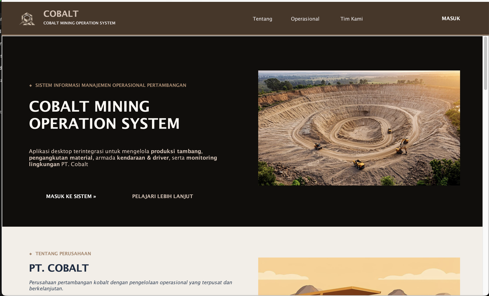

---

## 2. Deskripsi Singkat

PT Cobalt merupakan perusahaan yang menjalankan aktivitas penambangan, pengangkutan hasil tambang, pengelolaan kendaraan dan driver, serta pemantauan lingkungan. Seluruh aktivitas tersebut menghasilkan data yang saling berhubungan. Pengelolaan terpisah menyulitkan pencarian informasi, pemeriksaan stok material, penjadwalan kendaraan, pemilihan driver, dan evaluasi kondisi lingkungan.

C-MOS dirancang untuk mengintegrasikan proses tersebut dalam satu aplikasi desktop yang terhubung ke Database. Petugas Operasional mencatat hasil produksi, lalu menggunakan produksi yang tersedia sebagai sumber pengangkutan. Sebelum membuat pengangkutan, sistem memeriksa kesesuaian lokasi, kapasitas kendaraan, ketersediaan driver, masa berlaku SIM, jumlah material, serta potensi benturan jadwal. Petugas HSE mencatat hasil pengukuran parameter lingkungan dan tindak lanjut. Manager memantau hasil kegiatan melalui dashboard dan laporan.

Data lingkungan menjadi informasi untuk pengambilan keputusan. Status peringatan lingkungan **tidak otomatis menghentikan pengangkutan**. Tindakan operasional tetap mengikuti kewenangan dan proses yang ditentukan perusahaan.

### 2.1 Tujuan pengembangan

1. Memusatkan pencatatan data operasional pertambangan.
2. Menghubungkan produksi dengan pengangkutan berdasarkan sumber material.
3. Mencegah penugasan driver atau kendaraan yang tidak memenuhi ketentuan operasional.
4. Mengontrol jumlah muatan terhadap kapasitas kendaraan dan stok produksi.
5. Mencatat hasil monitoring lingkungan dan tindak lanjutnya.
6. Menyediakan dashboard dan laporan untuk mendukung keputusan Manager.
7. Menerapkan konsep PBO, basis data relasional, dan antarmuka Java Swing.

### 2.2 Ruang lingkup

Sistem mengelola data pegawai, akun, lokasi, jenis material, kendaraan, parameter lingkungan, produksi tambang, pengangkutan, monitoring lingkungan, detail monitoring, dan laporan. Pemeriksaan teknis kendaraan secara terpisah tidak termasuk modul utama. Driver merupakan data pegawai yang ditugaskan dalam pengangkutan, bukan pengguna yang melakukan login.

### 2.3 Pembagian peran

| Peran | Tanggung jawab utama | Login |
| --- | --- | --- |
| Admin | Mengelola pegawai, akun, dan data master | Ya |
| Petugas Operasional | Mengelola produksi dan pengangkutan | Ya |
| Petugas HSE | Mengelola monitoring, pengukuran, dan tindak lanjut lingkungan | Ya |
| Manager | Melihat dashboard, laporan, detail operasional, dan informasi penanganan | Ya |
| Driver | Mengemudikan kendaraan pada kegiatan pengangkutan | Tidak |

---

## 3. Fitur Utama Program

### 3.1 Autentikasi dan pembagian akses

- Login menggunakan akun pengguna.
- Mengidentifikasi pegawai yang terhubung dengan akun.
- Mengarahkan pengguna ke halaman utama sesuai jenis pegawai.
- Menyediakan empat halaman utama: `Login sebagai Admin`, `Login sebagai Petugas Operasional`, `Login sebagai Petugas HSE`, dan `Login sebagai Manajer`.
- Memisahkan data `User` dari `Pegawai`. Driver tidak memiliki akun login.

### 3.2 Pengelolaan pegawai

- Menambah, melihat, mengubah, dan menghapus data sesuai aturan sistem.
- Memilih jenis pegawai: Admin, Petugas Operasional, Petugas HSE, Manager, atau Driver.
- Menampilkan isian khusus sesuai jenis pegawai.
- Mengelola status kepegawaian.
- Menyimpan data turunan sesuai jenis pegawai pada tabel yang bersangkutan.

Contoh isian khusus: `shift_kerja` pada Petugas Operasional, `no_sim` dan `masa_berlaku_sim` pada Driver, `no_sertifikasi_HSE` pada Petugas HSE, serta `divisi_tanggung_jawab` pada Manager.

### 3.3 Pengelolaan akun pengguna

- Membuat dan mengelola akun bagi pegawai yang berhak login.
- Mengaitkan akun dengan satu pegawai.
- Memeriksa identitas saat login.
- Mengelola perubahan data akun sesuai hak akses.

### 3.4 Pengelolaan lokasi

- Menyimpan nama, jenis, status operasional, dan keterangan lokasi.
- Membedakan lokasi penambangan (`PIT`) dan lokasi penumpukan (`STOCKPILE`).
- Menyediakan pilihan lokasi pada produksi, pengangkutan, dan monitoring.

### 3.5 Pengelolaan jenis material

- Menyimpan nama material, satuan, dan deskripsi.
- Menghubungkan jenis material dengan catatan produksi.
- Menyediakan pilihan material dalam form produksi.

### 3.6 Pengelolaan kendaraan

- Menyimpan jenis kendaraan, nomor polisi, kapasitas, tahun, dan status kendaraan.
- Memeriksa ketersediaan kendaraan sebelum pengangkutan.
- Memvalidasi muatan agar tidak melampaui kapasitas.

### 3.7 Pengelolaan parameter lingkungan

- Menyimpan nama parameter, satuan, batas minimum, batas maksimum, dan keterangan.
- Menggunakan parameter sebagai acuan pemeriksaan hasil pengukuran.
- Menghubungkan parameter dengan setiap detail monitoring.

Contoh parameter yang dapat disiapkan dalam data master: pH air, TSS, PM10, kebisingan, dan kadar kobalt dalam air. Nilai batas harus mengikuti ketentuan atau standar kesehatan yang telah ditetapkan, bukan angka asumsi tanpa dasar.

### 3.8 Produksi tambang

- Mencatat tanggal, lokasi, jenis material, jumlah produksi, dan petugas pencatat.
- Menghitung jumlah material yang tersedia untuk pengangkutan.
- Menyediakan daftar produksi sebagai sumber pengangkutan.
- Menampilkan status produksi dan informasi stok.

### 3.9 Pengangkutan material

- Memilih produksi sebagai sumber material.
- Memilih kendaraan dan driver yang tersedia.
- Menentukan lokasi asal dan tujuan.
- Memvalidasi muatan terhadap kapasitas kendaraan dan stok produksi.
- Memeriksa status pegawai, status driver, masa berlaku SIM, dan jadwal yang berpotensi bentrok.
- Mendukung tahapan pengangkutan: `DIJADWALKAN`, `DALAM_PERJALANAN`, `SELESAI`, dan pembatalan sesuai aturan program.
- Memperbarui stok setelah pengangkutan diselesaikan sesuai logika service.

### 3.10 Monitoring lingkungan

- Mencatat kegiatan monitoring berdasarkan lokasi dan petugas HSE.
- Memasukkan nilai hasil pengukuran untuk setiap parameter.
- Membandingkan hasil pengukuran dengan ambang batas.
- Menampilkan kondisi monitoring, tindak lanjut, dan status penanganan.
- Menyimpan riwayat monitoring serta detail pengukuran.
- Menyediakan informasi kondisi lokasi untuk Manager.

### 3.11 Dashboard dan laporan

- Dashboard khusus untuk setiap jenis pengguna.
- Ringkasan data produksi, pengangkutan, kendaraan, dan lingkungan sesuai kewenangan.
- Konfirmasi atas kegiatan monitoring yang dilakukan oleh petugas HSE.
- Grafik ringkasan melalui komponen chart yang tersedia.
- Halaman laporan produksi, pengangkutan, dan monitoring.
- Penyajian data detail agar Manager dapat menilai kondisi operasional.

### 3.12 Pencarian, filter, dan validasi

Aplikasi menyediakan komponen tabel, form, dan filter pada berbagai halaman. Filter harus memuat data dari sumber yang relevan. Data internal seperti ID basis data dapat disembunyikan dari tampilan dan diganti nomor urut baris, tanpa menghilangkan ID yang dibutuhkan program untuk operasi CRUD.

---

## 4. Tech Stack dan Library

C-MOS (Cobalt Mining Operation System) merupakan aplikasi desktop berbasis Java yang dikembangkan menggunakan pendekatan Object-Oriented Programming (OOP). Aplikasi ini menggunakan Java Swing dan NetBeans GUI Builder untuk membangun antarmuka pengguna, serta MySQL sebagai database utama.

Dalam proses pengembangannya, C-MOS menggunakan beberapa teknologi, tools, framework, dan library yang memiliki fungsi berbeda.

### 4.1 Teknologi dan Tools Pengembangan

| Teknologi | Kategori | Fungsi dalam Proyek |
|---|---|---|
| Java | Bahasa Pemrograman | Mengembangkan logika aplikasi, menerapkan OOP, validasi, dan proses bisnis C-MOS. |
| Apache NetBeans | IDE | Menulis, mengelola, menjalankan, dan melakukan debugging source code Java. |
| NetBeans GUI Builder | GUI Designer | Merancang tampilan aplikasi secara visual menggunakan komponen Java Swing. |
| Java Swing | GUI Framework | Membangun antarmuka desktop seperti JFrame, JPanel, JTable, JButton, dan JComboBox. |
| MySQL | Database Management System | Menyimpan dan mengelola data pegawai, produksi, pengangkutan, kendaraan, dan monitoring lingkungan. |
| XAMPP | Local Development Environment | Menjalankan layanan database MySQL/MariaDB secara lokal selama pengembangan dan pengujian. |
| Oracle SQL Developer Data Modeler | Database Modeling Tool | Merancang ERD, atribut, relasi antartabel, Primary Key, dan Foreign Key. |
| GitHub | Version Control Platform | Menyimpan repository proyek, mengelola perkembangan source code, dan mendukung kolaborasi tim. |
| Apache Maven | Build Automation Tool | Mengelola dependency, konfigurasi proyek, dan proses build melalui file `pom.xml`. |

### 4.2 Library Eksternal Java

Dalam pengerjaan program PBO, C-MOS menggunakan beberapa library eksternal untuk mendukung koneksi database, visualisasi grafik, pemilihan tanggal, dan pengaturan tampilan.

| Library | Versi | Fungsi |
|---|---|---|
| MySQL Connector/J | 8.3.0 | Menghubungkan aplikasi Java dengan database MySQL melalui JDBC. |
| JFreeChart | 1.5.4 | Membuat visualisasi grafik pada dashboard aplikasi. |
| JCalendar | 1.4 | Menyediakan komponen kalender dan pemilihan tanggal menggunakan JDateChooser. |
| Swing Layout Extensions | 1.0.3 | Mendukung pengaturan tata letak komponen Java Swing. |
| AbsoluteLayout | SNAPSHOT | Mendukung pengaturan posisi komponen antarmuka melalui NetBeans GUI Builder. |

#### A. MySQL Connector/J

MySQL Connector/J merupakan library yang digunakan untuk menghubungkan aplikasi Java dengan database MySQL. Library ini bekerja bersama JDBC (Java Database Connectivity) untuk menjalankan operasi database.

Penerapannya dalam C-MOS meliputi:

1. Mengambil data akun ketika pengguna melakukan login.
2. Menyimpan dan memperbarui data pegawai.
3. Mengelola data master lokasi, material, kendaraan, dan parameter lingkungan.
4. Menyimpan transaksi produksi tambang.
5. Menyimpan dan memperbarui kegiatan pengangkutan.
6. Mengambil data kendaraan dan driver yang tersedia.
7. Menyimpan hasil monitoring lingkungan dan detail pengukuran.
8. Mengambil data untuk kebutuhan dashboard dan laporan.

Dengan library ini, seluruh modul aplikasi dapat mengakses database secara terintegrasi.

#### B. JFreeChart

JFreeChart merupakan library Java yang digunakan untuk menampilkan data dalam bentuk grafik.

Dalam C-MOS, library ini mendukung visualisasi informasi pada dashboard sesuai kebutuhan masing-masing pengguna.

Contoh penerapannya:

| Dashboard | Visualisasi | Tujuan |
|---|---|---|
| Administrator | Distribusi Pegawai | Membandingkan jumlah pegawai berdasarkan jenisnya. |
| Petugas Operasional | Produksi Berdasarkan Lokasi | Membandingkan jumlah produksi pada setiap lokasi PIT. |
| Petugas Operasional | Tren Produksi | Menampilkan perkembangan produksi berdasarkan periode waktu. |
| Petugas HSE | Peringatan Berdasarkan Parameter | Menampilkan frekuensi hasil pengukuran lingkungan yang melampaui batas. |
| Manager | Grafik Produksi dan Pengangkutan | Mendukung analisis hasil kegiatan operasional pertambangan. |
| Manager | Grafik Monitoring Lingkungan | Membantu mengevaluasi kondisi lingkungan berdasarkan data monitoring. |

Jenis grafik yang dapat digunakan:

- **Bar Chart:** Membandingkan jumlah atau nilai berdasarkan kategori.
- **Horizontal Bar Chart:** Membandingkan data dengan nama kategori yang panjang.
- **Line Chart:** Menampilkan perkembangan data berdasarkan waktu.
- **Pie Chart:** Menampilkan proporsi kategori terhadap keseluruhan data.

Penggunaan grafik disesuaikan dengan kebutuhan informasi. Tidak semua dashboard harus menggunakan banyak grafik.

#### C. JCalendar

JCalendar merupakan library yang menyediakan komponen kalender untuk aplikasi Java Swing. Salah satu komponen utamanya adalah `JDateChooser`, yang memungkinkan pengguna memilih tanggal melalui tampilan kalender. Dalam C-MOS, komponen ini digunakan pada form yang membutuhkan input tanggal, seperti pencatatan monitoring lingkungan.

Manfaat penggunaan JCalendar:

1. Memudahkan pengguna memilih tanggal.
2. Mengurangi kesalahan format tanggal.
3. Menjaga konsistensi input tanggal.
4. Mendukung validasi tanggal sesuai kebutuhan sistem.

#### D. Swing Layout Extensions

Swing Layout Extensions merupakan library pendukung pengaturan tata letak komponen Java Swing. Library ini membantu penyusunan komponen antarmuka pada form yang dirancang menggunakan NetBeans GUI Builder. Penggunaannya berkaitan dengan pengaturan posisi, ukuran, dan susunan komponen agar tampilan sesuai dengan rancangan GUI.

#### E. AbsoluteLayout

AbsoluteLayout merupakan library yang memungkinkan komponen antarmuka ditempatkan berdasarkan posisi atau koordinat tertentu. Dalam C-MOS, library ini mendukung pengaturan layout pada form yang menggunakan Absolute Layout melalui NetBeans GUI Builder. Library ini berfungsi sebagai pendukung antarmuka dan tidak digunakan untuk menjalankan logika bisnis aplikasi.

---

## 5. Perancangan Sistem

Perancangan sistem merupakan tahap untuk menggambarkan bagaimana C-MOS (Cobalt Mining Operation System) bekerja, mulai dari interaksi pengguna, proses pengolahan data, hingga hubungan antarentitas dalam database.

C-MOS dirancang untuk membantu PT Cobalt mengelola kegiatan pertambangan secara terintegrasi, meliputi pengelolaan data master, pencatatan produksi tambang, pengangkutan material, pemantauan lingkungan, serta penyajian informasi untuk mendukung pengambilan keputusan.

Perancangan sistem dilakukan menggunakan tiga pendekatan utama, yaitu:

1. **Flowchart**, untuk menggambarkan urutan proses dan pengambilan keputusan dalam aplikasi.
2. **Use Case Diagram**, untuk menggambarkan interaksi pengguna dengan fitur sistem berdasarkan hak akses.
3. **Entity Relationship Diagram (ERD)**, untuk menggambarkan struktur data, atribut, dan hubungan antarentitas dalam database.

Ketiga rancangan tersebut saling berkaitan. Flowchart menjelaskan bagaimana proses berjalan, Use Case menjelaskan siapa yang menjalankan proses, sedangkan ERD menjelaskan bagaimana data dari proses tersebut disimpan dan saling terhubung.

---

### 5.1 Flowchart Sistem

Flowchart merupakan diagram yang menggambarkan urutan proses, aktivitas, dan pengambilan keputusan dalam suatu sistem menggunakan simbol-simbol tertentu. Dalam proyek C-MOS, flowchart digunakan untuk menjelaskan alur aplikasi sejak pengguna melakukan login hingga menjalankan fitur sesuai tanggung jawab masing-masing.

Perancangan flowchart dibagi menjadi beberapa diagram karena C-MOS memiliki empat jenis pengguna dengan proses yang berbeda, yaitu Administrator, Petugas Operasional, Petugas HSE, dan Manager. Selain flowchart utama setiap pengguna, terdapat flowchart khusus yang menjelaskan proses pengelolaan data master oleh Administrator.

Seluruh diagram flowchart disediakan melalui QR Code berikut agar pembaca dapat melihat setiap proses secara lebih jelas.

> **Gambar 2. QR Code Flowchart Cobalt Mining Operation System**


**Keterangan:** Pindai QR Code untuk mengakses seluruh diagram flowchart C-MOS.

Flowchart C-MOS terdiri atas 11 diagram, yaitu:

| No. | Nama Flowchart | Proses yang Digambarkan |
|---|---|---|
| 1 | Login Form | Proses autentikasi dan penentuan hak akses pengguna. |
| 2 | Administrator | Alur navigasi dan pengelolaan sistem oleh Admin. |
| 3 | Kelola Data Pegawai | Proses pengelolaan pegawai berdasarkan jenis pegawai. |
| 4 | Kelola Data User | Proses pembuatan dan pengelolaan akun pengguna. |
| 5 | Kelola Data Lokasi | Proses pengelolaan data lokasi pertambangan. |
| 6 | Kelola Data Jenis Material | Proses pengelolaan katalog material tambang. |
| 7 | Kelola Data Kendaraan | Proses pengelolaan kendaraan operasional. |
| 8 | Kelola Parameter Lingkungan | Proses pengelolaan parameter pengukuran lingkungan. |
| 9 | Petugas Operasional | Proses pencatatan produksi dan pengangkutan material. |
| 10 | Petugas HSE | Proses monitoring lingkungan dan pengelolaan tindak lanjut. |
| 11 | Manager | Proses pemantauan dashboard, laporan, dan informasi operasional. |

#### 5.1.1 Alur Utama Aplikasi

Secara umum, proses C-MOS dimulai ketika pengguna menjalankan aplikasi desktop. Sistem menampilkan halaman awal, kemudian pengguna diarahkan menuju halaman login untuk melakukan autentikasi. Pada halaman login, pengguna memasukkan username dan password yang telah terdaftar.

Sistem memeriksa data tersebut melalui database untuk memastikan bahwa akun tersedia, password sesuai, dan akun memiliki izin untuk mengakses aplikasi. Apabila autentikasi gagal, sistem menampilkan pesan kesalahan dan pengguna dapat mengulangi proses login. Apabila autentikasi berhasil, sistem mengidentifikasi jenis pegawai yang terhubung dengan akun pengguna. Berdasarkan jenis pegawai tersebut, sistem menampilkan halaman utama sesuai hak akses masing-masing.

Pembagian akses terdiri atas:

- **Administrator**, mengelola data master dan akun pengguna.
- **Petugas Operasional**, mencatat produksi tambang dan mengelola pengangkutan.
- **Petugas HSE**, melakukan monitoring lingkungan dan menangani hasil pengukuran.
- **Manager**, memantau informasi operasional, laporan, dan kondisi lingkungan untuk mendukung keputusan.

Driver tidak memiliki akses login karena dalam C-MOS Driver merupakan pegawai yang ditugaskan untuk mengemudikan kendaraan pada kegiatan pengangkutan. Dengan demikian, Driver tetap tercatat dalam database sebagai pegawai, tetapi tidak menggunakan aplikasi secara langsung. Setelah berhasil login, setiap pengguna dapat menjalankan fitur sesuai hak aksesnya. Pengguna dapat mengakhiri sesi dengan memilih menu Keluar Akun atau Logout. Sistem kemudian mengakhiri sesi pengguna dan mengembalikan tampilan ke halaman autentikasi.

#### 5.1.2 Alur Login dan Pembagian Hak Akses

Login merupakan proses awal yang harus dilakukan sebelum pengguna dapat mengakses fitur utama C-MOS. Proses autentikasi bertujuan memastikan bahwa hanya pengguna yang memiliki akun terdaftar yang dapat masuk ke dalam aplikasi.

Tahapan proses login adalah sebagai berikut:

1. Pengguna membuka aplikasi C-MOS.
2. Sistem menampilkan halaman login.
3. Pengguna memasukkan username dan password.
4. Sistem memeriksa kelengkapan input.
5. Jika terdapat input kosong, sistem meminta pengguna melengkapinya.
6. Jika input lengkap, sistem melakukan pemeriksaan akun melalui database.
7. Sistem memeriksa kecocokan password.
8. Sistem memeriksa status akun pengguna.
9. Jika autentikasi tidak valid, sistem menolak akses.
10. Jika autentikasi valid, sistem mengidentifikasi pegawai yang memiliki akun.
11. Sistem menentukan jenis pegawai dan hak aksesnya.
12. Sistem menampilkan halaman utama sesuai jenis pengguna.

Hubungan antara akun dan pegawai menjadi bagian penting dalam proses login. Entitas `User` menyimpan informasi autentikasi, sedangkan entitas `Pegawai` menyimpan identitas dan jenis pegawai. Melalui hubungan tersebut, sistem dapat mengetahui apakah pengguna yang login merupakan Admin, Petugas Operasional, Petugas HSE, atau Manager.

Pembagian hak akses ini mencegah pengguna menjalankan fitur yang berada di luar tanggung jawabnya. Sebagai contoh, Petugas Operasional dapat menggunakan data lokasi dan material untuk mencatat produksi, tetapi tidak memiliki kewenangan mengubah data master tersebut. Begitu juga Manager dapat melihat laporan produksi dan monitoring lingkungan, tetapi tidak bertugas mencatat produksi atau memasukkan hasil pengukuran lingkungan.

#### 5.1.3 Alur Administrator

Administrator bertanggung jawab mengelola data dasar yang digunakan oleh seluruh modul C-MOS. Data yang dikelola meliputi pegawai, akun pengguna, lokasi tambang, jenis material, kendaraan, dan parameter lingkungan. Proses Administrator dimulai setelah pengguna berhasil login menggunakan akun Admin. Sistem menampilkan halaman utama Administrator yang menyediakan navigasi menuju seluruh fitur pengelolaan data master.

Admin dapat memilih salah satu menu sesuai kebutuhan. Setiap menu memiliki proses pengelolaan data yang mencakup penambahan, pencarian, penampilan, perubahan, dan penghapusan data sesuai aturan sistem. Sebelum data disimpan, sistem melakukan validasi untuk memastikan bahwa input sesuai dengan ketentuan. Apabila input tidak valid, sistem menampilkan pesan kesalahan. Apabila input valid, data diproses dan disimpan ke database. Setelah proses berhasil, sistem memperbarui tampilan tabel agar data terbaru dapat dilihat.

Berikut penjelasan setiap proses pengelolaan data Administrator.

##### A. Pengelolaan Data Pegawai

Pengelolaan pegawai digunakan untuk mencatat seluruh pegawai yang bekerja dalam kegiatan operasional PT Cobalt. C-MOS menerapkan konsep superclass dan subclass pada data pegawai.

Entitas `Pegawai` merupakan superclass yang memiliki lima jenis turunan:

1. Admin.
2. Petugas Operasional.
3. Petugas HSE.
4. Manager.
5. Driver.

Setiap jenis pegawai memiliki atribut umum yang berasal dari entitas Pegawai serta atribut khusus sesuai tanggung jawabnya. Data umum pegawai mencakup identitas pegawai, nama, nomor telepon, tanggal masuk, dan status pegawai.

Sementara itu, data khusus bergantung pada jenis pegawai yang dipilih. Contohnya:

| Jenis Pegawai | Data Khusus |
|---|---|
| Admin | Kode Admin dan tanggal mulai akses. |
| Petugas Operasional | Shift kerja. |
| Petugas HSE | Nomor sertifikasi HSE dan masa berlaku sertifikasi. |
| Manager | Divisi tanggung jawab. |
| Driver | Nomor SIM, masa berlaku SIM, dan status Driver. |

Proses penambahan pegawai dimulai ketika Admin memilih menu Data Pegawai dan menekan tombol Tambah. Sistem menampilkan form pegawai. Admin mengisi data umum, kemudian memilih jenis pegawai. Setelah jenis pegawai dipilih, sistem menampilkan field tambahan yang sesuai dengan jenis tersebut. Sebagai contoh, ketika Admin memilih Driver, form menampilkan input nomor SIM, masa berlaku SIM, dan status Driver. Ketika Admin memilih Petugas Operasional, form menampilkan input shift kerja. Setelah seluruh data diisi, Admin menekan tombol Simpan. Sistem memvalidasi data sebelum menyimpannya ke database.

Apabila data berhasil disimpan, sistem memperbarui tabel pegawai. Selain menambah data, Admin dapat melihat, mencari, memperbarui, dan menghapus data pegawai sesuai ketentuan. Penghapusan pegawai perlu memperhatikan keterkaitan datanya dengan akun pengguna, produksi, pengangkutan, atau monitoring lingkungan. Hal tersebut penting karena pegawai dapat menjadi bagian dari riwayat kegiatan operasional yang telah tercatat.

##### B. Pengelolaan Akun Pengguna

Pengelolaan akun digunakan untuk memberikan akses aplikasi kepada pegawai yang memiliki kewenangan login. Tidak semua pegawai memerlukan akun pengguna. Dalam C-MOS, akun diberikan kepada Admin, Petugas Operasional, Petugas HSE, dan Manager. Driver tidak memiliki akun karena tidak menjalankan aplikasi secara langsung. Proses pengelolaan akun dimulai ketika Admin membuka menu Akun Pengguna. Sistem menampilkan daftar akun yang telah terdaftar. Admin dapat menambahkan akun baru dengan memilih pegawai yang sesuai, menentukan username, dan mengatur password.

Sebelum menyimpan akun, sistem perlu memastikan bahwa:

1. Pegawai yang dipilih terdaftar dalam sistem.
2. Pegawai termasuk jenis yang memiliki hak login.
3. Pegawai belum memiliki akun apabila hubungan akun dibatasi satu akun per pegawai.
4. Username tidak digunakan oleh akun lain.
5. Data akun memenuhi aturan validasi.

Setelah validasi berhasil, akun disimpan dan dihubungkan dengan data pegawai. Admin juga dapat memperbarui informasi akun, mengubah status akses, dan mengelola akun yang sudah tidak digunakan. Melalui proses ini, sistem dapat mengontrol siapa saja yang memiliki akses ke aplikasi.

##### C. Pengelolaan Lokasi Tambang

Data lokasi digunakan untuk mencatat lokasi yang terlibat dalam kegiatan produksi, pengangkutan, dan monitoring lingkungan. Lokasi dalam C-MOS dapat berupa PIT dan STOCKPILE.

Admin bertanggung jawab menambahkan dan memperbarui informasi lokasi. Data lokasi mencakup identitas lokasi, nama lokasi, jenis lokasi, status operasional, dan keterangan. Proses dimulai ketika Admin membuka menu Lokasi Tambang. Admin dapat menambahkan lokasi baru dengan mengisi data yang diperlukan.

Sistem memvalidasi input sebelum menyimpannya ke database. Data lokasi yang telah tersimpan dapat digunakan oleh Petugas Operasional ketika mencatat produksi atau menentukan lokasi pengangkutan. Petugas HSE juga menggunakan data lokasi ketika melakukan monitoring lingkungan.

Dengan demikian, pengelolaan lokasi dilakukan oleh Admin, sedangkan pengguna lain memanfaatkan data tersebut sesuai tugasnya.

##### D. Pengelolaan Jenis Material

Data jenis material merupakan katalog material yang digunakan dalam kegiatan produksi tambang. Admin bertanggung jawab mencatat jenis material yang dapat dipilih ketika Petugas Operasional melakukan pencatatan produksi. Data material mencakup nama material, satuan, dan deskripsi.

Proses dimulai ketika Admin membuka menu Jenis Material. Admin dapat menambah, melihat, mengubah, dan menghapus data sesuai aturan sistem. Sebelum menyimpan material baru, sistem melakukan validasi terhadap input yang diberikan. Data yang berhasil disimpan akan tersedia sebagai pilihan pada proses pencatatan produksi. Perlu dibedakan bahwa data jenis material bukan merupakan data jumlah persediaan material. Jumlah material yang tersedia berasal dari pencatatan produksi dan perubahan stok berdasarkan kegiatan pengangkutan.

##### E. Pengelolaan Kendaraan

Data kendaraan digunakan untuk mencatat armada yang dapat digunakan dalam kegiatan pengangkutan hasil tambang. Admin bertanggung jawab mengelola informasi kendaraan sebagai data master. Atribut kendaraan mencakup identitas kendaraan, jenis kendaraan, nomor polisi, kapasitas, tahun kendaraan, dan status kendaraan.

Proses dimulai ketika Admin membuka menu Kendaraan. Admin dapat menambahkan kendaraan baru dengan mengisi data yang diperlukan. Sistem memvalidasi informasi kendaraan, termasuk kapasitas dan kelengkapan data. Setelah data disimpan, kendaraan dapat digunakan sebagai pilihan dalam kegiatan pengangkutan sesuai status ketersediaannya.

Data kapasitas kendaraan memiliki peran penting karena digunakan untuk memastikan jumlah material yang diangkut tidak melebihi kapasitas kendaraan.

Dengan demikian, data kendaraan yang dikelola Admin menjadi dasar validasi operasional bagi Petugas Operasional.

##### F. Pengelolaan Parameter Lingkungan

Parameter lingkungan merupakan data master yang digunakan sebagai acuan pengukuran dalam kegiatan monitoring lingkungan. Admin bertanggung jawab menentukan dan mengelola parameter yang tersedia dalam sistem. Setiap parameter memiliki nama, satuan, batas minimum, batas maksimum, dan keterangan.

Contoh parameter yang digunakan dalam konsep C-MOS meliputi:

1. pH Air.
2. Total Suspended Solids (TSS).
3. PM10.
4. Kebisingan.
5. Kadar Kobalt dalam Air.

Admin dapat menambah, melihat, mengubah, dan menghapus parameter sesuai aturan sistem. Parameter yang telah tersimpan digunakan oleh Petugas HSE ketika memasukkan hasil pengukuran lingkungan. Sistem membandingkan nilai pengukuran dengan batas yang telah ditentukan. Hasil perbandingan tersebut digunakan untuk menentukan apakah parameter berada dalam batas yang ditetapkan atau menghasilkan peringatan. Perlu diperhatikan bahwa pengelolaan parameter tidak sama dengan pelaksanaan monitoring. Admin mengelola acuan pengukuran, sedangkan Petugas HSE melakukan pengukuran dan pencatatan hasilnya.

#### 5.1.4 Alur Petugas Operasional

Petugas Operasional bertanggung jawab mencatat hasil produksi tambang dan mengelola proses pengangkutan material. Kedua proses tersebut saling berkaitan karena pengangkutan menggunakan material yang berasal dari hasil produksi. Proses dimulai setelah Petugas Operasional berhasil login.

Sistem menampilkan halaman utama sesuai hak aksesnya. Petugas dapat mengakses informasi produksi, mencatat produksi baru, melihat data produksi yang tersedia, serta mengelola kegiatan pengangkutan.

##### A. Pencatatan Produksi Tambang

Pencatatan produksi digunakan untuk menyimpan informasi hasil kegiatan penambangan.

Petugas Operasional membuka halaman Produksi Tambang dan memilih proses penambahan data.

Sistem menampilkan form produksi.

Petugas mengisi tanggal produksi, memilih lokasi PIT, menentukan jenis material, memasukkan jumlah produksi, dan melengkapi informasi yang diperlukan.

Data lokasi dan jenis material diambil dari data master yang sebelumnya dikelola Administrator.

Sistem memvalidasi data produksi sebelum melakukan penyimpanan.

Validasi bertujuan memastikan bahwa data yang dimasukkan sesuai dengan ketentuan.

Contohnya, jumlah produksi harus bernilai positif dan lokasi yang dipilih harus sesuai dengan kebutuhan pencatatan produksi.

Setelah data valid, sistem menyimpan hasil produksi ke database.

Data produksi yang berhasil disimpan menjadi sumber material yang dapat digunakan dalam proses pengangkutan.

##### B. Pengelolaan Stok Material

Stok material dalam C-MOS berasal dari hasil pencatatan produksi tambang.

Setiap produksi memiliki jumlah produksi dan jumlah material yang masih tersedia.

Jumlah tersedia digunakan untuk mengetahui sisa material yang dapat diangkut.

Sebagai contoh:

```text
Produksi Tambang

Lokasi       : PIT Kobalt Utara
Jenis        : Bijih Kobalt
Hasil        : 100 Ton
Stok Awal    : 100 Ton

Pengangkutan Selesai

Jumlah       : 30 Ton

Sisa Material

100 - 30 = 70 Ton
```

Contoh tersebut menunjukkan hubungan antara produksi dan pengangkutan.

Jumlah material tersedia akan berkurang ketika proses pengangkutan dinyatakan selesai sesuai aturan bisnis C-MOS.

Dengan mekanisme tersebut, sistem membantu mencegah pengangkutan material yang melebihi jumlah stok yang tersedia.

##### C. Perencanaan Pengangkutan

Pengangkutan merupakan proses pemindahan material hasil produksi dari lokasi asal menuju lokasi tujuan.

Petugas Operasional membuka halaman Pengangkutan dan memilih proses penambahan kegiatan.

Sistem menampilkan form pengangkutan.

Petugas memilih data produksi yang akan diangkut, kendaraan yang digunakan, Driver yang bertugas, lokasi tujuan, dan jumlah muatan.

Data produksi, kendaraan, Driver, serta lokasi berasal dari database.

Sebelum pengangkutan disimpan, sistem melakukan validasi operasional.

Validasi meliputi:

1. Data produksi yang dipilih harus tersedia.
2. Jumlah material yang akan diangkut harus lebih besar dari nol.
3. Jumlah muatan tidak boleh melebihi stok produksi yang dapat dialokasikan.
4. Jumlah muatan tidak boleh melebihi kapasitas kendaraan.
5. Kendaraan harus memenuhi ketentuan ketersediaan.
6. Driver harus memenuhi ketentuan penugasan.
7. Lokasi asal dan tujuan harus sesuai dengan aturan pengangkutan.

Jika terdapat data yang tidak memenuhi ketentuan, sistem menolak proses dan menampilkan informasi kesalahan.

Jika seluruh data valid, kegiatan pengangkutan dapat dicatat.

##### D. Pelaksanaan dan Perubahan Status Pengangkutan

Setelah pengangkutan dibuat, kegiatan tersebut memiliki status yang menunjukkan perkembangan proses.

Status pengangkutan dalam konsep C-MOS meliputi:

- Dijadwalkan.
- Dalam Perjalanan.
- Selesai.
- Dibatalkan.

Status Dijadwalkan menunjukkan bahwa kegiatan pengangkutan telah direncanakan.

Status Dalam Perjalanan menunjukkan bahwa kendaraan dan Driver sedang menjalankan pengangkutan.

Status Selesai menunjukkan bahwa pengangkutan telah diselesaikan.

Status Dibatalkan menunjukkan bahwa kegiatan pengangkutan tidak dilanjutkan.

Perubahan status memiliki pengaruh terhadap informasi operasional.

Contohnya, kendaraan dan Driver yang sedang digunakan tidak boleh dianggap tersedia untuk penugasan lain yang bertabrakan.

Ketika pengangkutan selesai, sistem memperbarui informasi yang berkaitan dengan penyelesaian kegiatan, termasuk stok material sesuai aturan bisnis.

Dengan demikian, proses pengangkutan tidak hanya menyimpan catatan perjalanan, tetapi juga menjaga hubungan antara produksi, kendaraan, Driver, dan jumlah material.

##### E. Riwayat Produksi dan Pengangkutan

Petugas Operasional dapat melihat data produksi dan pengangkutan yang telah tercatat.

Riwayat digunakan untuk memeriksa kegiatan sebelumnya, mencari informasi tertentu, dan mengetahui perkembangan proses operasional.

Data produksi menunjukkan hasil pencatatan material tambang.

Sementara itu, data pengangkutan menunjukkan proses pemindahan material beserta kendaraan, Driver, jumlah muatan, dan statusnya.

Kedua data tersebut saling terhubung sehingga informasi asal material dapat ditelusuri melalui data produksi.

#### 5.1.5 Alur Petugas HSE

Petugas HSE bertanggung jawab melakukan monitoring lingkungan dan mengelola tindak lanjut terhadap hasil pengukuran yang memerlukan perhatian.

Proses monitoring digunakan untuk mengetahui kondisi lingkungan pada lokasi pertambangan berdasarkan parameter yang telah ditentukan.

Setelah login, Petugas HSE dapat membuka halaman monitoring lingkungan.

Sistem menampilkan informasi kondisi lingkungan dan kegiatan monitoring yang tersedia.

##### A. Pemilihan Lokasi Monitoring

Proses monitoring dimulai dengan menentukan lokasi yang akan diperiksa.

Petugas HSE memilih lokasi dari data master yang tersedia.

Lokasi tersebut dapat berupa PIT atau lokasi lain yang menjadi objek pemantauan lingkungan.

Pemilihan lokasi penting karena setiap hasil monitoring harus memiliki informasi lokasi yang jelas.

Dengan demikian, hasil pengukuran dapat dihubungkan dengan kondisi lingkungan pada lokasi tertentu.

##### B. Pembuatan Kegiatan Monitoring

Setelah menentukan lokasi, Petugas HSE membuat kegiatan monitoring.

Data yang dicatat mencakup tanggal monitoring, lokasi, dan informasi kegiatan yang diperlukan.

Sistem menyimpan kegiatan monitoring sebagai data utama sebelum hasil pengukuran parameter dicatat.

Satu kegiatan monitoring dapat memiliki beberapa detail pengukuran.

Hubungan tersebut memungkinkan Petugas HSE mencatat berbagai parameter lingkungan dalam satu kegiatan pemeriksaan.

##### C. Pencatatan Hasil Pengukuran Parameter

Setelah kegiatan monitoring dibuat, Petugas HSE memasukkan hasil pengukuran parameter lingkungan.

Parameter dipilih dari katalog yang telah dikelola Administrator.

Setiap detail pengukuran memiliki informasi parameter, nilai hasil pengukuran, status hasil, dan catatan.

Sistem membandingkan nilai pengukuran dengan batas minimum dan maksimum yang ditetapkan pada parameter.

Apabila hasil pengukuran berada dalam batas yang ditentukan, hasil dapat dikategorikan sebagai normal atau aman.

Apabila hasil pengukuran berada di luar batas yang ditentukan, sistem memberikan status peringatan sesuai aturan bisnis.

Sebagai contoh:

```text
Parameter       : pH Air
Batas Minimum   : 6,0
Batas Maksimum  : 9,0
Hasil Pengukuran: 5,2

Hasil           : Di Luar Batas
Status          : Peringatan
```

Angka pada contoh merupakan ilustrasi mekanisme validasi, bukan penetapan standar baku mutu lingkungan.

##### D. Penentuan Status Monitoring

Status monitoring menunjukkan hasil keseluruhan dari kegiatan pengukuran lingkungan.

Jika seluruh parameter memenuhi batas yang ditetapkan, monitoring dapat dikategorikan sebagai NORMAL.

Jika terdapat satu atau lebih parameter yang berada di luar batas, monitoring dapat dikategorikan sebagai PERINGATAN.

Contohnya:

```text
Monitoring Lokasi PIT Utara

pH Air        : Normal
TSS           : Normal
PM10          : Peringatan
Kebisingan    : Normal
Kobalt Air    : Normal

Status Monitoring:
PERINGATAN
```

Meskipun hanya satu parameter yang menghasilkan peringatan, hasil monitoring secara keseluruhan menunjukkan bahwa terdapat kondisi yang perlu diperhatikan.

Status tersebut membantu Petugas HSE mengetahui lokasi yang membutuhkan pemeriksaan atau tindak lanjut.

##### E. Pengelolaan Tindak Lanjut

Apabila hasil monitoring menunjukkan peringatan, Petugas HSE dapat melakukan tindak lanjut.

Tindak lanjut digunakan untuk mencatat langkah penanganan terhadap kondisi lingkungan yang ditemukan.

Status penanganan dapat menunjukkan apakah masalah belum ditangani, sedang ditangani, atau telah selesai ditangani.

Informasi tersebut membantu memantau perkembangan penanganan masalah lingkungan.

Perlu dibedakan antara status hasil monitoring dan status penanganan.

Status monitoring menunjukkan hasil pengukuran lingkungan.

Status penanganan menunjukkan perkembangan tindakan terhadap hasil tersebut.

Dengan demikian, penanganan yang selesai tidak otomatis mengubah hasil monitoring sebelumnya menjadi normal.

Kondisi lingkungan terbaru harus didasarkan pada hasil pemeriksaan atau monitoring berikutnya.

##### F. Monitoring Ulang

Monitoring ulang dilakukan untuk mengetahui kondisi lingkungan setelah tindakan penanganan.

Petugas HSE dapat melakukan pemeriksaan kembali pada lokasi yang sebelumnya menghasilkan peringatan.

Hasil pengukuran baru dicatat sebagai kegiatan monitoring sehingga riwayat kondisi lingkungan tetap dapat ditelusuri.

Melalui proses tersebut, sistem dapat menyimpan informasi perubahan kondisi lingkungan dari waktu ke waktu.

##### G. Informasi Status Operasional Lokasi

Hasil monitoring lingkungan juga dapat digunakan sebagai bahan pertimbangan terhadap status operasional lokasi.

Apabila ditemukan kondisi yang memerlukan perhatian, informasi tersebut dapat menjadi dasar evaluasi lebih lanjut.

Namun, status PERINGATAN tidak otomatis menghentikan produksi atau pengangkutan.

Keputusan terhadap kegiatan operasional tetap perlu mempertimbangkan hasil monitoring dan kewenangan pengguna yang bertanggung jawab.

Hal ini sesuai dengan konsep C-MOS yang menggunakan monitoring lingkungan sebagai informasi pendukung pengambilan keputusan.

#### 5.1.6 Alur Manager

Manager merupakan pengguna yang berfokus pada pemantauan informasi, evaluasi kegiatan operasional, dan pengambilan keputusan.

Berbeda dari Admin, Petugas Operasional, dan Petugas HSE, Manager tidak bertugas mengelola data master atau mencatat transaksi operasional secara langsung.

Setelah login, Manager diarahkan menuju halaman utama yang menyediakan dashboard dan informasi laporan.

##### A. Dashboard Manager

Dashboard Manager digunakan untuk menampilkan ringkasan kondisi operasional pertambangan.

Informasi yang disajikan dapat mencakup produksi tambang, material tersedia, pengangkutan, dan kondisi lingkungan.

Dashboard membantu Manager memahami keadaan operasional berdasarkan data yang telah dicatat oleh pengguna lain.

Informasi tersebut dapat ditampilkan melalui angka, tabel, dan grafik sesuai kebutuhan analisis.

##### B. Pemantauan Produksi Tambang

Manager dapat melihat informasi produksi yang telah dicatat oleh Petugas Operasional.

Data produksi dapat digunakan untuk mengetahui jumlah material yang dihasilkan, lokasi penghasil produksi, serta perkembangan produksi berdasarkan periode tertentu.

Informasi tersebut membantu Manager mengevaluasi hasil kegiatan pertambangan.

##### C. Pemantauan Pengangkutan

Manager dapat melihat informasi pengangkutan material yang telah tercatat.

Informasi tersebut mencakup kegiatan pengangkutan, jumlah material yang diangkut, serta perkembangan status pengangkutan.

Data pengangkutan dapat dibandingkan dengan hasil produksi untuk mengetahui hubungan antara material yang dihasilkan dan material yang telah dipindahkan.

##### D. Pemantauan Lingkungan

Manager dapat melihat hasil monitoring lingkungan yang dicatat oleh Petugas HSE.

Informasi yang ditampilkan mencakup lokasi monitoring, parameter pengukuran, hasil normal atau peringatan, serta perkembangan penanganan.

Melalui informasi tersebut, Manager dapat mengetahui lokasi yang membutuhkan perhatian dan memahami kondisi lingkungan yang berkaitan dengan kegiatan operasional.

##### E. Laporan dan Statistik

Manager dapat mengakses laporan yang menyajikan informasi produksi, pengangkutan, dan monitoring lingkungan.

Laporan membantu Manager melakukan evaluasi berdasarkan data yang telah tercatat.

Visualisasi grafik dapat digunakan untuk memperjelas perbandingan dan perkembangan informasi.

Contohnya, grafik produksi dapat menunjukkan perbandingan hasil produksi antarperiode.

Sementara itu, grafik monitoring dapat membantu mengidentifikasi parameter lingkungan yang sering menghasilkan peringatan.

##### F. Pengambilan Keputusan

Informasi dari dashboard dan laporan digunakan sebagai dasar pertimbangan Manager.

Contohnya, apabila hasil monitoring menunjukkan adanya peringatan pada suatu lokasi, Manager dapat memeriksa hasil pengukuran dan informasi penanganan sebelum menentukan tindakan yang diperlukan.

Manager dapat memberikan keputusan sesuai kewenangannya, tetapi tidak menggantikan tugas Petugas HSE dalam memasukkan hasil pengukuran atau mencatat detail monitoring.

Dengan pembagian tersebut, tanggung jawab setiap pengguna tetap jelas.

#### 5.1.7 Hubungan Alur Antar Pengguna

Meskipun setiap pengguna memiliki fitur berbeda, seluruh proses C-MOS saling berkaitan melalui database yang sama.

Hubungan tersebut dapat dijelaskan melalui tahapan berikut.

**Tahap 1. Administrator menyiapkan data master.**

Admin mencatat pegawai, akun pengguna, lokasi, jenis material, kendaraan, dan parameter lingkungan.

Data tersebut menjadi dasar bagi proses operasional dan monitoring.

**Tahap 2. Petugas Operasional mencatat produksi.**

Petugas Operasional menggunakan data lokasi dan material untuk mencatat hasil produksi tambang.

Hasil pencatatan tersebut menghasilkan informasi jumlah produksi dan material yang tersedia.

**Tahap 3. Petugas Operasional mengelola pengangkutan.**

Petugas memilih produksi yang akan diangkut, kendaraan, Driver, tujuan, dan jumlah muatan.

Sistem melakukan validasi berdasarkan data produksi dan kapasitas kendaraan.

Setelah pengangkutan selesai, informasi stok material diperbarui sesuai aturan sistem.

**Tahap 4. Petugas HSE melakukan monitoring lingkungan.**

Petugas HSE menggunakan data lokasi dan parameter lingkungan untuk melakukan pengukuran.

Hasil monitoring menunjukkan kondisi normal atau peringatan.

Apabila terdapat peringatan, Petugas HSE dapat melakukan tindak lanjut.

**Tahap 5. Manager memantau hasil kegiatan.**

Manager melihat informasi produksi, pengangkutan, dan monitoring lingkungan melalui dashboard serta laporan.

Informasi tersebut digunakan untuk melakukan evaluasi dan mendukung pengambilan keputusan.

---

### 5.2 Use Case Diagram

Use Case Diagram merupakan diagram UML (Unified Modeling Language) yang digunakan untuk menggambarkan hubungan antara pengguna atau aktor dengan fitur yang tersedia dalam sistem.

Diagram ini menunjukkan siapa yang dapat menjalankan suatu proses dan bagaimana proses tersebut berhubungan dengan proses lainnya.

Dalam C-MOS, Use Case Diagram dirancang berdasarkan pembagian hak akses empat pengguna utama.

> **Gambar 3. Use Case Diagram Cobalt Mining Operation System**

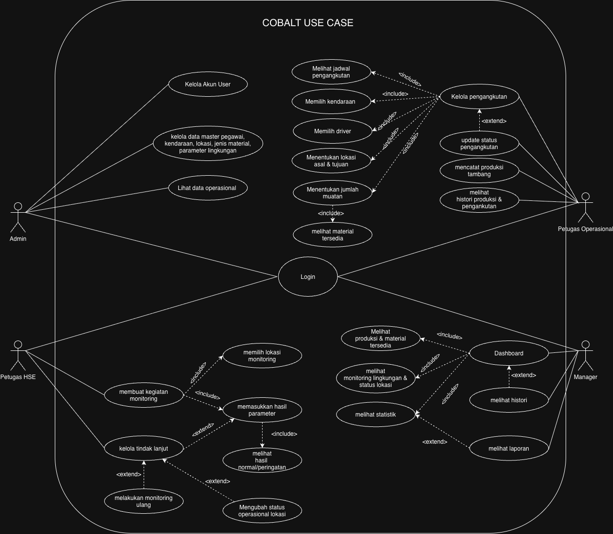

**Arahan gambar:** Gunakan gambar Use Case Diagram C-MOS yang telah dibuat. Simpan dengan nama `Usecase_CMOS.png` pada folder `images`.

#### 5.2.1 Aktor dalam Use Case Diagram

Use Case Diagram C-MOS memiliki empat aktor utama.

| Aktor | Tanggung Jawab |
|---|---|
| Admin | Mengelola data master dan akun pengguna. |
| Petugas Operasional | Mencatat produksi dan mengelola pengangkutan. |
| Petugas HSE | Melakukan monitoring lingkungan dan mengelola tindak lanjut. |
| Manager | Melihat dashboard, statistik, riwayat, dan laporan untuk mendukung keputusan. |

Keempat aktor tersebut memiliki hubungan dengan use case Login. Login digunakan sebagai proses autentikasi sebelum aktor dapat menjalankan fitur sesuai hak aksesnya. Driver tidak ditampilkan sebagai aktor utama karena tidak melakukan interaksi langsung dengan aplikasi. Driver merupakan pegawai yang datanya digunakan dalam proses pengangkutan oleh Petugas Operasional.

#### 5.2.2 Use Case Administrator

Pada diagram, Admin terhubung dengan beberapa aktivitas utama, yaitu:

1. Login.
2. Kelola Akun User.
3. Kelola Data Master.
4. Lihat Data Operasional.

**Login**

Admin melakukan autentikasi untuk memperoleh akses ke halaman Administrator.

**Kelola Akun User**

Admin mengelola akun yang digunakan oleh pegawai untuk masuk ke aplikasi.

Proses ini berkaitan dengan pembuatan akun, pengelolaan informasi akun, dan pengaturan status akses.

**Kelola Data Master**

Admin mengelola data dasar yang digunakan oleh modul lain.

Data master tersebut mencakup:

- Pegawai.
- Kendaraan.
- Lokasi tambang.
- Jenis material.
- Parameter lingkungan.

Pengelolaan data master menjadi tanggung jawab utama Administrator.

**Lihat Data Operasional**

Pada Use Case Diagram terdapat aktivitas melihat data operasional yang terhubung dengan Admin.

Aktivitas ini perlu dibedakan dari akses laporan Manager.

Melihat data operasional dalam konteks administrasi tidak berarti Admin memiliki kewenangan mengakses laporan analisis produksi, pengangkutan, atau monitoring lingkungan yang menjadi tanggung jawab Manager.

Dalam pembagian hak akses C-MOS, Admin berfokus pada pengelolaan data master dan akun pengguna.

#### 5.2.3 Use Case Petugas Operasional

Petugas Operasional memiliki tanggung jawab terhadap produksi dan pengangkutan hasil tambang.

Use case utama yang ditampilkan meliputi:

1. Login.
2. Mencatat Produksi Tambang.
3. Kelola Pengangkutan.
4. Update Status Pengangkutan.
5. Melihat Histori Produksi dan Pengangkutan.

**Mencatat Produksi Tambang**

Petugas Operasional mencatat hasil kegiatan penambangan.

Data yang dicatat meliputi lokasi, material, tanggal, dan jumlah produksi.

Hasil pencatatan menjadi sumber material untuk proses pengangkutan.

**Kelola Pengangkutan**

Use case ini menggambarkan proses pengelolaan kegiatan pemindahan material hasil produksi.

Pada diagram, Kelola Pengangkutan memiliki hubungan `<<include>>` dengan beberapa aktivitas pendukung, yaitu:

- Melihat jadwal pengangkutan.
- Memilih kendaraan.
- Memilih Driver.
- Menentukan lokasi asal dan tujuan.
- Menentukan jumlah muatan.

Hubungan tersebut menunjukkan bahwa pengelolaan pengangkutan membutuhkan informasi dari beberapa proses pendukung.

**Melihat Jadwal Pengangkutan**

Petugas melihat kegiatan pengangkutan yang telah direncanakan.

Informasi ini membantu mengetahui jadwal kegiatan yang tersedia.

**Memilih Kendaraan**

Petugas memilih kendaraan yang akan digunakan untuk mengangkut material.

Pemilihan kendaraan mempertimbangkan ketersediaan dan kapasitas muatan.

**Memilih Driver**

Petugas menentukan Driver yang bertugas menjalankan pengangkutan.

Driver dipilih dari data pegawai yang memiliki jenis Driver.

**Menentukan Lokasi Asal dan Tujuan**

Petugas menentukan lokasi sumber material dan lokasi tujuan pengangkutan.

Informasi ini digunakan untuk mencatat arah pemindahan material.

**Menentukan Jumlah Muatan**

Petugas memasukkan jumlah material yang akan diangkut.

Pada diagram, aktivitas ini memiliki hubungan dengan proses melihat material tersedia.

Hubungan tersebut menunjukkan bahwa penentuan jumlah muatan harus mempertimbangkan stok material yang berasal dari hasil produksi.

**Update Status Pengangkutan**

Petugas memperbarui status kegiatan pengangkutan sesuai perkembangan proses.

Status digunakan untuk menunjukkan apakah kegiatan masih dijadwalkan, sedang berlangsung, selesai, atau dibatalkan.

**Melihat Histori Produksi dan Pengangkutan**

Petugas dapat melihat kembali kegiatan produksi dan pengangkutan yang telah tercatat.

Riwayat tersebut membantu proses pencarian dan pemeriksaan data operasional.

#### 5.2.4 Use Case Petugas HSE

Petugas HSE bertanggung jawab terhadap pemantauan kondisi lingkungan pertambangan.

Use case yang ditampilkan meliputi:

1. Login.
2. Membuat Kegiatan Monitoring.
3. Memilih Lokasi Monitoring.
4. Memasukkan Hasil Parameter.
5. Melihat Hasil Normal atau Peringatan.
6. Kelola Tindak Lanjut.
7. Melakukan Monitoring Ulang.
8. Mengubah Status Operasional Lokasi.

**Membuat Kegiatan Monitoring**

Petugas HSE membuat kegiatan pemeriksaan lingkungan pada lokasi tertentu.

Pada diagram, aktivitas ini memiliki hubungan `<<include>>` dengan pemilihan lokasi dan pemasukan hasil parameter.

**Memilih Lokasi Monitoring**

Petugas menentukan lokasi yang akan diperiksa.

Lokasi dipilih dari data yang telah tersedia dalam sistem.

**Memasukkan Hasil Parameter**

Petugas mencatat hasil pengukuran parameter lingkungan.

Setiap hasil pengukuran dibandingkan dengan batas parameter yang telah ditentukan.

**Melihat Hasil Normal atau Peringatan**

Sistem menampilkan hasil monitoring berdasarkan nilai pengukuran.

Hasil tersebut membantu Petugas HSE mengetahui apakah kondisi yang diperiksa berada dalam batas yang ditetapkan.

**Kelola Tindak Lanjut**

Petugas HSE mencatat tindakan penanganan terhadap hasil monitoring yang memerlukan perhatian.

Informasi tindak lanjut digunakan untuk memantau perkembangan penanganan.

**Melakukan Monitoring Ulang**

Monitoring ulang digunakan untuk memeriksa kondisi lingkungan setelah tindakan penanganan.

Hasil monitoring ulang dicatat sebagai informasi pemeriksaan baru.

**Mengubah Status Operasional Lokasi**

Pada Use Case Diagram terdapat aktivitas perubahan status operasional lokasi yang berkaitan dengan tindak lanjut monitoring.

Dalam konsep C-MOS, perubahan status lokasi harus mengikuti kewenangan dan aturan bisnis yang ditetapkan.

Hasil monitoring berstatus PERINGATAN tidak secara otomatis menghentikan kegiatan produksi atau pengangkutan.

Informasi monitoring digunakan sebagai bahan evaluasi dan pertimbangan tindakan lebih lanjut.

#### 5.2.5 Use Case Manager

Manager berperan dalam pemantauan informasi dan evaluasi kegiatan pertambangan.

Use case yang ditampilkan meliputi:

1. Login.
2. Dashboard.
3. Melihat Produksi dan Material Tersedia.
4. Melihat Monitoring Lingkungan dan Status Lokasi.
5. Melihat Statistik.
6. Melihat Histori.
7. Melihat Laporan.

**Dashboard**

Manager mengakses dashboard yang menampilkan ringkasan informasi operasional.

Dashboard menggabungkan informasi dari kegiatan produksi, pengangkutan, dan monitoring lingkungan.

**Melihat Produksi dan Material Tersedia**

Manager dapat mengetahui jumlah produksi serta material yang masih tersedia.

Informasi ini membantu mengevaluasi hasil kegiatan penambangan.

**Melihat Monitoring Lingkungan dan Status Lokasi**

Manager dapat memeriksa kondisi lingkungan berdasarkan hasil monitoring yang dicatat Petugas HSE.

Informasi tersebut membantu mengetahui lokasi yang memiliki hasil normal atau peringatan.

**Melihat Statistik**

Manager dapat melihat informasi dalam bentuk angka dan grafik.

Statistik digunakan untuk mempermudah pemahaman terhadap data operasional.

**Melihat Histori**

Manager dapat melihat data historis kegiatan untuk mengetahui informasi yang telah tercatat.

**Melihat Laporan**

Manager dapat mengakses laporan produksi, pengangkutan, dan monitoring lingkungan.

Laporan digunakan untuk mendukung evaluasi dan pengambilan keputusan.

Manager tidak bertugas mengelola data master, mencatat produksi, atau memasukkan hasil parameter monitoring.

---

### 5.3 Entity Relationship Diagram (ERD)

Entity Relationship Diagram (ERD) merupakan diagram yang digunakan untuk menggambarkan struktur data dan hubungan antarentitas dalam database.

Dalam C-MOS, ERD dirancang untuk memastikan bahwa data pegawai, akun pengguna, produksi, pengangkutan, kendaraan, lokasi, dan monitoring lingkungan dapat saling terhubung.

Perancangan database dilakukan menggunakan Oracle SQL Developer Data Modeler.

ERD C-MOS terdiri atas dua model utama:

1. **Logical Data Model**, yang menggambarkan entitas, atribut, dan hubungan data secara konseptual.
2. **Relational Data Model**, yang menggambarkan penerapan entitas menjadi tabel database beserta Primary Key, Foreign Key, dan tipe data.

Kedua model tersebut digunakan untuk memastikan bahwa struktur database mendukung kebutuhan proses bisnis C-MOS.

---

#### 5.3.1 Logical Data Model

Logical Data Model merupakan rancangan yang menggambarkan struktur data berdasarkan kebutuhan sistem tanpa berfokus pada detail teknis implementasi database.

Model ini menunjukkan entitas utama, atribut yang dimiliki, serta hubungan antarentitas.

> **Gambar 4. Logical Data Model Cobalt Mining Operation System**

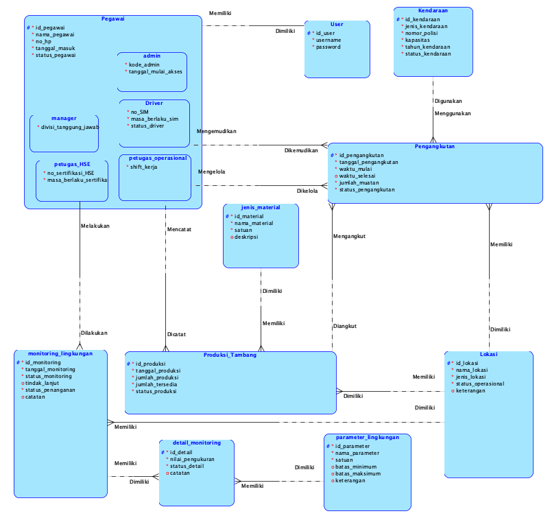

##### A. Entitas Pegawai

Entitas Pegawai digunakan untuk menyimpan informasi umum seluruh pegawai PT Cobalt.

Atribut utama yang terdapat pada entitas Pegawai adalah:

| Atribut | Keterangan |
|---|---|
| `id_pegawai` | Identitas unik pegawai. |
| `nama_pegawai` | Nama pegawai. |
| `no_hp` | Nomor telepon pegawai. |
| `tanggal_masuk` | Tanggal mulai bekerja. |
| `status_pegawai` | Status kepegawaian. |

Pegawai merupakan entitas utama yang memiliki beberapa subtype.

Subtype digunakan karena setiap jenis pegawai memiliki karakteristik dan atribut khusus.

Subtype tersebut meliputi:

**1. Admin**

Admin memiliki atribut khusus:

- `kode_admin`
- `tanggal_mulai_akses`

Atribut tersebut digunakan untuk menyimpan informasi khusus pegawai yang bertugas sebagai Administrator.

**2. Petugas Operasional**

Petugas Operasional memiliki atribut khusus:

- `shift_kerja`

Atribut tersebut digunakan untuk menyimpan informasi pembagian shift kerja petugas.

**3. Petugas HSE**

Petugas HSE memiliki atribut khusus:

- `no_sertifikasi_HSE`
- `masa_berlaku_sertifikasi`

Atribut tersebut digunakan untuk mencatat informasi sertifikasi petugas yang menjalankan kegiatan monitoring lingkungan.

**4. Manager**

Manager memiliki atribut khusus:

- `divisi_tanggung_jawab`

Atribut tersebut digunakan untuk menunjukkan divisi yang menjadi tanggung jawab Manager.

**5. Driver**

Driver memiliki atribut khusus:

- `no_SIM`
- `masa_berlaku_SIM`
- `status_driver`

Atribut tersebut digunakan untuk mencatat informasi pengemudi yang dapat ditugaskan pada kegiatan pengangkutan.

Penggunaan subtype membuat data pegawai lebih terstruktur karena atribut umum disimpan pada Pegawai, sedangkan atribut khusus disimpan pada jenis pegawai masing-masing.

Konsep ini juga mendukung penerapan Inheritance dalam pemrograman berorientasi objek.

##### B. Entitas User

Entitas User digunakan untuk menyimpan informasi akun yang digunakan ketika login.

Atribut utamanya meliputi:

| Atribut | Keterangan |
|---|---|
| `id_user` | Identitas unik akun pengguna. |
| `username` | Nama pengguna untuk login. |
| `password` | Data autentikasi akun. |

User memiliki hubungan dengan Pegawai.

Hubungan tersebut digunakan untuk mengetahui pegawai yang memiliki akun aplikasi.

Dalam konsep C-MOS, User tidak menyimpan role sebagai atribut tersendiri.

Jenis pengguna ditentukan berdasarkan subtype Pegawai yang terhubung dengan akun.

Dengan demikian, satu akun dapat diidentifikasi sebagai akun Admin, Petugas Operasional, Petugas HSE, atau Manager berdasarkan jenis pegawainya.

Driver tidak memiliki akun login.

##### C. Entitas Lokasi

Entitas Lokasi digunakan untuk menyimpan informasi lokasi pertambangan.

Atributnya meliputi:

| Atribut | Keterangan |
|---|---|
| `id_lokasi` | Identitas unik lokasi. |
| `nama_lokasi` | Nama lokasi pertambangan. |
| `jenis_lokasi` | Jenis lokasi, seperti PIT atau STOCKPILE. |
| `status_operasional` | Status operasional lokasi. |
| `keterangan` | Informasi tambahan lokasi. |

Lokasi memiliki hubungan dengan kegiatan produksi, pengangkutan, dan monitoring lingkungan.

Dalam produksi, lokasi digunakan untuk menentukan tempat material dihasilkan.

Dalam pengangkutan, lokasi digunakan untuk menentukan asal dan tujuan material.

Dalam monitoring lingkungan, lokasi digunakan untuk menentukan tempat pengukuran dilakukan.

Dengan demikian, satu data lokasi dapat digunakan oleh beberapa proses yang berbeda.

##### D. Entitas Jenis Material

Entitas Jenis Material digunakan untuk menyimpan katalog material yang dapat dicatat dalam produksi tambang.

Atributnya meliputi:

| Atribut | Keterangan |
|---|---|
| `id_material` | Identitas unik jenis material. |
| `nama_material` | Nama material. |
| `satuan` | Satuan pengukuran material. |
| `deskripsi` | Keterangan material. |

Jenis Material memiliki hubungan dengan Produksi Tambang.

Satu jenis material dapat digunakan dalam banyak catatan produksi.

Sebaliknya, setiap catatan produksi menggunakan satu jenis material tertentu.

Hubungan ini membantu menjaga konsistensi penamaan material.

##### E. Entitas Kendaraan

Entitas Kendaraan digunakan untuk menyimpan data armada pengangkutan.

Atributnya meliputi:

| Atribut | Keterangan |
|---|---|
| `id_kendaraan` | Identitas unik kendaraan. |
| `jenis_kendaraan` | Jenis kendaraan operasional. |
| `nomor_polisi` | Nomor registrasi kendaraan. |
| `kapasitas` | Kapasitas muatan kendaraan. |
| `tahun_kendaraan` | Tahun kendaraan. |
| `status_kendaraan` | Status kendaraan. |

Kendaraan memiliki hubungan dengan Pengangkutan.

Satu kendaraan dapat digunakan pada banyak kegiatan pengangkutan dalam waktu yang berbeda.

Namun, setiap kegiatan pengangkutan menggunakan satu kendaraan tertentu.

Data kapasitas kendaraan digunakan sebagai dasar validasi jumlah muatan.

##### F. Entitas Produksi Tambang

Entitas Produksi Tambang digunakan untuk menyimpan hasil kegiatan penambangan.

Atributnya meliputi:

| Atribut | Keterangan |
|---|---|
| `id_produksi` | Identitas unik produksi. |
| `tanggal_produksi` | Tanggal pencatatan produksi. |
| `jumlah_produksi` | Jumlah material yang dihasilkan. |
| `jumlah_tersedia` | Jumlah material yang masih tersedia. |
| `status_produksi` | Status data produksi. |

Produksi Tambang memiliki hubungan dengan Petugas Operasional, Lokasi, Jenis Material, dan Pengangkutan.

Hubungan tersebut menunjukkan bahwa:

1. Produksi dicatat oleh Petugas Operasional.
2. Produksi berasal dari lokasi tertentu.
3. Produksi menghasilkan jenis material tertentu.
4. Hasil produksi dapat digunakan sebagai sumber pengangkutan.

Satu catatan produksi dapat menjadi sumber beberapa kegiatan pengangkutan selama jumlah material yang tersedia masih mencukupi.

##### G. Entitas Pengangkutan

Entitas Pengangkutan digunakan untuk menyimpan kegiatan pemindahan material hasil produksi.

Atributnya meliputi:

| Atribut | Keterangan |
|---|---|
| `id_pengangkutan` | Identitas unik pengangkutan. |
| `tanggal_pengangkutan` | Tanggal kegiatan pengangkutan. |
| `waktu_mulai` | Waktu dimulainya pengangkutan. |
| `waktu_selesai` | Waktu penyelesaian pengangkutan. |
| `jumlah_muatan` | Jumlah material yang diangkut. |
| `status_pengangkutan` | Status kegiatan pengangkutan. |

Pengangkutan memiliki hubungan dengan beberapa entitas utama.

**Hubungan dengan Produksi Tambang**

Pengangkutan menggunakan material dari hasil produksi yang telah tercatat.

Hubungan ini memungkinkan sistem mengetahui sumber material yang diangkut.

**Hubungan dengan Kendaraan**

Setiap pengangkutan menggunakan kendaraan tertentu.

Informasi kendaraan digunakan untuk memeriksa kapasitas muatan dan ketersediaan armada.

**Hubungan dengan Driver**

Setiap pengangkutan memiliki Driver yang bertugas.

Driver dapat terlibat dalam beberapa pengangkutan pada waktu yang berbeda.

**Hubungan dengan Petugas Operasional**

Petugas Operasional bertanggung jawab mengelola pencatatan dan perkembangan kegiatan pengangkutan.

**Hubungan dengan Lokasi**

Pengangkutan memiliki informasi lokasi asal dan tujuan.

Hubungan tersebut memungkinkan sistem mengetahui dari mana material berasal dan ke mana material dipindahkan.

##### H. Entitas Monitoring Lingkungan

Entitas Monitoring Lingkungan digunakan untuk menyimpan kegiatan pemantauan kondisi lingkungan pertambangan.

Atributnya meliputi:

| Atribut | Keterangan |
|---|---|
| `id_monitoring` | Identitas unik kegiatan monitoring. |
| `tanggal_monitoring` | Tanggal monitoring dilakukan. |
| `status_monitoring` | Hasil monitoring, seperti NORMAL atau PERINGATAN. |
| `tindak_lanjut` | Informasi tindak lanjut monitoring. |
| `status_penanganan` | Perkembangan penanganan hasil monitoring. |
| `catatan` | Keterangan tambahan kegiatan monitoring. |

Monitoring Lingkungan memiliki hubungan dengan Petugas HSE, Lokasi, dan Detail Monitoring.

Petugas HSE bertanggung jawab melakukan kegiatan monitoring.

Lokasi menunjukkan tempat monitoring dilakukan.

Detail Monitoring menyimpan hasil pengukuran parameter pada kegiatan tersebut.

##### I. Entitas Parameter Lingkungan

Entitas Parameter Lingkungan digunakan sebagai acuan pengukuran kondisi lingkungan.

Atributnya meliputi:

| Atribut | Keterangan |
|---|---|
| `id_parameter` | Identitas unik parameter. |
| `nama_parameter` | Nama parameter lingkungan. |
| `satuan` | Satuan pengukuran. |
| `batas_minimum` | Nilai batas minimum. |
| `batas_maksimum` | Nilai batas maksimum. |
| `keterangan` | Informasi tambahan parameter. |

Parameter Lingkungan memiliki hubungan dengan Detail Monitoring.

Satu parameter dapat digunakan pada banyak detail pengukuran.

Hubungan tersebut memungkinkan parameter yang sama digunakan dalam kegiatan monitoring pada lokasi dan waktu yang berbeda.

##### J. Entitas Detail Monitoring

Entitas Detail Monitoring digunakan untuk menyimpan hasil pengukuran parameter lingkungan.

Atributnya meliputi:

| Atribut | Keterangan |
|---|---|
| `id_detail` | Identitas unik detail monitoring. |
| `nilai_pengukuran` | Nilai hasil pengukuran. |
| `status_detail` | Status hasil pengukuran parameter. |
| `catatan` | Informasi tambahan hasil pengukuran. |

Detail Monitoring menghubungkan kegiatan Monitoring Lingkungan dengan Parameter Lingkungan.

Satu kegiatan monitoring dapat memiliki banyak detail pengukuran.

Sebaliknya, setiap detail pengukuran mengacu pada satu kegiatan monitoring dan satu parameter tertentu.

Sebagai contoh, satu kegiatan monitoring dapat mencatat hasil pH Air, TSS, PM10, Kebisingan, dan Kadar Kobalt dalam Air.

Melalui hubungan tersebut, sistem dapat mengetahui parameter yang menghasilkan kondisi normal atau peringatan.

#### 5.3.2 Hubungan Antarentitas pada Logical Model

Berdasarkan Logical Model, hubungan utama antarentitas dapat dirangkum sebagai berikut.

| Entitas Pertama | Hubungan | Entitas Kedua | Penjelasan |
|---|---|---|---|
| Pegawai | Memiliki | User | Pegawai yang memiliki hak login dapat mempunyai akun pengguna. |
| Pegawai | Supertype | Admin | Admin merupakan jenis Pegawai. |
| Pegawai | Supertype | Petugas Operasional | Petugas Operasional merupakan jenis Pegawai. |
| Pegawai | Supertype | Petugas HSE | Petugas HSE merupakan jenis Pegawai. |
| Pegawai | Supertype | Manager | Manager merupakan jenis Pegawai. |
| Pegawai | Supertype | Driver | Driver merupakan jenis Pegawai. |
| Petugas Operasional | Mencatat | Produksi Tambang | Petugas Operasional mencatat hasil produksi. |
| Petugas Operasional | Mengelola | Pengangkutan | Petugas Operasional mengelola kegiatan pengangkutan. |
| Driver | Mengemudikan | Pengangkutan | Driver menjalankan kendaraan dalam pengangkutan. |
| Kendaraan | Digunakan | Pengangkutan | Kendaraan digunakan untuk mengangkut material. |
| Jenis Material | Digunakan dalam | Produksi Tambang | Produksi mencatat material berdasarkan jenisnya. |
| Lokasi | Menjadi tempat | Produksi Tambang | Produksi berasal dari lokasi tertentu. |
| Produksi Tambang | Menjadi sumber | Pengangkutan | Material yang diangkut berasal dari hasil produksi. |
| Lokasi | Menjadi asal/tujuan | Pengangkutan | Pengangkutan menghubungkan lokasi asal dan tujuan. |
| Petugas HSE | Melakukan | Monitoring Lingkungan | Petugas HSE mencatat kegiatan monitoring. |
| Lokasi | Dipantau melalui | Monitoring Lingkungan | Monitoring dilakukan pada lokasi tertentu. |
| Monitoring Lingkungan | Memiliki | Detail Monitoring | Satu monitoring memiliki sejumlah hasil pengukuran. |
| Parameter Lingkungan | Digunakan dalam | Detail Monitoring | Setiap detail menggunakan parameter tertentu. |

Hubungan tersebut menunjukkan bahwa C-MOS menggunakan data yang saling terintegrasi.

Contohnya, proses pengangkutan tidak dapat dipisahkan dari produksi karena jumlah muatan harus mempertimbangkan material yang tersedia.

Begitu juga monitoring lingkungan tidak dapat dipisahkan dari lokasi karena setiap hasil pengukuran harus memiliki informasi tempat pemeriksaan.

---

#### 5.3.3 Relational Data Model

Relational Data Model merupakan rancangan yang menggambarkan penerapan Logical Model menjadi struktur tabel database.

Pada tahap ini, setiap entitas diterjemahkan menjadi tabel yang memiliki kolom, tipe data, Primary Key, dan Foreign Key.

Relational Model digunakan sebagai dasar implementasi database MySQL pada aplikasi C-MOS.

> **Gambar 5. Relational Data Model Cobalt Mining Operation System**

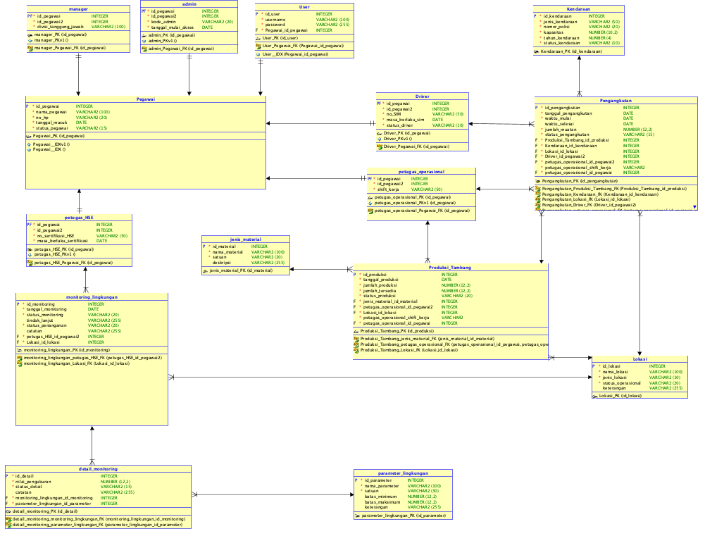

##### A. Struktur Tabel Database

Berdasarkan Relational Model, database C-MOS terdiri atas 15 tabel utama.

| No. | Tabel | Fungsi |
|---|---|---|
| 1 | `pegawai` | Menyimpan informasi umum pegawai. |
| 2 | `admin` | Menyimpan atribut khusus Admin. |
| 3 | `petugas_operasional` | Menyimpan atribut khusus Petugas Operasional. |
| 4 | `petugas_HSE` | Menyimpan atribut khusus Petugas HSE. |
| 5 | `manager` | Menyimpan atribut khusus Manager. |
| 6 | `driver` | Menyimpan atribut khusus Driver. |
| 7 | `user` | Menyimpan akun pengguna aplikasi. |
| 8 | `lokasi` | Menyimpan data lokasi pertambangan. |
| 9 | `jenis_material` | Menyimpan katalog jenis material. |
| 10 | `kendaraan` | Menyimpan data kendaraan operasional. |
| 11 | `produksi_tambang` | Menyimpan hasil produksi tambang. |
| 12 | `pengangkutan` | Menyimpan kegiatan pengangkutan material. |
| 13 | `monitoring_lingkungan` | Menyimpan kegiatan monitoring lingkungan. |
| 14 | `parameter_lingkungan` | Menyimpan acuan parameter pengukuran. |
| 15 | `detail_monitoring` | Menyimpan hasil pengukuran setiap parameter. |

Kelima belas tabel tersebut saling terhubung melalui relasi yang ditentukan berdasarkan kebutuhan sistem.

##### B. Primary Key

Primary Key merupakan kolom yang digunakan untuk membedakan setiap baris data dalam suatu tabel.

Setiap tabel utama pada C-MOS memiliki identitas yang digunakan sebagai Primary Key.

Contohnya:

- `pegawai.id_pegawai`
- `user.id_user`
- `lokasi.id_lokasi`
- `jenis_material.id_material`
- `kendaraan.id_kendaraan`
- `produksi_tambang.id_produksi`
- `pengangkutan.id_pengangkutan`
- `monitoring_lingkungan.id_monitoring`
- `parameter_lingkungan.id_parameter`
- `detail_monitoring.id_detail`

Primary Key memastikan bahwa setiap data memiliki identitas unik.

Sebagai contoh, dua pegawai dapat memiliki nama yang sama, tetapi tetap dibedakan melalui `id_pegawai`.

##### C. Foreign Key

Foreign Key merupakan kolom yang digunakan untuk menghubungkan suatu tabel dengan tabel lainnya.

Dalam C-MOS, Foreign Key digunakan untuk menjaga hubungan antarentitas.

Contohnya, tabel Produksi Tambang memiliki hubungan dengan Lokasi, Jenis Material, dan Petugas Operasional.

Hubungan tersebut memungkinkan sistem mengetahui lokasi produksi, material yang dihasilkan, dan petugas yang mencatat produksi.

Contoh lainnya adalah tabel Pengangkutan yang terhubung dengan Produksi Tambang, Kendaraan, Driver, Petugas Operasional, dan Lokasi.

Melalui hubungan tersebut, sistem dapat menelusuri asal material, kendaraan yang digunakan, Driver yang bertugas, serta lokasi pengangkutan.

##### D. Implementasi Supertype dan Subtype

Pada Relational Model, hubungan Supertype dan Subtype diterapkan menggunakan tabel terpisah.

Tabel Pegawai menyimpan atribut umum.

Sementara itu, tabel Admin, Petugas Operasional, Petugas HSE, Manager, dan Driver menyimpan atribut khusus masing-masing.

Setiap tabel subtype menggunakan identitas pegawai sebagai penghubung dengan tabel Pegawai.

Dengan demikian, identitas pegawai tetap konsisten meskipun atribut khususnya berada pada tabel berbeda.

Contoh hubungan:

```text
PEGAWAI
id_pegawai (PK)
     |
     +------ ADMIN
     |       id_pegawai (FK)
     |
     +------ PETUGAS_OPERASIONAL
     |       id_pegawai (FK)
     |
     +------ PETUGAS_HSE
     |       id_pegawai (FK)
     |
     +------ MANAGER
     |       id_pegawai (FK)
     |
     +------ DRIVER
             id_pegawai (FK)
```

Pada implementasi subtype, identitas pegawai juga dapat digunakan sebagai bagian dari kunci utama tabel subtype sesuai rancangan database.

##### E. Relasi Produksi dan Pengangkutan

Salah satu hubungan terpenting dalam C-MOS adalah relasi antara Produksi Tambang dan Pengangkutan.

Produksi Tambang menyimpan informasi material yang dihasilkan.

Pengangkutan menggunakan material dari produksi tersebut.

Hubungan yang digunakan adalah satu produksi dapat menjadi sumber banyak kegiatan pengangkutan.

Contoh:

```text
PRODUKSI TAMBANG
ID Produksi : PRD001
Jumlah      : 100 Ton
       |
       +------ PENGANGKUTAN 1
       |       Muatan: 30 Ton
       |
       +------ PENGANGKUTAN 2
       |       Muatan: 25 Ton
       |
       +------ PENGANGKUTAN 3
               Muatan: 20 Ton

Total Diangkut : 75 Ton
Sisa Material  : 25 Ton
```

Contoh tersebut menunjukkan bahwa satu catatan produksi dapat digunakan dalam beberapa pengangkutan.

Hubungan ini mendukung pengelolaan stok material agar jumlah yang diangkut tidak melebihi material yang tersedia.

##### F. Relasi Kendaraan dan Pengangkutan

Tabel Kendaraan memiliki hubungan dengan Pengangkutan.

Satu kendaraan dapat digunakan dalam banyak kegiatan pengangkutan pada waktu yang berbeda.

Namun, setiap kegiatan pengangkutan menggunakan satu kendaraan.

Hubungan tersebut digunakan untuk mengetahui riwayat penggunaan kendaraan dan mendukung validasi kapasitas muatan.

Sebagai contoh, kendaraan dengan kapasitas 20 ton tidak boleh digunakan untuk pengangkutan dengan jumlah muatan 30 ton.

Validasi tersebut dilakukan pada logika aplikasi menggunakan data kapasitas kendaraan yang tersimpan dalam database.

##### G. Relasi Driver dan Pengangkutan

Driver memiliki hubungan langsung dengan Pengangkutan.

Satu Driver dapat menjalankan banyak kegiatan pengangkutan pada waktu yang berbeda.

Setiap kegiatan pengangkutan menggunakan satu Driver yang ditugaskan.

Hubungan ini digunakan untuk mengetahui siapa yang mengemudikan kendaraan dalam kegiatan pengangkutan.

Driver tidak memiliki hubungan langsung dengan Produksi Tambang karena Driver tidak bertugas mencatat atau menghasilkan produksi.

Tanggung jawab Driver berada pada kegiatan pengangkutan.

##### H. Relasi Monitoring dan Detail Monitoring

Monitoring Lingkungan memiliki hubungan satu-ke-banyak dengan Detail Monitoring.

Satu kegiatan monitoring dapat memiliki beberapa detail hasil pengukuran.

Setiap detail mengacu pada satu parameter lingkungan.

Contoh:

```text
MONITORING LINGKUNGAN
ID Monitoring : MON001
Lokasi        : PIT Kobalt Utara
       |
       +------ DETAIL 1
       |       Parameter : pH Air
       |       Hasil     : 7,2
       |       Status    : Normal
       |
       +------ DETAIL 2
       |       Parameter : TSS
       |       Hasil     : 75 mg/L
       |       Status    : Peringatan
       |
       +------ DETAIL 3
               Parameter : PM10
               Hasil     : 120 µg/m³
               Status    : Normal

Status Monitoring:
PERINGATAN
```

Angka tersebut merupakan ilustrasi untuk menjelaskan hubungan data.

Hubungan ini memungkinkan satu kegiatan monitoring menyimpan banyak hasil pengukuran tanpa harus membuat tabel monitoring terpisah untuk setiap parameter.

##### I. Relasi Parameter dan Detail Monitoring

Parameter Lingkungan memiliki hubungan satu-ke-banyak dengan Detail Monitoring.

Satu parameter dapat digunakan pada banyak kegiatan pengukuran.

Sebagai contoh, parameter pH Air dapat digunakan untuk monitoring PIT Utara, PIT Selatan, dan STOCKPILE pada tanggal yang berbeda.

Dengan demikian, data batas parameter cukup dikelola melalui tabel Parameter Lingkungan.

Sementara itu, nilai pengukuran disimpan pada Detail Monitoring.

Pemisahan ini membantu menjaga konsistensi data acuan dan data hasil pemeriksaan.

#### 5.3.5 Penerapan Kardinalitas Relasi

Kardinalitas merupakan aturan yang menunjukkan jumlah hubungan antara satu entitas dengan entitas lainnya.

Dalam C-MOS, hubungan utama menggunakan konsep One-to-Many (1:M) dan One-to-One (1:1) atau One-to-Zero-or-One (1:0..1) sesuai kebutuhan.

| Hubungan | Kardinalitas | Penjelasan |
|---|---|---|
| Pegawai → User | 1:0..1 | Pegawai dapat memiliki satu akun atau tidak memiliki akun. |
| Pegawai → Subtype | 1:0..1 per subtype | Setiap pegawai dapat memiliki data khusus pada subtype yang sesuai. |
| Petugas Operasional → Produksi Tambang | 1:M | Satu petugas dapat mencatat banyak produksi. |
| Petugas Operasional → Pengangkutan | 1:M | Satu petugas dapat mengelola banyak pengangkutan. |
| Driver → Pengangkutan | 1:M | Satu Driver dapat menjalankan banyak pengangkutan. |
| Kendaraan → Pengangkutan | 1:M | Satu kendaraan dapat digunakan pada banyak pengangkutan. |
| Jenis Material → Produksi Tambang | 1:M | Satu jenis material dapat digunakan pada banyak produksi. |
| Lokasi → Produksi Tambang | 1:M | Satu lokasi dapat memiliki banyak catatan produksi. |
| Produksi Tambang → Pengangkutan | 1:M | Satu produksi dapat menjadi sumber banyak pengangkutan. |
| Lokasi → Monitoring Lingkungan | 1:M | Satu lokasi dapat diperiksa berkali-kali. |
| Petugas HSE → Monitoring Lingkungan | 1:M | Satu petugas dapat melakukan banyak monitoring. |
| Monitoring Lingkungan → Detail Monitoring | 1:M | Satu monitoring memiliki banyak detail pengukuran. |
| Parameter Lingkungan → Detail Monitoring | 1:M | Satu parameter dapat digunakan pada banyak pengukuran. |

Penerapan kardinalitas tersebut bertujuan memastikan bahwa hubungan antarentitas sesuai dengan kebutuhan proses bisnis.

Sebagai contoh, satu produksi dapat memiliki beberapa pengangkutan, tetapi satu pengangkutan hanya mengacu pada satu sumber produksi sesuai rancangan sistem.

---

## 6. Struktur Folder dan Package

Struktur berikut mengikuti source Java pada arsip `CMOS_Revisi_Awal_GUIBuilder.zip` yang tersedia untuk pemeriksaan.

> **Gambar 6. Struktur Source Packages di NetBeans**

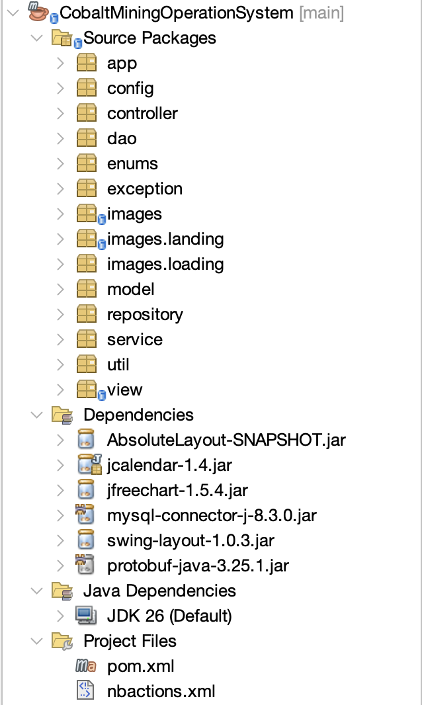

### 6.1 Package `app`

`Main.java` merupakan titik masuk aplikasi. Method `main()` memanggil `SwingUtilities.invokeLater()` agar antarmuka Swing dibuat pada Event Dispatch Thread. Setelah menginisialisasi konfigurasi aplikasi, program membuka `LoginFrame`.

### 6.2 Package `config`

- `AppConfig.java` menyiapkan komponen dan dependensi aplikasi.
- `DatabaseConfig.java` mengatur koneksi JDBC ke MySQL serta menyediakan pemeriksaan koneksi.

### 6.3 Package `controller`

Controller menghubungkan aksi pengguna dari tampilan dengan proses di service. `AuthController` menangani autentikasi, `MasterDataController` menangani data master, `ProduksiController` menangani produksi, `PengangkutanController` menangani pengangkutan, `MonitoringController` menangani monitoring, dan controller dashboard/laporan menyiapkan informasi untuk tampilan.

### 6.4 Package `dao`

DAO berisi implementasi akses database melalui JDBC. Setiap DAO berfokus pada kelompok data tertentu. Contohnya `ProduksiDAO` menangani penyimpanan dan pembacaan produksi, sedangkan `PengangkutanDAO` menangani data pengangkutan. `JdbcSupport` menyediakan fungsi pendukung operasi JDBC.

### 6.5 Package `enums`

Enum membatasi nilai status atau kategori ke pilihan yang telah ditentukan. Contohnya `StatusPengangkutan`, `StatusDriver`, `StatusKendaraan`, `StatusMonitoring`, dan `ShiftKerja`. Penggunaan enum mengurangi kesalahan penulisan status pada logika Java.

### 6.6 Package `exception`

- `ValidationException`: kesalahan nilai masukan.
- `DataNotFoundException`: data yang diminta tidak ditemukan.
- `BusinessException`: pelanggaran aturan proses bisnis.

### 6.7 Package `model`

Model merepresentasikan objek utama sistem. `Pegawai` merupakan superclass abstrak bagi lima jenis pegawai. Model lain merepresentasikan lokasi, material, kendaraan, produksi, pengangkutan, monitoring, parameter, dan detail monitoring.

### 6.8 Package `repository`

Repository mendefinisikan operasi data yang diperlukan oleh service. `CrudRepository` menyediakan kontrak operasi umum. Repository khusus memisahkan kebutuhan data per domain, sedangkan DAO menjalankan query JDBC yang sesuai.

### 6.9 Package `service`

Service menyimpan aturan bisnis. Contohnya `PengangkutanService` memeriksa kapasitas, ketersediaan, tanggal, SIM, stok, dan jadwal sebelum membuat pengangkutan. `MonitoringService` menangani kegiatan monitoring, detail pengukuran, dan tindak lanjut. `DashboardService` serta `LaporanService` menyajikan data ringkasan dan laporan.

### 6.10 Package `util`

`BootstrapAdmin` menyediakan proses pendukung inisialisasi admin, sedangkan `PasswordUtil` menyediakan fungsi pendukung pengelolaan kata sandi.

### 6.11 Package `view`

Package `view` menyimpan JFrame dan JPanel antarmuka. Berkas `.form` yang menyertai sejumlah kelas view merupakan metadata desain NetBeans GUI Builder. Desain komponen dan layout harus dikelola melalui tab **Design**, bukan dengan membuat panel visual baru secara manual melalui kode.

`MainFrameRouter` mengarahkan pengguna ke halaman utama berdasarkan jenis pegawai. Setiap `MainFrame...` menyediakan navigasi untuk peran terkait. `...Panel` menyajikan halaman daftar, dashboard, atau laporan. `...FormFrame` menyediakan formulir tambah dan ubah data.

## 7. Penerapan Empat Pilar OOP

### 7.1 Encapsulation

Encapsulation melindungi atribut objek dengan akses `private` dan menyediakan akses terkontrol melalui method. Contohnya pada `model.Pegawai`:

```java
private int idPegawai;
private String namaPegawai;
private String noHp;
private java.time.LocalDate tanggalMasuk;
private enums.StatusPegawai statusPegawai;

public String getNamaPegawai() {
    return namaPegawai;
}

public void setNamaPegawai(String value) {
    this.namaPegawai = value;
}
```

Atribut `namaPegawai` tidak diakses langsung oleh kelas lain. Kelas lain menggunakan getter atau setter. Dengan demikian, struktur data objek tetap terkendali. Validasi bisnis yang lebih kompleks ditempatkan pada service sebelum perubahan data disimpan.

> **Gambar 12. Bukti encapsulation pada `Pegawai.java`**


**Arahan screenshot:** Sorot deklarasi atribut `private` serta method getter dan setter dalam `model/Pegawai.java`.

### 7.2 Inheritance

Inheritance memungkinkan subclass mewarisi atribut dan method dari superclass. Dalam proyek ini, `Pegawai` merupakan superclass bagi `Admin`, `PetugasOperasional`, `PetugasHSE`, `Manager`, dan `Driver`.

```java
public abstract class Pegawai {
    // Atribut dasar pegawai dan method bersama.
}

public class Admin extends Pegawai {
    // Atribut khusus Admin.
}

public class Driver extends Pegawai {
    // Atribut khusus Driver.
}
```

Kode tersebut menunjukkan hubungan pewarisan yang terdapat pada source. Setiap subtype memiliki atribut bersama dari `Pegawai` serta atribut khusus sesuai tugasnya. Contohnya Driver mempunyai informasi SIM, sedangkan Petugas Operasional memiliki informasi shift kerja.

### 7.3 Polymorphism

Polymorphism merupakan konsep OOP yang memungkinkan method memiliki perilaku berbeda sesuai objek atau parameter yang digunakan. Pada proyek **C-MOS**, polymorphism diterapkan melalui dua bentuk, yaitu **Method Overriding** dan **Method Overloading**.

#### 7.3.1 Method Overriding

Method overriding terjadi ketika subclass mengimplementasikan kembali method yang didefinisikan pada superclass.

Pada C-MOS, penerapan overriding terdapat pada superclass `Pegawai` dan kelima subclass-nya, yaitu `Admin`, `PetugasOperasional`, `PetugasHSE`, `Manager`, dan `Driver`.

**Bukti penerapan:**

Lokasi: `model/Pegawai.java`

```java
public abstract String getJenisPegawai();
```

Method tersebut dideklarasikan sebagai method abstrak sehingga setiap subclass wajib memberikan implementasinya sendiri.

Contoh pada `model/Admin.java`:

```java
@Override
public String getJenisPegawai() {
    return "ADMIN";
}
```

Contoh pada `model/Driver.java`:

```java
@Override
public String getJenisPegawai() {
    return "DRIVER";
}
```

**Penjelasan:**

Kedua subclass menggunakan method `getJenisPegawai()` yang sama, tetapi menghasilkan nilai berbeda sesuai jenis pegawainya.

Keyword `@Override` menunjukkan bahwa subclass mengimplementasikan method dari superclass.

Penerapan ini termasuk **Runtime Polymorphism**, karena Java menentukan implementasi method berdasarkan objek sebenarnya saat program berjalan.

#### 7.3.2 Method Overloading

Method overloading terjadi ketika terdapat beberapa method dengan nama sama dalam satu class, tetapi memiliki jumlah atau tipe parameter berbeda.

Pada C-MOS, overloading diterapkan dalam beberapa class pada package `service`.

**A. ProduksiService**

Lokasi: `service/ProduksiService.java`

```java
public ProduksiTambang tambahProduksi(
        int idProduksi, int idMaterial, int idLokasi,
        PetugasOperasional petugas, LocalDate tanggal, double jumlah)
```

```java
public ProduksiTambang tambahProduksi(
        int idMaterial, int idLokasi,
        PetugasOperasional p, LocalDate t, double j) {
    return tambahProduksi(0, idMaterial, idLokasi, p, t, j);
}
```

**Penjelasan:**

Method `tambahProduksi()` memiliki dua bentuk, yaitu dengan enam parameter dan lima parameter. Method kedua memanggil method pertama dengan memberikan nilai ID `0` secara otomatis.

Hal ini mempermudah proses penambahan produksi tanpa perlu memasukkan ID secara langsung.

**B. PengangkutanService**

Lokasi: `service/PengangkutanService.java`

```java
public Pengangkutan buatPengangkutan(
        int id, int idProd, PetugasOperasional ops,
        int idVehicle, Driver driver, int idAsal,
        int idTujuan, LocalDate date, double amount)
```

```java
public Pengangkutan buatPengangkutan(
        int idProd, PetugasOperasional ops,
        int idVehicle, Driver d, int asal,
        int tujuan, LocalDate date, double amount) {
    return buatPengangkutan(
        0, idProd, ops, idVehicle, d, asal, tujuan, date, amount);
}
```

**Penjelasan:**

Method `buatPengangkutan()` memiliki dua bentuk dengan sembilan dan delapan parameter. Perbedaannya terdapat pada parameter ID pengangkutan.

Method kedua memanggil method utama sehingga proses validasi dan pembuatan pengangkutan tetap menggunakan aturan yang sama.

**C. MonitoringService**

Lokasi: `service/MonitoringService.java`

```java
public MonitoringLingkungan buatMonitoring(
        int id, int lokasiId, PetugasHSE h,
        LocalDateTime t, String catatan)
```

```java
public MonitoringLingkungan buatMonitoring(
        int lokasiId, PetugasHSE h,
        LocalDateTime t, String catatan) {
    return buatMonitoring(0, lokasiId, h, t, catatan);
}
```

**Penjelasan:**

Method `buatMonitoring()` memiliki dua bentuk dengan lima dan empat parameter. Method kedua mempermudah pembuatan monitoring tanpa perlu memberikan ID kegiatan secara langsung.

Selain itu, `MonitoringService` juga menerapkan overloading pada method `tambahDetail()` untuk mencatat hasil pengukuran parameter lingkungan.

Penerapan overloading termasuk **Compile-Time Polymorphism**, karena Java menentukan method yang digunakan berdasarkan parameter saat kompilasi.


### 7.4 Abstraction

Abstraction menyajikan kontrak penting tanpa mewajibkan pemanggil mengetahui seluruh detail implementasi. `Pegawai` ditetapkan sebagai `abstract class`, sehingga objek `Pegawai` umum tidak dapat dibuat secara langsung. Subclass harus menyediakan implementasi `getJenisPegawai()`.

```java
public abstract class Pegawai {
    public abstract String getJenisPegawai();
}
```

Selain itu, `repository.CrudRepository` dan repository khusus menggunakan interface sebagai kontrak akses data. Service dapat bekerja terhadap operasi repository tanpa perlu mengetahui setiap detail SQL di DAO.

### 7.5 Keterkaitan OOP dengan arsitektur

Penerapan empat pilar OOP tidak berdiri sendiri. Model memanfaatkan encapsulation, inheritance, polymorphism, dan abstraction. Service menggunakan objek model serta kontrak repository untuk menjalankan aturan bisnis. Controller meneruskan permintaan dari view ke service. DAO berkomunikasi dengan database melalui JDBC. Pemisahan ini memudahkan pengujian dan perubahan logika tanpa mencampurkan seluruh proses ke dalam satu JFrame.


## 8. Panduan Penggunaan dan Alur Hasil Program

Bagian ini mengikuti **source proyek `CobaltMiningOperationSystem(4).zip`**, khususnya `app.Main`, seluruh `MainFrame*`, panel dan form pada package `view`, serta method pada `controller` dan `service`. Alur dibagi berdasarkan empat akun login. **Driver bukan pengguna login**. Gambar adalah slot dokumentasi yang harus diisi screenshot aplikasi nyata, bukan gambar hasil rekaan.

**Cara membaca panduan:** setiap langkah memuat tindakan pengguna, hasil yang diharapkan, lokasi class, dan arahan screenshot. Screenshot diambil sesudah tindakan berhasil, kecuali langkah yang khusus mendokumentasikan validasi. Data contoh dalam penjelasan tidak menggantikan data database Anda.

### 8.1 Persiapan dan Menjalankan Aplikasi

#### Struktur proyek di NetBeans

Buka proyek Maven melalui NetBeans. Pastikan `pom.xml` terbaca dan package `app`, `config`, `controller`, `dao`, `enums`, `exception`, `model`, `repository`, `service`, `util`, dan `view` tersedia. File `.form` pada package view harus tetap berpasangan dengan `.java` untuk pengeditan visual GUI Builder.

> **Gambar 18. Struktur proyek di NetBeans**

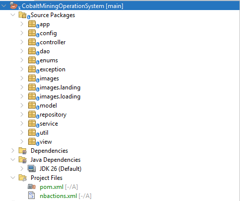

**Arahan screenshot:** Buka tab Projects di NetBeans, perluas Source Packages. **Yang harus terlihat:** Nama proyek dan seluruh package utama.

#### Konfigurasi database MySQL

Siapkan MySQL dan impor `DATABASE_ASLI_DBCobaltCMOS.sql` sesuai panduan proyek. Periksa `config/DatabaseConfig.java` dan `config/AppConfig.java`. File `MIGRASI_DML_TANPA_PERUBAHAN_STRUKTUR.sql` disertakan proyek sebagai skrip penyesuaian data. Gunakan hanya sesuai petunjuk migrasi dan setelah mencadangkan database.

> **Gambar 19. Konfigurasi database MySQL**


**Arahan screenshot:** Ambil screenshot daftar tabel dari aplikasi pengelola MySQL. **Yang harus terlihat:** Nama database, tabel utama, dan status koneksi tanpa memperlihatkan password.

#### Menjalankan Main Java

Jalankan entry point `app.Main`. Aplikasi melakukan inisialisasi sebelum menampilkan layar awal. Jika koneksi database gagal, aplikasi dapat menampilkan dialog kesalahan dan proses tidak dilanjutkan.

> **Gambar 20. Menjalankan Main Java**


**Arahan screenshot:** Klik Run Project atau jalankan `app.Main`. **Yang harus terlihat:** Jendela aplikasi saat pertama kali dibuka.

#### Loading aplikasi

`view.LoadingFrame` menjalankan animasi/progress serta inisialisasi database. Tunggu hingga proses selesai. Layar ini bukan halaman login dan tidak mengubah data operasional.

> **Gambar 21. Loading aplikasi**

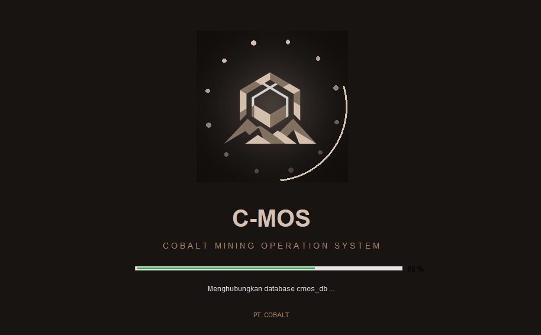

**Arahan screenshot:** Ambil gambar ketika loading masih berjalan. **Yang harus terlihat:** Logo/animasi loading dan indikator progress.

#### Landing page C-MOS

Setelah loading berhasil, `view.LandingFrame` menampilkan pengenalan C-MOS. Halaman ini menyediakan navigasi informasi dan tombol untuk masuk ke login.

> **Gambar 22. Landing page C-MOS**


**Arahan screenshot:** Tampilkan halaman landing pada ukuran jendela normal. **Yang harus terlihat:** Identitas C-MOS, tombol login, dan konten pengenalan.

#### Navigasi landing dan tombol login

Periksa bagian Tentang, Operasi, dan Tim melalui navigasi landing jika tampil. Tekan tombol masuk pada header atau area utama. Kedua aksi mengarah ke form login.

> **Gambar 23. Navigasi landing dan tombol login**


**Arahan screenshot:** Ambil screenshot sebelum menekan login, lalu setelah form login terbuka. **Yang harus terlihat:** Tombol navigasi landing dan perpindahan ke login.

#### Form login dan validasi

`view.LoginFrame` menerima username dan password. Pengguna dapat memperlihatkan/menyembunyikan password. Sistem memvalidasi kredensial melalui `AuthController`/`AuthService`; kredensial salah tidak boleh membuka halaman utama.

> **Gambar 24. Form login dan validasi**

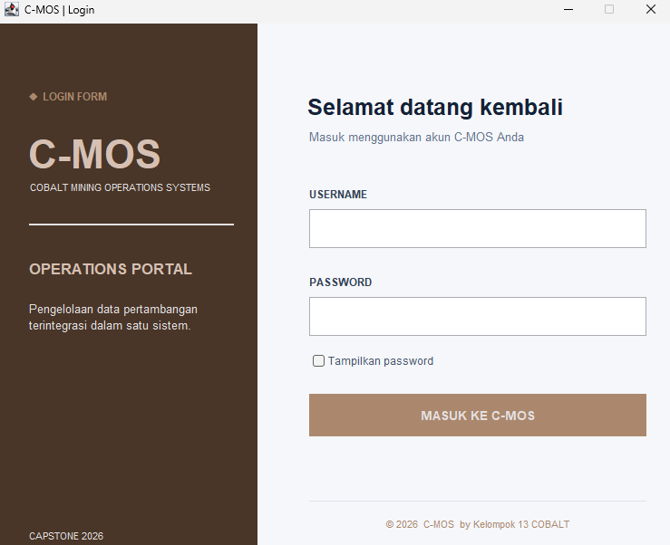

**Arahan screenshot:** Ambil screenshot form login tanpa menampilkan password asli. **Yang harus terlihat:** Kolom username, password, tombol masuk, dan opsi tampilkan password.

#### Percabangan hak akses setelah login

Setelah autentikasi berhasil, `view.MainFrameRouter` membuka salah satu dari `MainFrameAdmin`, `MainFrameOperasional`, `MainFrameHSE`, atau `MainFrameManager` sesuai subtype Pegawai. Driver tidak mempunyai jalur login.

> **Gambar 25. Percabangan hak akses setelah login**


**Arahan screenshot:** Buat bagan sederhana percabangan login dan empat peran, atau screenshot empat halaman utama secara terpisah. **Yang harus terlihat:** Login → pemeriksaan akun → Admin/Operasional/HSE/Manager.

**Alur ringkas:** `Main` → `LoadingFrame` → `LandingFrame` → `LoginFrame` → `AuthController` → `AuthService` → `MainFrameRouter` → halaman utama sesuai peran. Untuk setiap peran, logout mengakhiri sesi dan mengembalikan pengguna ke alur autentikasi aplikasi.

### 8.2 Alur A. Administrator

**Tujuan:** menjaga konsistensi data master dan akun. **Menu nyata pada `MainFrameAdmin`:** Dashboard, Data Pegawai, Akun Pengguna, Lokasi Tambang, Jenis Material, Kendaraan, Parameter Lingkungan, Ubah Akun, Keluar Akun. Admin tidak menjalankan produksi, perjalanan, atau pengukuran HSE.

#### Login sebagai Admin

Masuk dengan akun milik subtype Admin. Sistem membuka `view.MainFrameAdmin`. Perhatikan identitas pengguna dan menu yang berbeda dari peran lain.

> **Gambar 26. Login sebagai Admin**


**Arahan screenshot:** Login memakai akun Admin uji. **Yang harus terlihat:** Nama pengguna, peran Admin, sidebar dan judul halaman.

#### Dashboard Administrator

`DashboardAdminPanel` memuat ringkasan pegawai, akun dan perhatian administrasi serta data master. Angka diambil dari service/database. Tombol Kelola Akun atau Periksa Akun mengarahkan Admin ke pengelolaan akun.

> **Gambar 27. Dashboard Administrator**

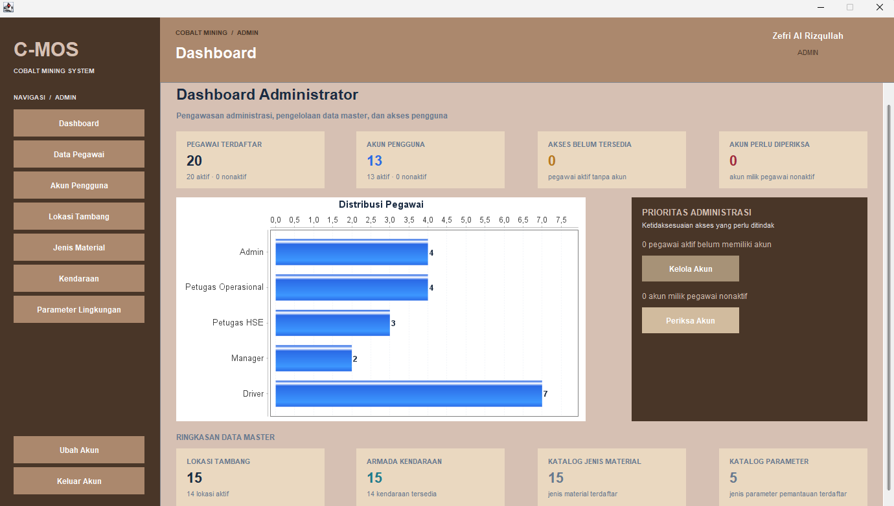

**Arahan screenshot:** Buka Dashboard. **Yang harus terlihat:** Kartu KPI, panel perhatian, distribusi pegawai, dan ringkasan data master.

#### Daftar Data Pegawai

Buka Data Pegawai. `PegawaiPanel` menampilkan data seluruh subtype Pegawai, fitur pencarian/filter, serta aksi tambah, ubah dan hapus. Nomor urut pada tabel adalah nomor tampilan, bukan ID database.

> **Gambar 28. Daftar Data Pegawai**

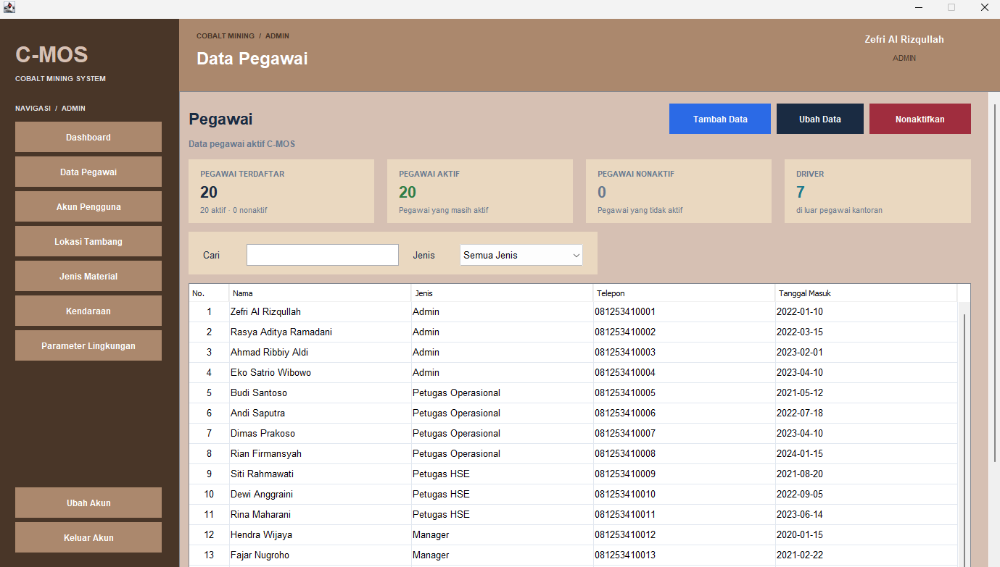

**Arahan screenshot:** Buka Data Pegawai dan tampilkan beberapa baris. **Yang harus terlihat:** Judul, kolom nomor, filter, pencarian dan tombol CRUD.

#### Form tambah Pegawai dan pilihan subtype

Tekan Tambah Data. Pada `PegawaiFormFrame`, pilih jenis pegawai: Admin, Petugas Operasional, Petugas HSE, Manager, atau Driver. Pilihan ini mengatur atribut khusus. Jangan menampilkan field SIM ketika jenis pegawai belum dipilih.

> **Gambar 29. Form tambah Pegawai dan pilihan subtype**

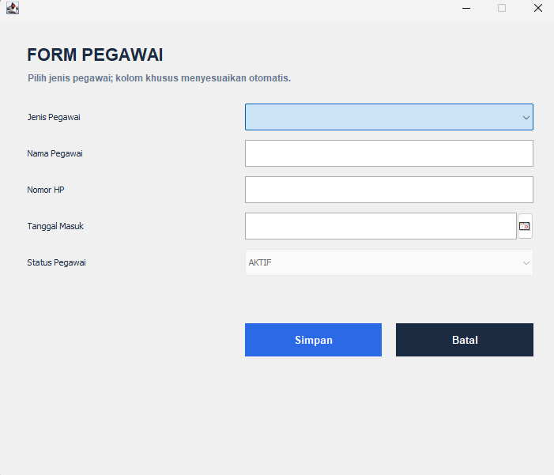

**Arahan screenshot:** Buka form tanpa memilih subtype lalu pilih salah satu subtype. **Yang harus terlihat:** Form awal dan combo jenis pegawai.

#### Form Pegawai jenis Admin

Pilih subtype **Admin** pada combo jenis pegawai. Isian khusus kode admin dan tanggal mulai akses. Simpan hanya setelah atribut umum dan khusus valid.

> **Gambar 30. Form Pegawai jenis Admin**

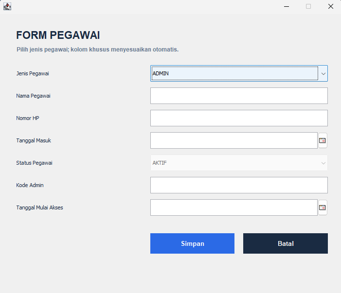

**Arahan screenshot:** Pilih Admin di form Pegawai. **Yang harus terlihat:** Field khusus yang muncul sesuai subtype, tanpa field subtype lain.

#### Form Pegawai jenis Petugas Operasional

Pilih subtype **Petugas Operasional** pada combo jenis pegawai. Isian khusus shift kerja. Simpan hanya setelah atribut umum dan khusus valid.

> **Gambar 31. Form Pegawai jenis Petugas Operasional**

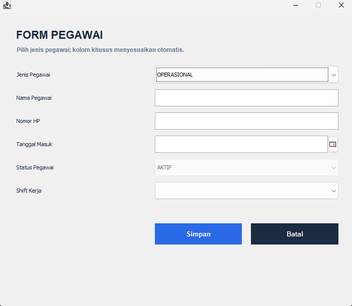

**Arahan screenshot:** Pilih Petugas Operasional di form Pegawai. **Yang harus terlihat:** Field khusus yang muncul sesuai subtype, tanpa field subtype lain.

#### Form Pegawai jenis Petugas HSE

Pilih subtype **Petugas HSE** pada combo jenis pegawai. Isian nomor sertifikasi dan masa berlaku sertifikasi. Simpan hanya setelah atribut umum dan khusus valid.

> **Gambar 32. Form Pegawai jenis Petugas HSE**

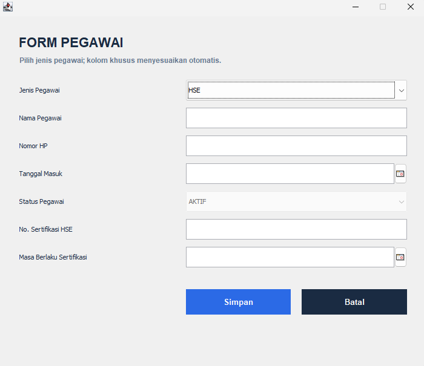

**Arahan screenshot:** Pilih Petugas HSE di form Pegawai. **Yang harus terlihat:** Field khusus yang muncul sesuai subtype, tanpa field subtype lain.

#### Form Pegawai jenis Manager

Pilih subtype **Manager** pada combo jenis pegawai. Isian divisi tanggung jawab. Simpan hanya setelah atribut umum dan khusus valid.

> **Gambar 33. Form Pegawai jenis Manager**

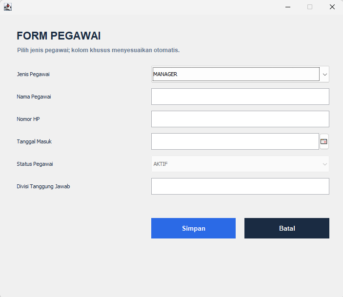

**Arahan screenshot:** Pilih Manager di form Pegawai. **Yang harus terlihat:** Field khusus yang muncul sesuai subtype, tanpa field subtype lain.

#### Form Pegawai jenis Driver

Pilih subtype **Driver** pada combo jenis pegawai. Isian nomor SIM, masa berlaku SIM, dan status driver. Driver tidak dibuatkan akun login. Simpan hanya setelah atribut umum dan khusus valid.

> **Gambar 34. Form Pegawai jenis Driver**

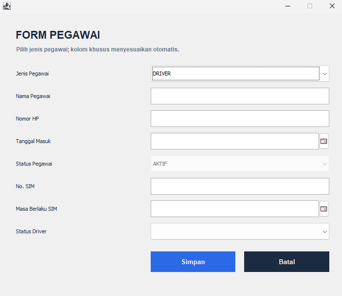

**Arahan screenshot:** Pilih Driver di form Pegawai. **Yang harus terlihat:** Field khusus yang muncul sesuai subtype, tanpa field subtype lain.

#### Simpan, ubah, batal, dan validasi Pegawai

Simpan data pegawai yang valid lalu periksa baris baru. Pilih data dan tekan Ubah untuk memperbarui atribut yang diizinkan. Coba Batal untuk menutup form tanpa menyimpan. Uji validasi field wajib dan format tanggal/SIM.

> **Gambar 35. Simpan, ubah, batal, dan validasi Pegawai**

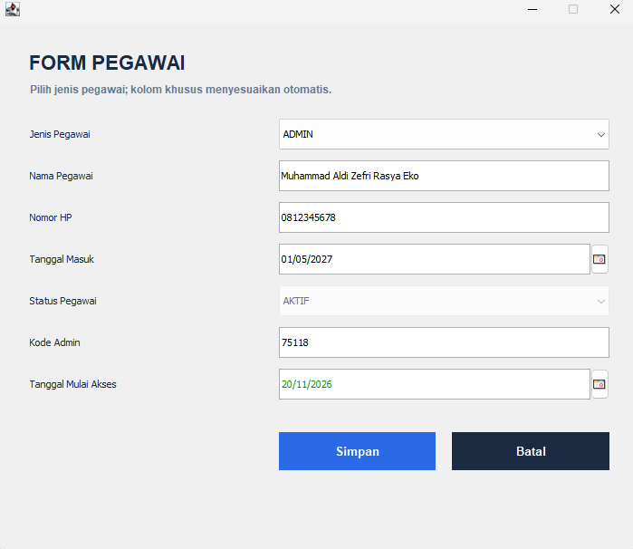

**Arahan screenshot:** Dokumentasikan empat kondisi secara terpisah jika memungkinkan. **Yang harus terlihat:** Data tersimpan, form edit, tombol Batal, dan contoh pesan validasi.

#### Daftar Akun Pengguna

Buka Akun Pengguna. `UserPanel` menampilkan akun terhubung dengan Pegawai. Pegawai subtype Driver tidak seharusnya memperoleh akun login.

> **Gambar 36. Daftar Akun Pengguna**

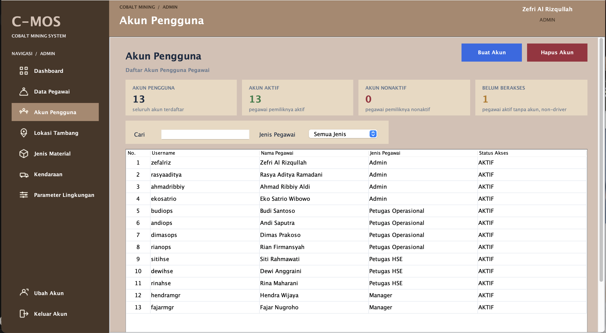

**Arahan screenshot:** Buka menu Akun Pengguna. **Yang harus terlihat:** Tabel akun, filter/status, dan tombol pengelolaan.

#### Tambah akun dan menghubungkan Pegawai

Buka `UserFormFrame`. Pilih pegawai yang berhak login, isi username serta kredensial sesuai form, lalu simpan. Periksa hasil pada tabel. Data password harus diproses melalui `PasswordUtil`, bukan disimpan sebagai teks biasa.

> **Gambar 37. Tambah akun dan menghubungkan Pegawai**


**Arahan screenshot:** Ambil screenshot combo pegawai dan form sebelum menyimpan, tutup informasi rahasia. **Yang harus terlihat:** Pilihan pegawai, username, status akun, dan tombol Simpan/Batal.

#### Ubah akun dan pemeriksaan akses

Pilih akun lalu lakukan pembaruan yang diizinkan. Periksa status aktif/nonaktif dan hubungan dengan pegawai. Jika dashboard menunjukkan akun perlu diperiksa, buka halaman ini untuk meninjau data terkait.

> **Gambar 38. Ubah akun dan pemeriksaan akses**


**Arahan screenshot:** Pilih baris akun uji dan buka Ubah. **Yang harus terlihat:** Data akun terpilih dan opsi pengelolaan.

#### Daftar Lokasi Tambang

Buka menu Lokasi Tambang. Halaman tabel menampilkan daftar data master dan fasilitas pencarian/filter. Data ini menjadi pilihan pada form operasional atau HSE sesuai fungsinya.

> **Gambar 39. Daftar Lokasi Tambang**

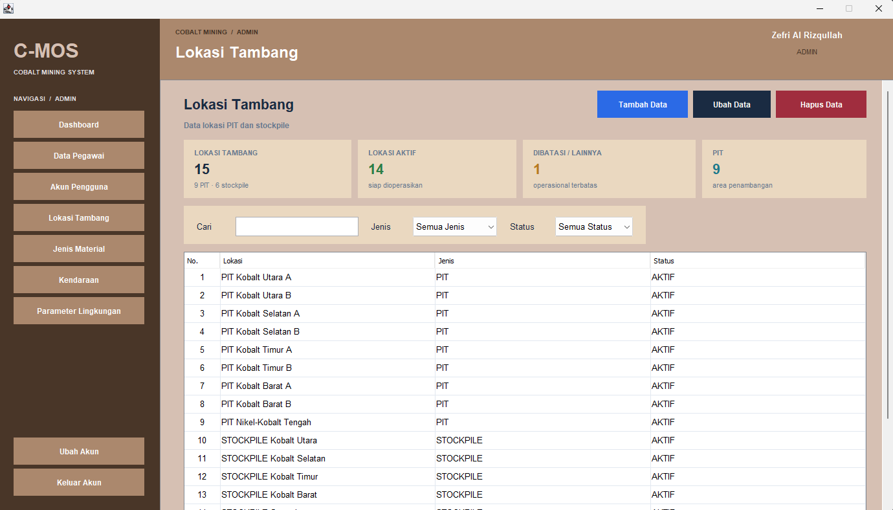

**Arahan screenshot:** Buka menu Lokasi Tambang. **Yang harus terlihat:** Judul, tabel, nomor urut, tombol tambah/ubah/hapus, dan filter.

#### Tambah dan ubah Lokasi Tambang

Buka `view/LokasiFormFrame.java` melalui tombol Tambah atau Ubah. Isi nama lokasi, jenis lokasi PIT/STOCKPILE, status operasional dan keterangan. Simpan data valid, lalu periksa perubahan pada tabel. Uji tombol Batal agar tidak terjadi penyimpanan.

> **Gambar 40. Tambah dan ubah Lokasi Tambang**

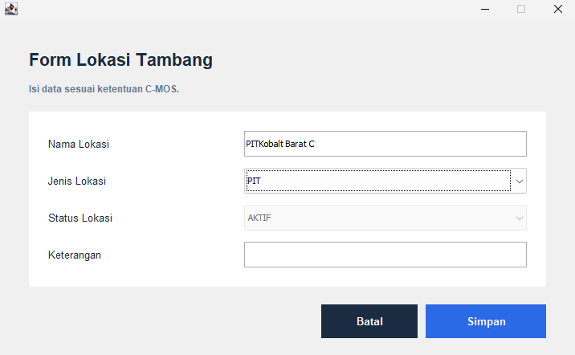

**Arahan screenshot:** Buka form tambah dan edit Lokasi Tambang. **Yang harus terlihat:** Field lengkap, pilihan combo, tombol Simpan/Batal, dan hasil pada tabel.

#### Daftar Jenis Material

Buka menu Jenis Material. Halaman tabel menampilkan daftar data master dan fasilitas pencarian/filter. Data ini menjadi pilihan pada form operasional atau HSE sesuai fungsinya.

> **Gambar 41. Daftar Jenis Material**

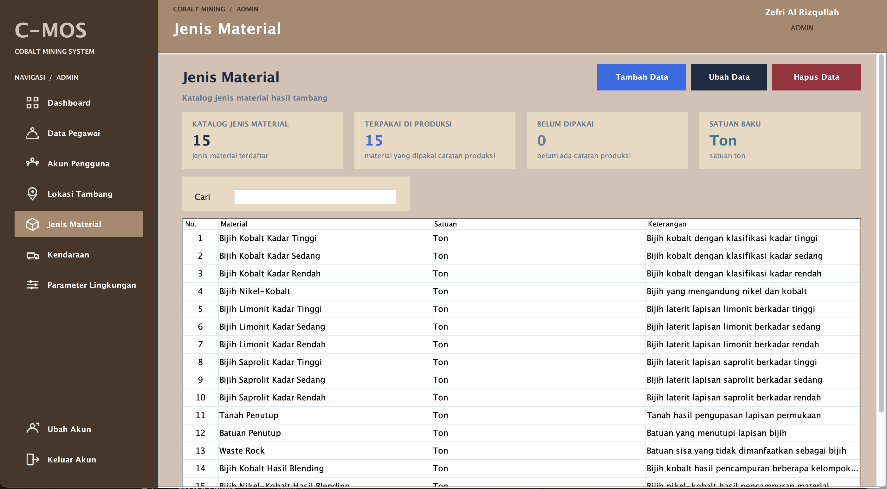

**Arahan screenshot:** Buka menu Jenis Material. **Yang harus terlihat:** Judul, tabel, nomor urut, tombol tambah/ubah/hapus, dan filter.

#### Tambah dan ubah Jenis Material

Buka `view/MaterialFormFrame.java` melalui tombol Tambah atau Ubah. Isi nama material, satuan, deskripsi. Simpan data valid, lalu periksa perubahan pada tabel. Uji tombol Batal agar tidak terjadi penyimpanan.

> **Gambar 42. Tambah dan ubah Jenis Material**

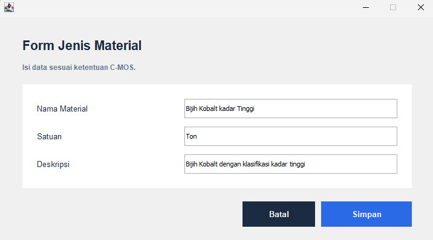

**Arahan screenshot:** Buka form tambah dan edit Jenis Material. **Yang harus terlihat:** Field lengkap, pilihan combo, tombol Simpan/Batal, dan hasil pada tabel.

#### Daftar Kendaraan

Buka menu Kendaraan. Halaman tabel menampilkan daftar data master dan fasilitas pencarian/filter. Data ini menjadi pilihan pada form operasional atau HSE sesuai fungsinya.

> **Gambar 43. Daftar Kendaraan**

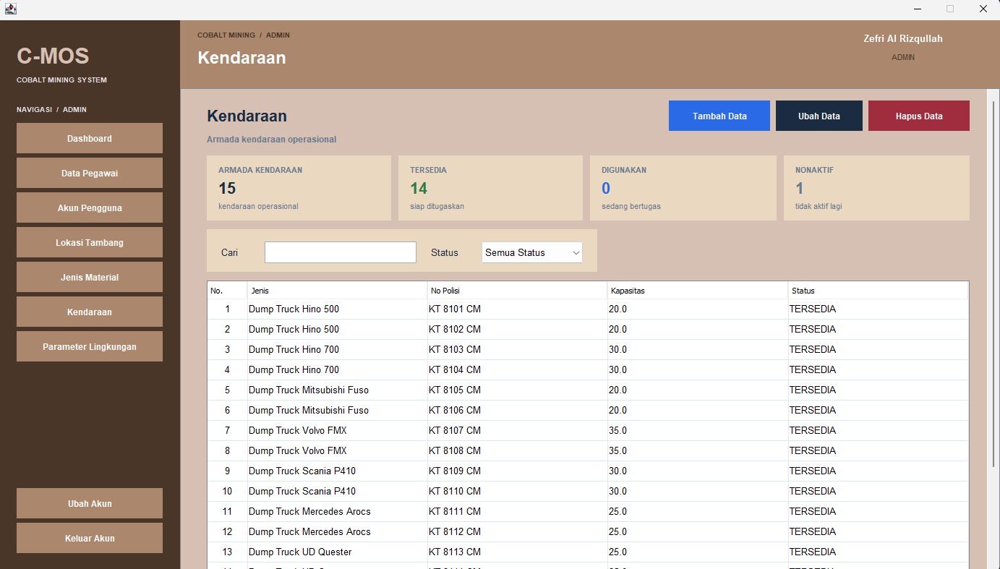

**Arahan screenshot:** Buka menu Kendaraan. **Yang harus terlihat:** Judul, tabel, nomor urut, tombol tambah/ubah/hapus, dan filter.

#### Tambah dan ubah Kendaraan

Buka `view/KendaraanFormFrame.java` melalui tombol Tambah atau Ubah. Isi jenis kendaraan, nomor polisi, kapasitas, tahun kendaraan, status kendaraan. Simpan data valid, lalu periksa perubahan pada tabel. Uji tombol Batal agar tidak terjadi penyimpanan.

> **Gambar 44. Tambah dan ubah Kendaraan**

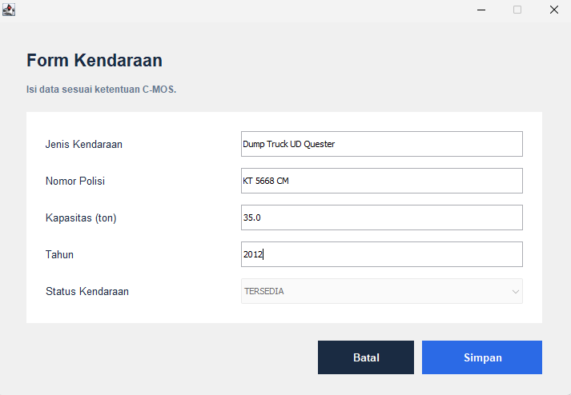

**Arahan screenshot:** Buka form tambah dan edit Kendaraan. **Yang harus terlihat:** Field lengkap, pilihan combo, tombol Simpan/Batal, dan hasil pada tabel.

#### Daftar Parameter Lingkungan

Buka menu Parameter Lingkungan. Halaman tabel menampilkan daftar data master dan fasilitas pencarian/filter. Data ini menjadi pilihan pada form operasional atau HSE sesuai fungsinya.

> **Gambar 45. Daftar Parameter Lingkungan**

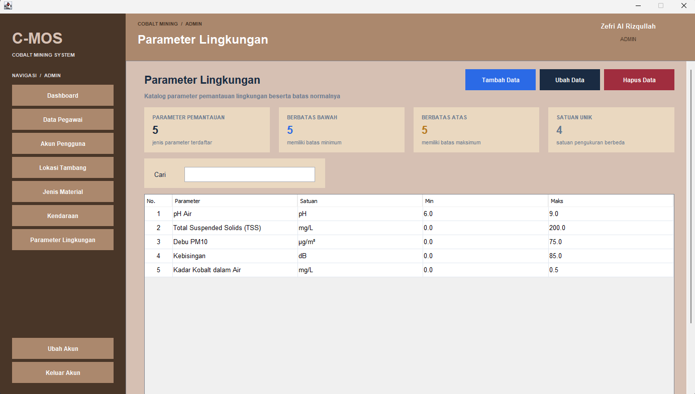

**Arahan screenshot:** Buka menu Parameter Lingkungan. **Yang harus terlihat:** Judul, tabel, nomor urut, tombol tambah/ubah/hapus, dan filter.

#### Tambah dan ubah Parameter Lingkungan

Buka `view/ParameterFormFrame.java` melalui tombol Tambah atau Ubah. Isi nama parameter, satuan, batas minimum/maksimum, keterangan. Simpan data valid, lalu periksa perubahan pada tabel. Uji tombol Batal agar tidak terjadi penyimpanan.

> **Gambar 46. Tambah dan ubah Parameter Lingkungan**

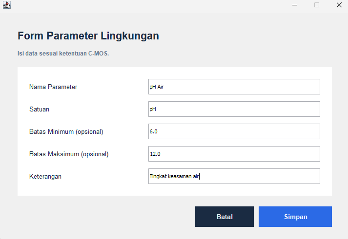

**Arahan screenshot:** Buka form tambah dan edit Parameter Lingkungan. **Yang harus terlihat:** Field lengkap, pilihan combo, tombol Simpan/Batal, dan hasil pada tabel.

#### Ubah Akun Admin

Gunakan menu Ubah Akun yang membuka `UbahAkunFrame`. Ikuti validasi yang tersedia untuk mengubah kredensial akun yang sedang login.

> **Gambar 47. Ubah Akun Admin**

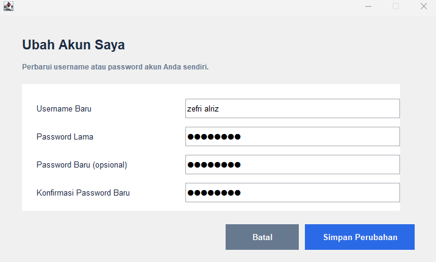

**Arahan screenshot:** Buka menu Ubah Akun. **Yang harus terlihat:** Form pengubahan akun tanpa menampilkan password.

#### Logout Admin

Tekan Keluar Akun. Pastikan sesi Admin berakhir sebelum login menggunakan peran lain.

> **Gambar 48. Logout Admin**

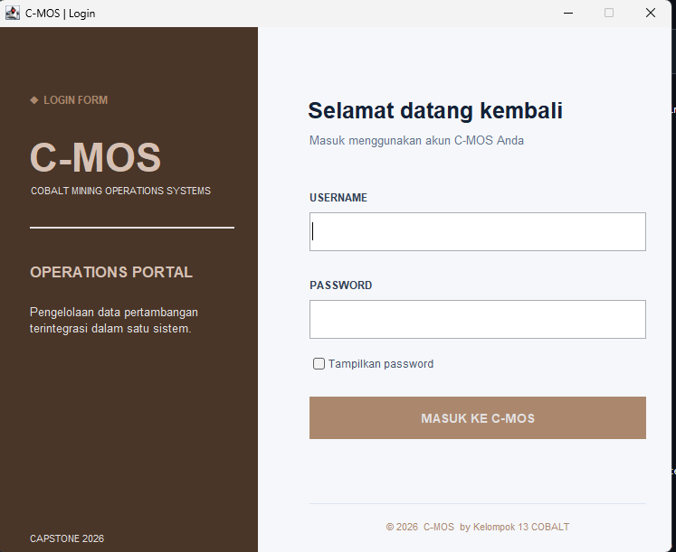

**Arahan screenshot:** Ambil gambar saat logout atau saat kembali ke login. **Yang harus terlihat:** Tombol Keluar Akun dan halaman autentikasi.

### 8.3 Alur B. Petugas Operasional

**Tujuan:** mencatat produksi, memantau stok, dan mengelola siklus pengangkutan. **Menu nyata pada `MainFrameOperasional`:** Dashboard, Produksi Tambang, Pengangkutan, Ubah Akun, Keluar Akun. Informasi kendaraan dan driver tersedia di halaman Pengangkutan, bukan sebagai fokus dashboard produksi.

#### Login Petugas Operasional

Login dengan akun Petugas Operasional. `MainFrameRouter` membuka `MainFrameOperasional`.

> **Gambar 49. Login Petugas Operasional**


**Arahan screenshot:** Masuk sebagai Petugas Operasional. **Yang harus terlihat:** Sidebar Operasional dan identitas pengguna.

#### Dashboard produksi dan filter periode

`DashboardOperasionalPanel` berfokus pada Total Produksi, Stok Saat Ini, Produksi Tercatat, dan Lokasi Berproduksi. Pilih Hari Ini, 7 Hari Terakhir, Bulan Ini, Tahun Ini, Semua Periode atau Rentang Kustom, lalu tekan Terapkan. Stok Saat Ini merupakan saldo terkini dan tidak mengikuti filter produksi.

> **Gambar 50. Dashboard produksi dan filter periode**

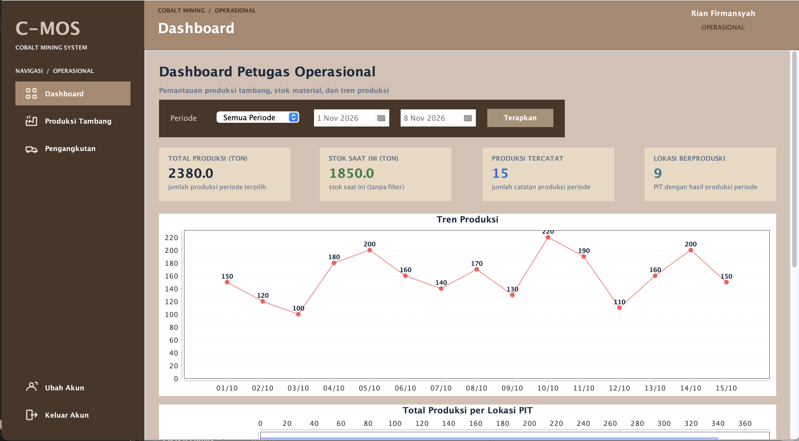

**Arahan screenshot:** Buka Dashboard dan ubah filter periode. **Yang harus terlihat:** Combo periode, input tanggal khusus, empat KPI dan tombol Terapkan.

#### Grafik produksi per lokasi dan tren

Dashboard menampilkan visualisasi produksi per lokasi dan tren produksi, serta tabel Produksi Terbaru. Nama lokasi, nilai tonase dan periode harus dapat dibaca.

> **Gambar 51. Grafik produksi per lokasi dan tren**

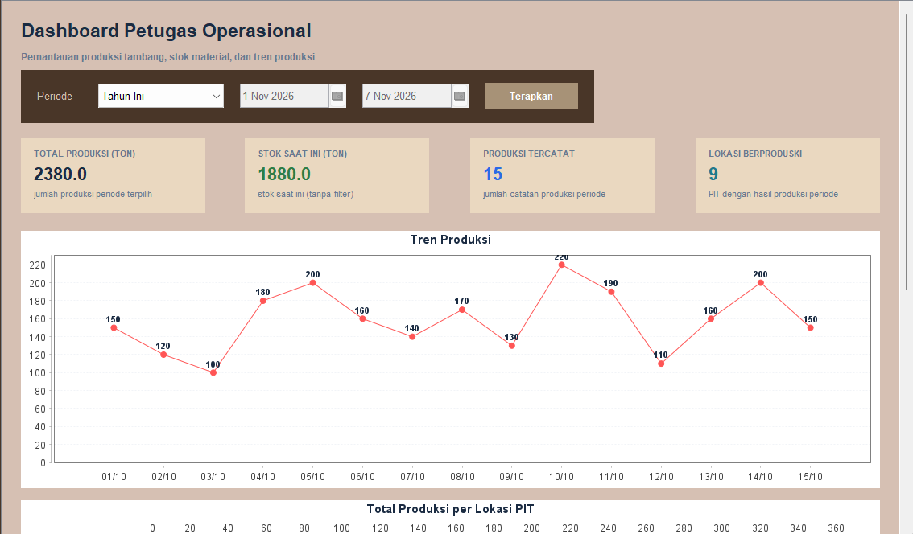

**Arahan screenshot:** Ambil bagian tengah dan bawah Dashboard. **Yang harus terlihat:** Grafik produksi, grafik tren, dan daftar produksi terbaru.

#### Halaman Produksi Tambang

Buka Produksi Tambang. `ProduksiPanel` menampilkan ringkasan catatan, total produksi, stok tersedia dan lokasi berproduksi, disertai tabel, pencarian/filter, dan tombol Tambah, Ubah, Hapus.

> **Gambar 52. Halaman Produksi Tambang**

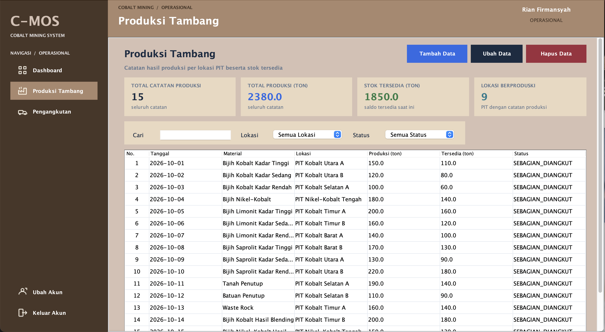

**Arahan screenshot:** Buka menu Produksi Tambang. **Yang harus terlihat:** KPI halaman produksi, filter dan tabel.

#### Tambah catatan produksi

Klik Tambah Data untuk membuka `ProduksiFormFrame`. Pilih lokasi PIT dan jenis material yang tersedia, isi tanggal, jumlah produksi dan catatan sesuai form. Pilihan lokasi/material harus terbaca oleh Petugas Operasional tanpa pesan “Hanya Admin”.

> **Gambar 53. Tambah catatan produksi**

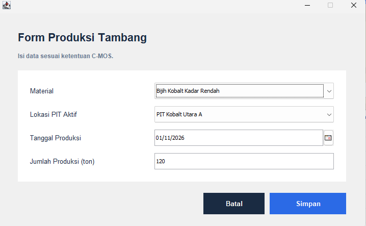

**Arahan screenshot:** Buka form Tambah Produksi. **Yang harus terlihat:** Combo lokasi, combo material, tanggal, tonase, tombol Simpan/Batal.

#### Validasi produksi dan simpan

Uji jumlah produksi tidak valid, data kosong, atau pilihan lokasi yang tidak sesuai. Setelah valid, simpan dan periksa total produksi serta stok pada tabel/dashboard.

> **Gambar 54. Validasi produksi dan simpan**


**Arahan screenshot:** Ambil pesan validasi dan kemudian hasil simpan. **Yang harus terlihat:** Validasi dan baris produksi baru.

#### Ubah, hapus, cari, dan filter produksi

Pilih catatan lalu tekan Ubah atau Hapus sesuai aturan bisnis. Perhatikan keterkaitan produksi yang telah dipakai pengangkutan. Gunakan pencarian/filter untuk menemukan catatan tertentu.

> **Gambar 55. Ubah, hapus, cari, dan filter produksi**

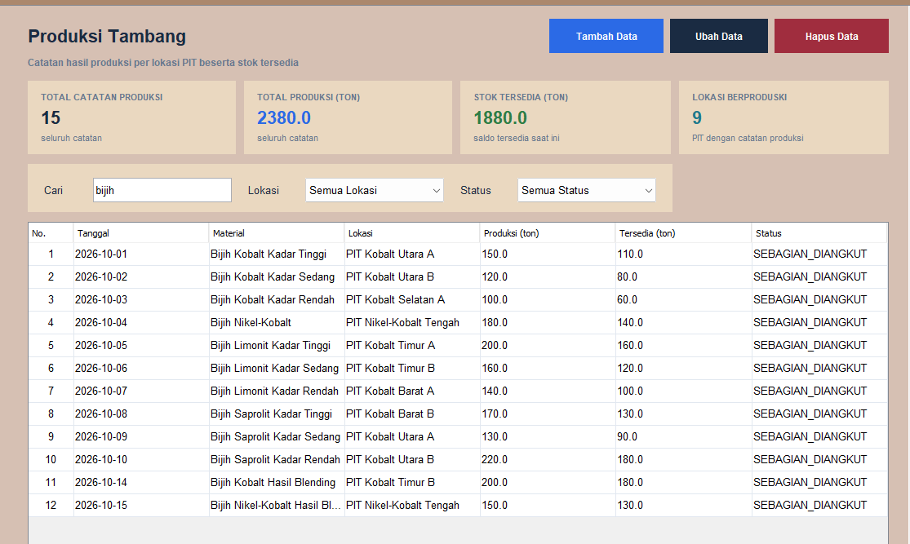

**Arahan screenshot:** Buka form ubah, konfirmasi hapus, dan hasil filter. **Yang harus terlihat:** Tombol operasi dan perubahan tabel.

#### Halaman Pengangkutan dan KPI kesiapan

Buka Pengangkutan. `PengangkutanPanel` menampilkan total pengangkutan, Dijadwalkan, Dalam Perjalanan, Selesai, Kendaraan Tersedia, dan Driver Tersedia. Di sini juga tersedia pencarian, filter status, tabel, dan panel Detail Pengangkutan.

> **Gambar 56. Halaman Pengangkutan dan KPI kesiapan**

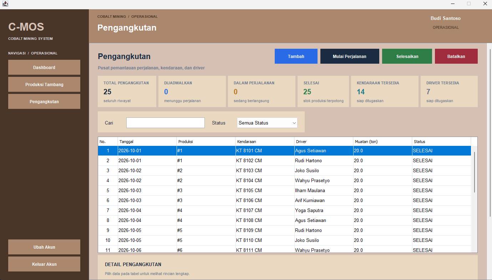

**Arahan screenshot:** Buka menu Pengangkutan. **Yang harus terlihat:** Enam KPI, filter status, daftar perjalanan dan detail.

#### Membuat jadwal pengangkutan

Tekan Tambah untuk membuka `PengangkutanFormFrame`. Pilih produksi tersedia, kendaraan tersedia, driver tersedia, lokasi tujuan, tanggal dan jumlah muatan. Lokasi asal ditentukan otomatis dari sumber produksi.

> **Gambar 57. Membuat jadwal pengangkutan**

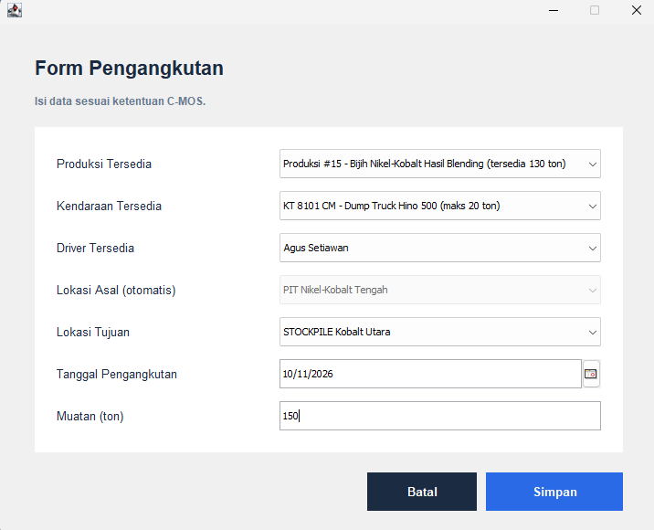

**Arahan screenshot:** Buka form Pengangkutan. **Yang harus terlihat:** Combo produksi/kendaraan/driver, asal otomatis, tujuan, tanggal, muatan.

#### Memeriksa kapasitas dan stok sebelum penjadwalan

Pastikan jumlah muatan tidak melebihi kapasitas kendaraan maupun material produksi yang masih dapat dialokasikan. Pengangkutan harus memiliki sumber produksi, kendaraan, driver dan tujuan yang valid. Uji muatan berlebih sebagai bukti validasi.

> **Gambar 58. Memeriksa kapasitas dan stok sebelum penjadwalan**


**Arahan screenshot:** Isi muatan melebihi kapasitas pada data uji. **Yang harus terlihat:** Pesan validasi yang muncul tanpa menyimpan data salah.

#### Jadwal tersimpan dan status Dijadwalkan

Simpan pengangkutan valid. Periksa status DIJADWALKAN di tabel, data detail, dan ringkasan. Pada tahap ini perjalanan belum dimulai.

> **Gambar 59. Jadwal tersimpan dan status Dijadwalkan**


**Arahan screenshot:** Simpan jadwal uji. **Yang harus terlihat:** Baris status DIJADWALKAN dan panel detail.

#### Memulai perjalanan

Pilih jadwal lalu tekan Mulai Perjalanan. Sistem menjalankan `PengangkutanService.mulaiPengangkutan`, mengubah status menjadi DALAM_PERJALANAN serta menandai kendaraan dan driver sedang bertugas sesuai aturan sistem.

> **Gambar 60. Memulai perjalanan**


**Arahan screenshot:** Pilih jadwal dan tekan Mulai Perjalanan. **Yang harus terlihat:** Status DALAM_PERJALANAN dan perubahan informasi kesiapan.

#### Menyelesaikan pengangkutan

Pilih perjalanan aktif lalu tekan Selesaikan. `PengangkutanService.selesaikanPengangkutan` menyelesaikan perjalanan dan memperbarui stok produksi. Periksa waktu selesai, status SELESAI, dan sisa stok produksi pada panel detail.

> **Gambar 61. Menyelesaikan pengangkutan**


**Arahan screenshot:** Selesaikan satu perjalanan uji. **Yang harus terlihat:** Status SELESAI, waktu selesai, dan stok setelah pengangkutan.

#### Membatalkan pengangkutan

Untuk pengangkutan yang dapat dibatalkan, pilih data dan tekan Batalkan. Konfirmasi tindakan. Pengangkutan yang dibatalkan tidak mengurangi stok produksi. Periksa status DIBATALKAN.

> **Gambar 62. Membatalkan pengangkutan**


**Arahan screenshot:** Batalkan jadwal uji yang diizinkan. **Yang harus terlihat:** Dialog konfirmasi dan status DIBATALKAN.

#### Filter dan detail Pengangkutan

Gunakan filter Semua Status, DIJADWALKAN, DALAM_PERJALANAN, SELESAI atau DIBATALKAN. Klik baris untuk melihat sumber produksi, material, asal, tujuan, muatan, kendaraan, plat, driver, petugas, waktu dan sisa stok.

> **Gambar 63. Filter dan detail Pengangkutan**

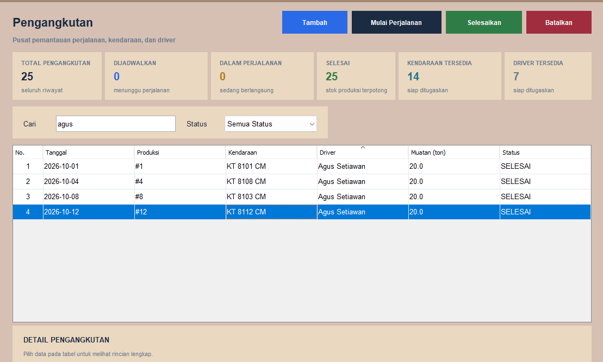

**Arahan screenshot:** Pilih beberapa status dan klik satu baris. **Yang harus terlihat:** Hasil filter dan panel Detail Pengangkutan lengkap.

#### Ubah Akun dan Logout Operasional

Gunakan Ubah Akun jika perlu memperbarui kredensial. Tekan Keluar Akun untuk mengakhiri sesi.

> **Gambar 64. Ubah Akun dan Logout Operasional**


**Arahan screenshot:** Buka Ubah Akun lalu logout. **Yang harus terlihat:** Form akun dan halaman setelah logout.

### 8.4 Alur C. Petugas HSE

**Tujuan:** mengajukan dan melaksanakan monitoring lingkungan, mengukur parameter, mencatat hasil serta penanganan. **Menu nyata pada `MainFrameHSE`:** Dashboard, Kondisi Lokasi, Riwayat Monitoring, Ubah Akun, Keluar Akun. **Catatan penting:** source terbaru memuat persetujuan Manager sebelum monitoring tertentu dapat dimulai. Status hasil mencakup NORMAL, PERINGATAN, dan BERBAHAYA.

#### Login Petugas HSE

Login menggunakan akun Petugas HSE untuk membuka `MainFrameHSE`.

> **Gambar 65. Login Petugas HSE**

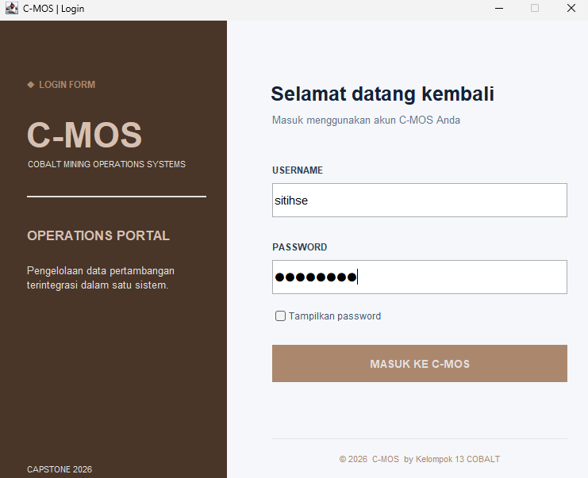

**Arahan screenshot:** Masuk dengan akun HSE. **Yang harus terlihat:** Sidebar HSE, identitas dan menu.

#### Dashboard HSE dan filter periode

`DashboardHSEPanel` menampilkan Total Monitoring, Hasil Normal, Monitoring Peringatan dan Penanganan Belum Selesai. Filter periode mengubah data pemeriksaan, sedangkan penanganan terbuka tetap dipantau lintas periode.

> **Gambar 66. Dashboard HSE dan filter periode**

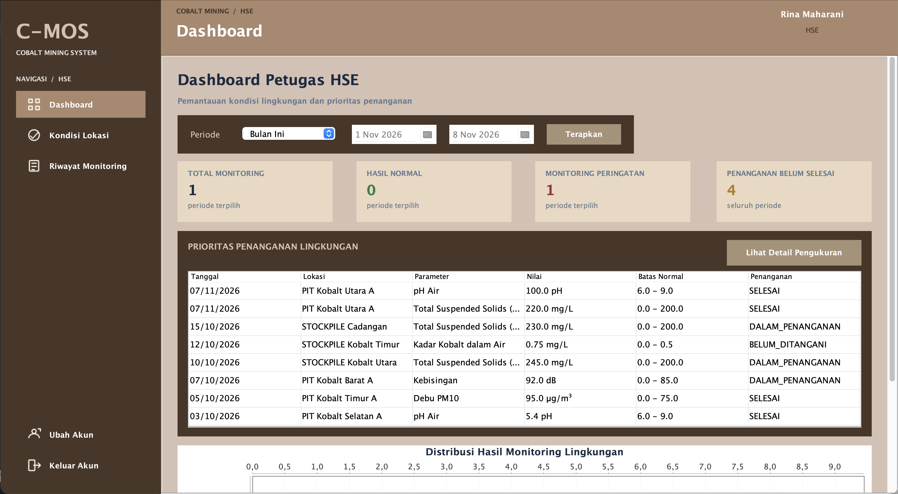

**Arahan screenshot:** Buka Dashboard HSE dan ubah periode. **Yang harus terlihat:** KPI, filter periode, tabel prioritas dan grafik.

#### Prioritas penanganan dan detail baca saja

Tabel prioritas menunjukkan monitoring yang membutuhkan perhatian. Tombol Lihat Detail Pengukuran membuka `MonitoringReadOnlyFrame` agar petugas dapat meninjau hasil tanpa mengubah data melalui tampilan ringkasan.

> **Gambar 67. Prioritas penanganan dan detail baca saja**

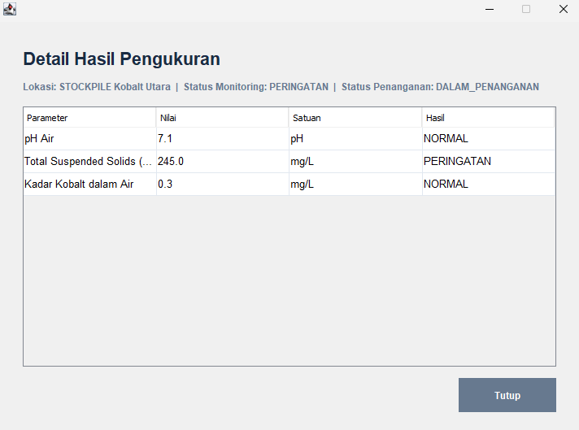

**Arahan screenshot:** Pilih satu baris prioritas. **Yang harus terlihat:** Lokasi/parameter bermasalah dan detail baca saja.

#### Kondisi Lokasi Tambang

Buka `KondisiLokasiPanel`. Halaman menampilkan kartu lokasi PIT/stockpile, ringkasan status terbaru, filter hasil (NORMAL, PERINGATAN, BERBAHAYA, Belum Ada Monitoring), dan panel detail lokasi.

> **Gambar 68. Kondisi Lokasi Tambang**

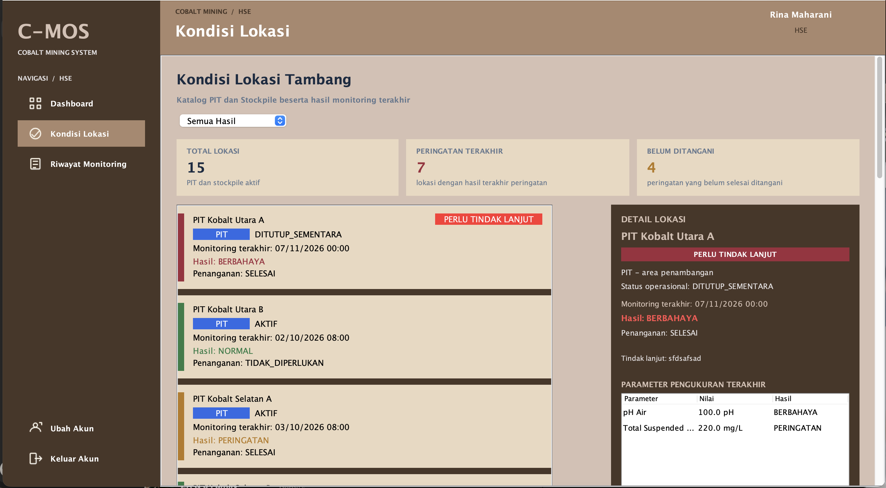

**Arahan screenshot:** Buka Kondisi Lokasi. **Yang harus terlihat:** Kartu lokasi, filter, KPI dan panel detail.

#### Memilih lokasi dan memeriksa pengukuran terakhir

Klik satu kartu lokasi. Panel detail menampilkan nama lokasi, jenis, status operasional, monitoring terakhir, hasil, status penanganan, tindak lanjut, serta tabel parameter pengukuran terakhir.

> **Gambar 69. Memilih lokasi dan memeriksa pengukuran terakhir**


**Arahan screenshot:** Pilih lokasi yang sudah pernah dimonitoring. **Yang harus terlihat:** Kartu aktif dan detail parameter lokasi.

#### Mengajukan monitoring ke Manager

Tekan Ajukan Monitoring Lokasi Ini pada lokasi yang belum memiliki persetujuan aktif. Sistem meminta alasan monitoring, kemudian mencatat permintaan dengan status MENUNGGU. Alasan harus memenuhi validasi service.

> **Gambar 70. Mengajukan monitoring ke Manager**

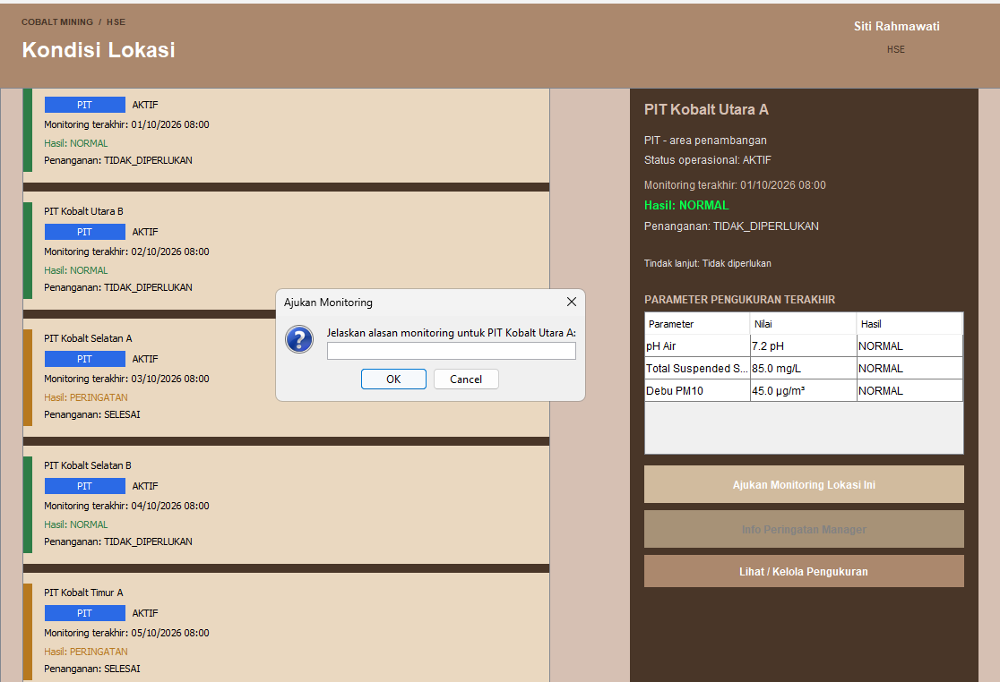

**Arahan screenshot:** Pilih lokasi, tekan ajukan dan isi alasan. **Yang harus terlihat:** Dialog alasan, notifikasi berhasil, dan status menunggu persetujuan.

#### Monitoring menunggu persetujuan

Selama status MENUNGGU, tombol menunjukkan Menunggu Persetujuan Manager dan monitoring tidak langsung dimulai. Proses dilanjutkan setelah Manager menyetujui permintaan.

> **Gambar 71. Monitoring menunggu persetujuan**


**Arahan screenshot:** Buka kembali lokasi yang telah diajukan. **Yang harus terlihat:** Label/tombol status MENUNGGU.

#### Memulai monitoring setelah disetujui

Setelah Manager menyetujui, tombol berubah menjadi Mulai Monitoring (Disetujui). Tekan tombol untuk membuka `MonitoringFormFrame`, pilih tanggal melalui komponen kalender, periksa lokasi dan isi catatan.

> **Gambar 72. Memulai monitoring setelah disetujui**


**Arahan screenshot:** Login kembali sebagai HSE setelah persetujuan, buka lokasi. **Yang harus terlihat:** Tombol mulai, form tanggal/lokasi/catatan.

#### Menyimpan kegiatan monitoring

Simpan form monitoring. Sistem membuat kegiatan yang dapat dilanjutkan dengan pengisian hasil pengukuran. Batal menutup form tanpa menyimpan.

> **Gambar 73. Menyimpan kegiatan monitoring**


**Arahan screenshot:** Tekan Simpan pada data uji valid. **Yang harus terlihat:** Pesan “Monitoring dimulai” dan data kegiatan.

#### Membuka Detail Monitoring

Tekan Lihat / Kelola Pengukuran pada lokasi terpilih untuk membuka `MonitoringDetailFrame` dalam mode pengelolaan HSE. Halaman ini memuat tabel hasil pengukuran serta tombol Tambah, Ubah, Hapus Pengukuran dan Selesai Penanganan sesuai status kegiatan.

> **Gambar 74. Membuka Detail Monitoring**

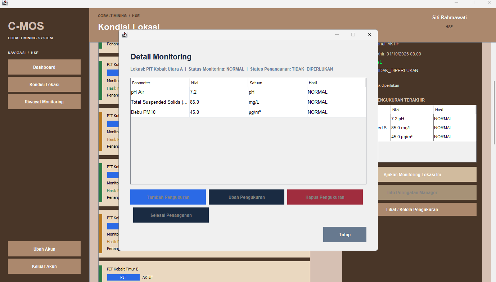

**Arahan screenshot:** Pilih lokasi dengan monitoring aktif dan buka detail. **Yang harus terlihat:** Judul, tabel parameter, tombol tindakan.

#### Menambah hasil pengukuran parameter

Tekan Tambah Pengukuran untuk membuka `DetailMonitoringFormFrame`. Pilih parameter dari data master, isi nilai pengukuran dan catatan. Sistem membandingkan nilai dengan batas minimum/maksimum yang dikonfigurasi.

> **Gambar 75. Menambah hasil pengukuran parameter**


**Arahan screenshot:** Buka form Tambah Pengukuran. **Yang harus terlihat:** Combo parameter, nilai, satuan/batas jika tampil, dan catatan.

#### Hasil Normal, Peringatan dan Berbahaya

Simpan hasil pengukuran valid lalu periksa status yang dihitung sistem. Bedakan NORMAL, PERINGATAN, dan BERBAHAYA sesuai logika pada source. Jangan menganggap penanganan selesai otomatis mengubah hasil pengukuran lama menjadi normal.

> **Gambar 76. Hasil Normal, Peringatan dan Berbahaya**


**Arahan screenshot:** Gunakan data uji parameter dalam batas dan di luar batas. **Yang harus terlihat:** Tabel hasil dengan status dan warna sesuai kondisi.

#### Mengubah atau menghapus detail pengukuran

Selama kegiatan mengizinkan perubahan, pilih detail lalu gunakan Ubah Pengukuran atau Hapus Pengukuran. Periksa validasi dan perhitungan ulang status.

> **Gambar 77. Mengubah atau menghapus detail pengukuran**


**Arahan screenshot:** Pilih detail uji dan tampilkan form ubah/konfirmasi hapus. **Yang harus terlihat:** Tombol pengelolaan dan hasil perubahan tabel.

#### Menginformasikan peringatan kepada Manager

Pada Kondisi Lokasi, tombol Info Peringatan Manager digunakan untuk memastikan hasil pengukuran bermasalah masuk daftar informasi Manager. Gunakan pada lokasi yang memenuhi kondisi peringatan.

> **Gambar 78. Menginformasikan peringatan kepada Manager**


**Arahan screenshot:** Pilih lokasi berstatus peringatan/berbahaya lalu tekan tombol informasi. **Yang harus terlihat:** Tombol Info Peringatan Manager dan notifikasi.

#### Menangani monitoring bermasalah

Ikuti alur penanganan melalui MonitoringDetailFrame dan service: status belum ditangani, dalam penanganan, hingga selesai. Catat tindak lanjut dan perbarui detail sesuai hak akses HSE.

> **Gambar 79. Menangani monitoring bermasalah**


**Arahan screenshot:** Buka detail monitoring bermasalah. **Yang harus terlihat:** Status penanganan dan data tindak lanjut.

#### Menyelesaikan penanganan

Tekan Selesai Penanganan ketika syarat pengukuran dan status kegiatan terpenuhi. Periksa perubahan status dan dashboard. Penyelesaian tindak lanjut bukan bukti bahwa pengukuran historis telah menjadi normal.

> **Gambar 80. Menyelesaikan penanganan**


**Arahan screenshot:** Selesaikan satu kasus uji. **Yang harus terlihat:** Tombol selesai, status penanganan baru dan perubahan KPI.

#### Riwayat Monitoring

Buka `MonitoringPanel` melalui Riwayat Monitoring. Halaman ini memuat seluruh catatan monitoring, filter/pencarian, KPI riwayat, tombol Lihat Pengukuran dan Hapus. Pembuatan monitoring baru berpusat di Kondisi Lokasi, bukan halaman riwayat.

> **Gambar 81. Riwayat Monitoring**

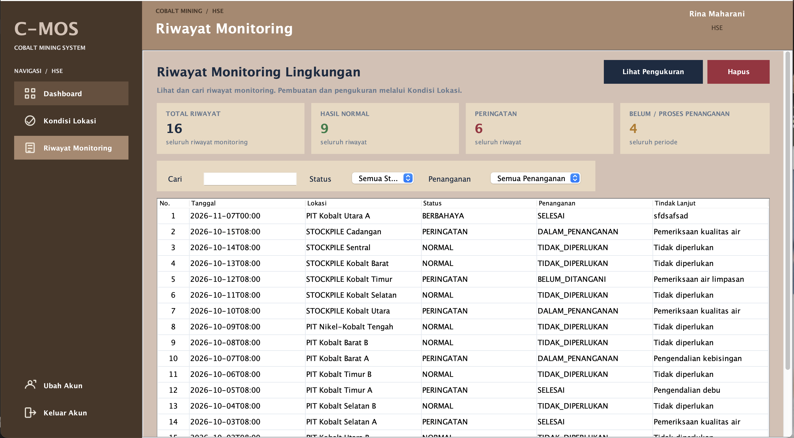

**Arahan screenshot:** Buka Riwayat Monitoring. **Yang harus terlihat:** KPI, tabel, pencarian, filter, tombol Lihat Pengukuran/Hapus.

#### Memeriksa dan menghapus riwayat

Pilih catatan, tekan Lihat Pengukuran untuk memeriksa rincian. Hapus hanya jika memenuhi aturan sistem dan sudah dikonfirmasi. Uji juga filter status dan pencarian.

> **Gambar 82. Memeriksa dan menghapus riwayat**

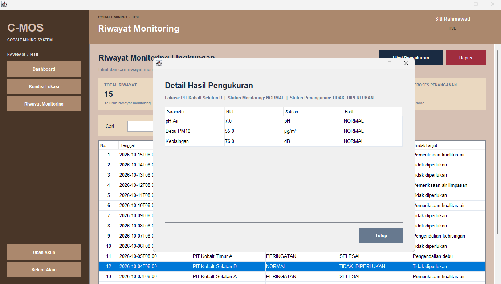

**Arahan screenshot:** Buka satu detail riwayat dan konfirmasi hapus data uji. **Yang harus terlihat:** Detail dan dialog konfirmasi.

#### Ubah Akun dan Logout HSE

Buka Ubah Akun bila perlu, lalu Keluar Akun untuk mengakhiri sesi HSE.

> **Gambar 83. Ubah Akun dan Logout HSE**


**Arahan screenshot:** Ambil gambar menu Ubah Akun dan logout. **Yang harus terlihat:** Perubahan halaman setelah keluar.

### 8.5 Alur D. Manager

**Tujuan:** melihat hasil produksi, stok, laporan monitoring, prioritas lingkungan, dan memberi persetujuan permintaan monitoring. **Menu nyata pada `MainFrameManager`:** Dashboard, Laporan Produksi, Laporan Monitoring, Ubah Akun, Keluar Akun. `LaporanPengangkutanPanel` ada pada source, tetapi **tidak tercantum sebagai menu tersendiri pada `MainFrameManager` versi ZIP ini**; jangan mendokumentasikannya seolah-olah menu tersebut pasti tampil. Manager dapat menyetujui permintaan monitoring, tetapi tidak menambah/mengubah detail pengukuran HSE.

#### Login Manager

Masuk dengan akun subtype Manager. Sistem membuka `MainFrameManager` dengan menu khusus Manager.

> **Gambar 84. Login Manager**

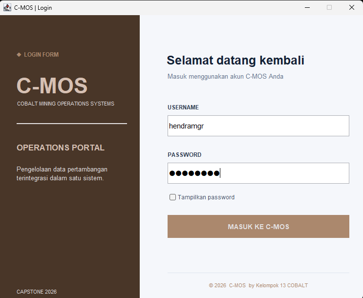

**Arahan screenshot:** Login sebagai Manager. **Yang harus terlihat:** Sidebar Manager dan identitas akun.

#### Dashboard Manager dan filter periode

`DashboardManagerPanel` memuat Produksi Periode, Stok Saat Ini, Peringatan Belum Selesai, dan Lokasi Peringatan. Pilih periode dan tekan Terapkan. Stok Saat Ini serta penanganan terbuka diberi cakupan waktu yang berbeda dari produksi periode.

> **Gambar 85. Dashboard Manager dan filter periode**

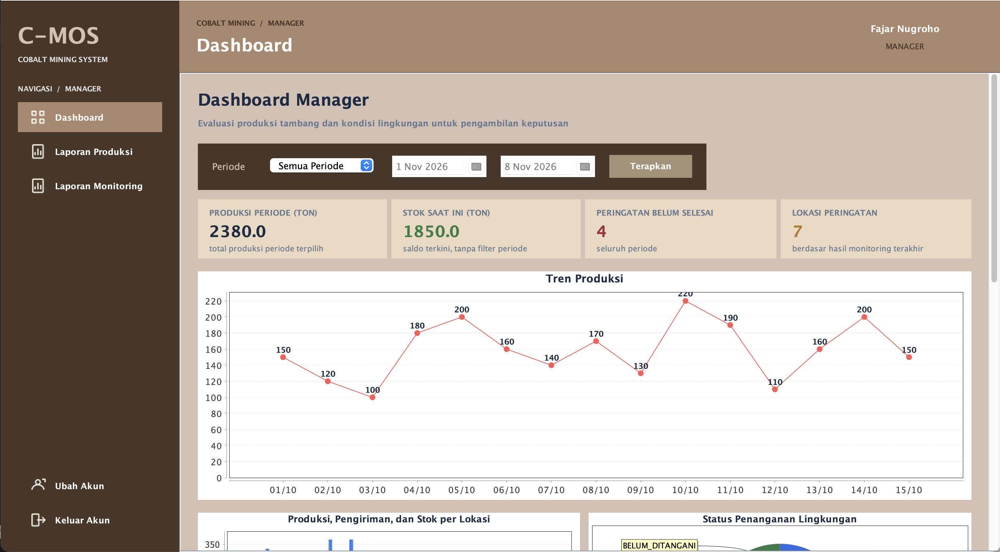

**Arahan screenshot:** Buka dashboard dan pilih filter periode. **Yang harus terlihat:** Filter, empat KPI dan label cakupan waktu.

#### Grafik dan evaluasi kondisi operasional

Periksa grafik produksi dan lingkungan yang tersedia serta ringkasan prioritas. Gunakan data tersebut untuk membandingkan hasil produksi dan kondisi lingkungan tanpa mengubah data operasional.

> **Gambar 86. Grafik dan evaluasi kondisi operasional**

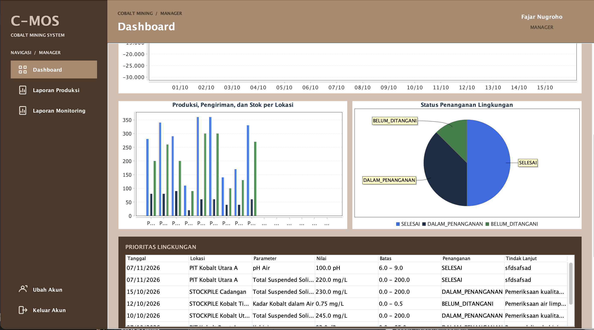

**Arahan screenshot:** Ambil bagian grafik dashboard Manager. **Yang harus terlihat:** Judul grafik, sumbu, nilai dan periode.

#### Prioritas lingkungan untuk keputusan

Tabel Prioritas Lingkungan menampilkan monitoring bermasalah. Pilih baris untuk membuka detail pengukuran dalam mode baca saja (`MonitoringDetailFrame` dengan `readOnly=true`).

> **Gambar 87. Prioritas lingkungan untuk keputusan**

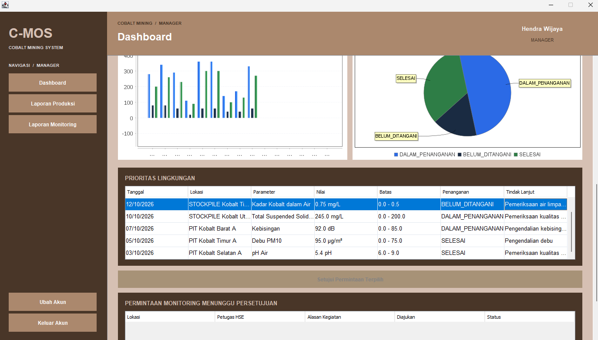

**Arahan screenshot:** Pilih baris pada Prioritas Lingkungan. **Yang harus terlihat:** Daftar prioritas dan detail tanpa tombol edit aktif.

#### Permintaan monitoring menunggu persetujuan

Dashboard Manager memiliki tabel Permintaan Monitoring Menunggu Persetujuan. Permintaan berasal dari HSE melalui Kondisi Lokasi. Periksa lokasi dan alasan sebelum menyetujui.

> **Gambar 88. Permintaan monitoring menunggu persetujuan**

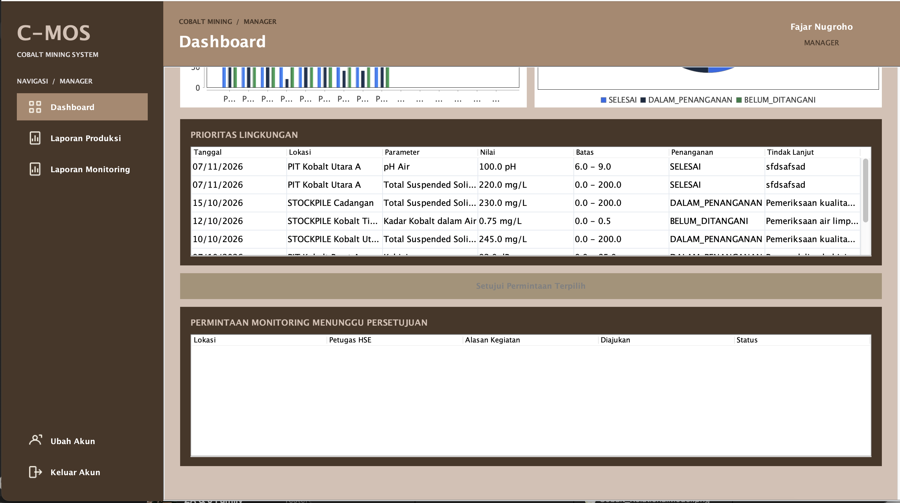

**Arahan screenshot:** Tampilkan tabel permintaan dari akun Manager. **Yang harus terlihat:** Permintaan, alasan/keterangan dan tombol Setujui Permintaan Terpilih.

#### Menyetujui permintaan monitoring HSE

Pilih satu permintaan, tekan Setujui Permintaan Terpilih, lalu konfirmasi. `MonitoringController.setujuiMonitoring` mengubah status permintaan sehingga HSE dapat memulai monitoring. Persetujuan ini bukan pengisian nilai parameter oleh Manager.

> **Gambar 89. Menyetujui permintaan monitoring HSE**


**Arahan screenshot:** Pilih permintaan uji lalu tekan Setujui. **Yang harus terlihat:** Dialog konfirmasi dan pesan permintaan disetujui.

#### Laporan Produksi

Buka `LaporanProduksiPanel` melalui Laporan Produksi. Tentukan rentang tanggal lalu tekan Tampilkan. Baca rekap dan tabel produksi. Manager menggunakan informasi ini untuk evaluasi, bukan mengubah catatan produksi.

> **Gambar 90. Laporan Produksi**

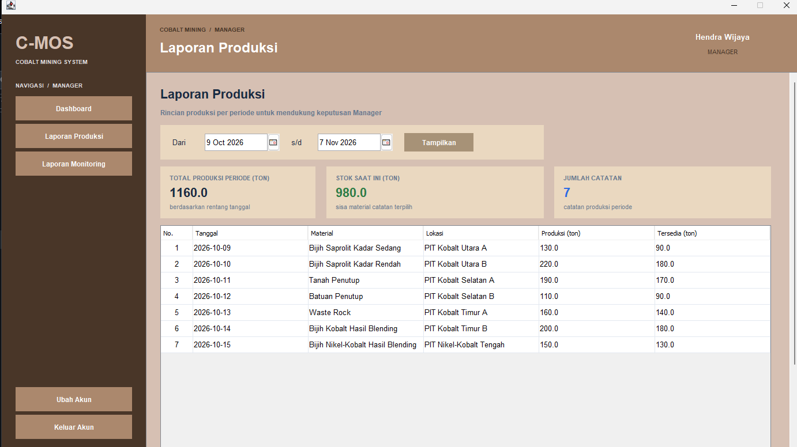

**Arahan screenshot:** Buka Laporan Produksi, pilih tanggal awal/akhir. **Yang harus terlihat:** Filter tanggal, tombol Tampilkan, ringkasan dan tabel.

#### Laporan Monitoring Lingkungan

Buka `LaporanMonitoringPanel` melalui Laporan Monitoring. Pilih rentang tanggal lalu tekan Tampilkan. Halaman menampilkan Total Monitoring, Hasil Normal, Peringatan dan tabel riwayat monitoring.

> **Gambar 91. Laporan Monitoring Lingkungan**


**Arahan screenshot:** Buka Laporan Monitoring. **Yang harus terlihat:** Filter tanggal, KPI dan tabel laporan.

#### Detail Pengukuran dari Laporan Monitoring

Pilih monitoring dan tekan Detail Pengukuran. Manager hanya melihat hasil pengukuran dan status penanganan. Tidak ada kewenangan untuk menambah, mengubah, atau menghapus detail parameter.

> **Gambar 92. Detail Pengukuran dari Laporan Monitoring**


**Arahan screenshot:** Pilih baris laporan dan buka detail. **Yang harus terlihat:** Rincian nilai parameter dalam mode baca saja.

#### Tinjauan informasi pengangkutan

Source menyediakan `LaporanPengangkutanPanel`, tetapi menu Manager pada versi ini tidak menautkannya langsung. Jika halaman tersebut diakses melalui alur lain yang memang ada saat dijalankan, dokumentasikan sesuai hasil aktual; jangan menambah menu fiktif dalam screenshot.

> **Gambar 93. Tinjauan informasi pengangkutan**


**Arahan screenshot:** Periksa menu Manager pada aplikasi versi ZIP ini. **Yang harus terlihat:** Menu yang benar-benar tampil, tanpa menu Pengangkutan tambahan.

#### Ubah Akun dan Logout Manager

Gunakan Ubah Akun bila perlu, lalu Keluar Akun. Sesi Manager berakhir dan pengguna kembali ke alur autentikasi.

> **Gambar 94. Ubah Akun dan Logout Manager**


**Arahan screenshot:** Buka menu akun lalu logout. **Yang harus terlihat:** Form Ubah Akun dan halaman setelah logout.

### 8.6 Skenario Pengujian Lintas Peran

#### Admin menyiapkan master data

Admin memastikan lokasi PIT, material, kendaraan, driver, parameter, dan akun pegawai operasional/HSE/Manager telah tersedia. Data tersebut menjadi sumber pilihan pada form peran lain.

> **Gambar 95. Admin menyiapkan master data**


**Arahan screenshot:** Buka halaman data master Admin. **Yang harus terlihat:** Data referensi yang nanti dipakai dalam produksi dan monitoring.

#### Operasional membuat produksi dan pengangkutan

Operasional mencatat produksi pada lokasi PIT dan material yang dibuat Admin, kemudian membuat jadwal pengangkutan memakai kendaraan dan driver tersedia.

> **Gambar 96. Operasional membuat produksi dan pengangkutan**


**Arahan screenshot:** Tampilkan data produksi lalu form pengangkutan. **Yang harus terlihat:** Relasi produksi, kendaraan, driver dan lokasi.

#### Perubahan stok setelah perjalanan selesai

Selesaikan perjalanan dan bandingkan sisa stok sebelum serta sesudah. Pastikan pengangkutan batal tidak mengurangi stok.

> **Gambar 97. Perubahan stok setelah perjalanan selesai**


**Arahan screenshot:** Ambil dua screenshot data stok sebelum dan sesudah. **Yang harus terlihat:** Nilai stok dan status pengangkutan.

#### HSE mengajukan monitoring dan Manager menyetujui

HSE memilih lokasi, mengajukan alasan monitoring, lalu Manager membuka permintaan dan menyetujuinya. Setelah itu HSE dapat memulai monitoring.

> **Gambar 98. HSE mengajukan monitoring dan Manager menyetujui**


**Arahan screenshot:** Ambil layar HSE sebelum dan setelah persetujuan serta layar Manager. **Yang harus terlihat:** Status MENUNGGU → DISETUJUI → monitoring dimulai.

#### HSE mengisi parameter dan Manager meninjau

HSE memasukkan nilai parameter. Monitoring berstatus peringatan/berbahaya terlihat pada prioritas dan laporan Manager. Manager membuka detail baca saja tanpa mengubah pengukuran.

> **Gambar 99. HSE mengisi parameter dan Manager meninjau**


**Arahan screenshot:** Tampilkan hasil pengukuran HSE dan detail Manager. **Yang harus terlihat:** Status dan nilai parameter yang konsisten lintas peran.

#### Filter dan pembatasan akses

Uji filter periode, status, pencarian, tombol Batal, serta percobaan akses fitur yang bukan hak pengguna.

> **Gambar 100. Filter dan pembatasan akses**


**Arahan screenshot:** Ambil screenshot filter sebelum/sesudah dan validasi. **Yang harus terlihat:** Hasil yang berubah sesuai filter dan tidak ada aksi terlarang.

## 9. Kontributor

Proyek C-MOS dikembangkan sebagai tugas kelompok. Isi nama dan NIM seluruh anggota sesuai identitas tim yang benar.

| No. | Nama | NIM | Peran |
| --- | --- | --- | --- |
| 1 | Zefri Al Rizqullah | 2509116084 | Ketua Project |
| 2 | Rasya Aditya Ramadani | 2509116082 | Anggota Project |
| 3 | Eko Satrio Wibowo | 2509116028 | Anggota Project |
| 4 | Ahmad Ribbiy Aldi | 25091160100 | Anggota Project |


---


## Lampiran 

### Package `app`

`Main.java`

### Package `config`

`AppConfig.java`, `DatabaseConfig.java`

### Package `controller`

`AuthController.java`, `DashboardController.java`, `LaporanController.java`, `MasterDataController.java`, `MonitoringController.java`, `PengangkutanController.java`, `ProduksiController.java`

### Package `dao`

`JdbcSupport.java`, `KendaraanDAO.java`, `LokasiDAO.java`, `MaterialDAO.java`, `MonitoringDAO.java`, `ParameterDAO.java`, `PegawaiDAO.java`, `PengangkutanDAO.java`, `ProduksiDAO.java`, `UserDAO.java`

### Package `enums`

`JenisLokasi.java`, `Periode.java`, `ShiftKerja.java`, `StatusDetail.java`, `StatusDriver.java`, `StatusKendaraan.java`, `StatusLokasi.java`, `StatusMonitoring.java`, `StatusPegawai.java`, `StatusPenanganan.java`, `StatusPengangkutan.java`, `StatusProduksi.java`

### Package `exception`

`BusinessException.java`, `DataNotFoundException.java`, `ValidationException.java`

### Package `model`

`Admin.java`, `DetailMonitoring.java`, `Driver.java`, `JenisMaterial.java`, `Kendaraan.java`, `Lokasi.java`, `Manager.java`, `MonitoringLingkungan.java`, `ParameterLingkungan.java`, `Pegawai.java`, `Pengangkutan.java`, `PetugasHSE.java`, `PetugasOperasional.java`, `ProduksiTambang.java`, `User.java`

### Package `repository`

`CrudRepository.java`, `KendaraanRepository.java`, `LokasiRepository.java`, `MaterialRepository.java`, `MonitoringRepository.java`, `ParameterRepository.java`, `PegawaiRepository.java`, `PengangkutanRepository.java`, `ProduksiRepository.java`, `UserRepository.java`

### Package `service`

`AuthService.java`, `DashboardService.java`, `LaporanService.java`, `MasterDataService.java`, `MonitoringService.java`, `PengangkutanService.java`, `ProduksiService.java`

### Package `util`

`BootstrapAdmin.java`, `PasswordUtil.java`

### Package `view`

`DashboardAdminPanel.java`, `DashboardCharts.java`, `DashboardHSEPanel.java`, `DashboardManagerPanel.java`, `DashboardOperasionalPanel.java`, `DataScreen.java`, `DetailMonitoringFormFrame.java`, `FormUtil.java`, `KartuLokasiPanel.java`, `KendaraanFormFrame.java`, `KendaraanPanel.java`, `KondisiLokasiPanel.java`, `LandingFrame.java`, `LaporanMonitoringPanel.java`, `LaporanPengangkutanPanel.java`, `LaporanProduksiPanel.java`, `LoadingFrame.java`, `LoginFrame.java`, `LokasiFormFrame.java`, `LokasiPanel.java`, `MainFrameAdmin.java`, `MainFrameHSE.java`, `MainFrameManager.java`, `MainFrameOperasional.java`, `MainFrameRouter.java`, `MaterialFormFrame.java`, `MaterialPanel.java`, `MonitoringDetailFrame.java`, `MonitoringFormFrame.java`, `MonitoringPanel.java`, `MonitoringReadOnlyFrame.java`, `ParameterFormFrame.java`, `ParameterPanel.java`, `PegawaiFormFrame.java`, `PegawaiPanel.java`, `PengangkutanFormFrame.java`, `PengangkutanPanel.java`, `PilihanData.java`, `ProduksiFormFrame.java`, `ProduksiPanel.java`, `UbahAkunFrame.java`, `UserFormFrame.java`, `UserPanel.java`, `ViewFactory.java`

### Konsultasi Pertama PBO x SBD


### Konsultasi Kedua SBD


### Konsultasi Kedua PBO
